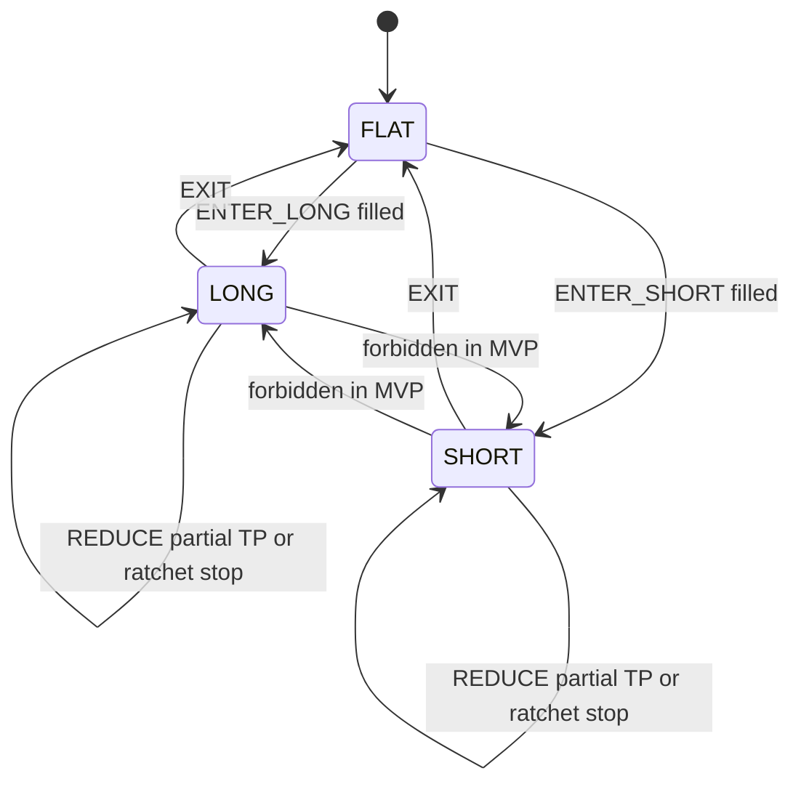

# ChanEdge 架構審查稿

這份文件給其他 agent 做架構審查。不要寫程式，不要改 `C:\Users\wayne\ChanEdge` 裡的檔案。審查對象有兩份。行為、數字與夾具以本文件從「架構設計」標題開始的全文為準，含目錄、資料流、纏論謂詞、JEV、前 20 名交易池、圖形監控與 PR 計畫。`docs/IMPLEMENTATION.md` 是寫程式的步驟，請核對它有沒有把本文件寫成兩種實作。兩份不一致時，問題記在實作計畫，除非本文件自己的兩處句子互相矛盾。

倉庫裡沒有交易程式。不要因為找不到模組就判規格錯誤。

## 給審查者

你的工作是找出一份工程師無法照著實作、或兩處說法互相矛盾的地方。不要重寫全文，不要改風格，不要提議另一套交易哲學。

回覆格式：

- 有問題就列清單。每條包含嚴重度（critical / major / minor）、章節、引用的原文、問題、建議改法。
- 沒有問題就寫 `approve`，並用幾句話說明你核對過哪些高風險段落。
- critical：沒有這條就會算錯進出場、前視、或無法唯一實作。
- major：Phase 1 會做出兩種都說得通的行為。
- minor：不影響 Phase 1 交易結果的缺口。

請依這份清單逐項核對，不要只看前幾節：

1. 管線順序。`systemone.enabled` 為 false（預設）：已收盤 K 線 → `ChanSnapshot` → 六通道特徵 → 本地 JEV → 硬閘門 → 風險 → 紙交易。旗標為 true 時，進場是特徵 → 預檢閘門 → System One → 只有狀態 `scored` 才第二次閘門 → 風險。預檢否決不打模型。分數不得推翻已失敗的預檢。JEV 不下單，也不決定出場。出場仍是本地加權日誌再 `review_open`，不打 HTTP。
2. 4H / 1H / 15m 的職責有沒有被後文改掉。出場條件是否寫成價位，而不是「結構失效」這句口號。
3. §5.6 的包含、筆的狀態機、中樞凍結、活動中樞、二買三買，能否對 `golden_multi_zs`、`golden_bi_machine`、`golden_third_buy_no_reemit`、`golden_zs_zd_frozen`、`golden_zs_outside_stays_out`、`golden_zs_drop_no_revive` 與 `golden_second_buy_reemit` 得到唯一結果。終點被取代時，索引 41 的三買是否仍防守 58，索引 44 是否沒有第二筆三買。創建第三筆的終點被取代時，ZG／ZD 是否仍是確認那一根的 50／34，索引 15 收盤 33 是否仍是 `BREAKOUT_DOWN`。結束中樞的那一筆被拉長、落回 `[ZD, ZG]` 時，ZS2 的成員是否仍停在 34→37，索引 50 是否出現 ZS3（ZG／ZD 64／58）。三筆交集為空時是否只丟掉最早那一筆，而且丟掉的是否不再撿回。`golden_zs_drop_no_revive` 的索引 13 是否沒有中樞、`structure_bias` 是否為 `UP`。`golden_second_buy_reemit` 的索引 13 是否再發二買，索引 11 的防守價是否仍是 34。被忽略的分型是否仍在 `snapshot.fenxings`。
4. §5.8 的六個通道是否都有原始欄位、子分數、懲罰，以及哪些是硬否決、哪些只扣分。共振有沒有被加兩次。無活動中樞時結構清晰度是否為 0.5。二買與二賣的位置項是否量到防守價，而不是 L0／H0。波動 tent 的峰是否為該幣信號前的 p50，而不是 `(min + max) / 2`。TP1、棘輪、`prior_high`／`prior_low` 用的已確認分型是否只指筆端點。前高不存在時，0.20 的靠近扣分是否不觸發。
5. §5.10 的一根 K 線順序：先撮合上一根 `next_open`，再由撮合器做盤中停損與 TP1，最後才跑 `run_pipeline`。同一部位該根只有一筆出場。重放鍵是 `(fill_time, bar_seq)`，不是 `fill_id`。
6. §5.12 前 20 名：成交額是檔名日期當天 00:00 UTC 已收完的日 K `quote_volume`、排除名單、歷史檔 `source: reconstructed`、紙交易正常凍結 `source: daily_kline`、`universe_date` 為決策時間減去 `refresh_minute` 分鐘後的 UTC 日期、沿用前一天時另寫帶 `fallback_from` 的當日檔、紙交易缺檔日只管既有持倉、回測缺檔則整段拒絕啟動、掉榜只出場、視窗不足不進場、先出場組後進場組。重建是否只補尚不存在的日期。歷史 15m、1H、4H 是否同樣來自 vision，而且 `download` 是否從 `history_start` 往前抓滿最長視窗（預設 4H 500 根，`history_start = 2024-01-01` 時最舊 4H 的 `open_time` 是 `2023-10-09T16:00:00Z`）。下架合約的 `price_tick`、`qty_step`、`min_qty` 是否由 CSV 小數推估。推不出來的拒絕碼是否為 `INSTRUMENT_SPEC`。回測第一根決策是否是 `universe_date` 等於 `history_start` 的第一根 15m 收盤（預設 `history_start` 00:15），而不是當天 00:00。今天的榜單檔已經存在時，手動 `universe` 是否不論 `source` 都不寫。
7. §5.13 與 §9.6：熱路徑有哪些工具，哪些明確不做。`segment_enabled` 預設是否為 false。
8. §5.14：Phase 1 只寫 `ChartFrame`。Phase 2 畫面只讀幀，不呼叫 `ChanEngine`，沒有下單路由。
9. 口數公式是否同時受到單筆風險、單筆名義、槓桿、持倉筆數、同方向筆數、合計名義本金與 `max_cost_r` 約束。有效合計名義是否為 `min(max_gross_notional_quote, equity_quote * max_leverage)`。停損距離不夠時是縮小口數，或因成本／R 拒絕；不是放寬停損。缺規格時是否為 `INSTRUMENT_SPEC`，而 `MIN_QTY` 是否仍恆為 0。
10. 重啟後現金是否從成交重放，平倉後不會回到 `initial_equity_quote`。
11. PR-1 到 PR-13 的依賴是否能按寫出的順序合併。Phase 1 是否不含實盤單與繪圖網頁。
12. 授權段落是否把未核對的部分標成未核對。

已鎖定，不要重開。規格若和這些句子衝突，記成問題：

- 4H 定方向與中樞，1H 看結構完整性，15m 產生二買、三買與對稱賣點。
- 持倉由結構是否仍有效決定。停損以結構停損為主，並受單筆風險上限約束。停利是分批加結構移動停損。
- JEV 有六個證據通道。硬規則失敗時，分數不得進場。JEV 不下單，也不閘控出場。
- 交易池是 Binance USDⓈ-M、USDT 本位永續、前一根已收盤日 K 成交額前 20 名。各幣種獨立決策，共用一個帳戶。同時持倉最多 3 筆，同方向最多 2 筆。口數先依單筆風險比例。
- 榜單每天 00:05 UTC 凍結。排序用檔名日期當天 00:00 UTC 已經收完的那根日 K `quote_volume`。決策讀減去 `refresh_minute` 分鐘之後的那個 UTC 日期。沒有該日檔案時不開新倉；已有持倉仍做出場與盤中停損。回測範圍內缺檔則拒絕啟動。
- 纏論熱路徑只留允許清單。特徵序列線段、區間套、背馳、一類買賣點與上游整包信號不進決策。
- 圖形監控是唯讀的獨立行程。Phase 1 只寫幀，Phase 2 才開網頁。畫面上不重算纏論。
- Phase 1 是紙交易與可解釋加權分數，不送實盤單。持倉模式固定 `one_way`。
- Phase 3 告警走 Telegram。Phase 1 不接 Telegram 客戶端。
- 結束中樞的那一筆被拉長也不重開。三筆交集為空時只丟掉最早一筆，丟掉的不再撿回。回測第一根決策是 `history_start` 00:15。`composite >= 0.62`。`hold_bias` 只做 `z_hold`。TP1 只看最後一個筆端點。今天的榜單檔已經存在就不寫。

2026-10-29 已核對上一輪三處，和正文一致。同日補進的是工程做法，不改進出場：1H／4H 快照在視窗沒變時沿用、`as_of` 是該週期最後一根的 `close_time`、`bar_window_hash` 的算法、回測進場組的 `NO_CANDIDATE` 精簡列、報告庫每根提交一次且 `synchronous=OFF`、榜單與 Parquet 用暫存檔加 `os.replace`、`trades.parquet` 的 `funding_estimate_quote`、紙交易與回測的 `decision_id` 對帳、收盤後等 `close_wait_seconds`、PR-2 之後三條線可並行。這些句子在 §5.4、§7、§5.12、§14 與 PR-11、PR-12。

上一輪已核對、只有和正文衝突時才記問題：合併順序裡 Phase 1 停在 PR-12、三個版本字串、結構 id 與 `config_hash` 排除項、PR-3 暖機與小數推估、`golden_zs_zd_frozen` 的 ZG／ZD 與索引 15、`golden_multi_zs` 逐列、`golden_third_buy_no_reemit` 的索引 41 與 44、二買再發的三個條件、`golden_zs_outside_stays_out`、四區間得到 30／25、`golden_zs_drop_no_revive`、`history_start` 00:15 與暖機起點、四條建構時注入、migration 001 的 `accounts`、剛好 0.62 是 `BUY` 與線性機率、最後一個筆端點的 TP1、今天的榜單檔已存在就不寫、PyYAML 與遞迴合併、`COST_R` 先於口數、前高距離可以是 0 或負數、候選由 `FeatureBuilder` 決定、出場組在 `RuleGate` 之前分開、`golden_second_buy_reemit` 的索引 11 與 13、PR-10 的名義 `min` 與 `binding_constraint`、PR-11 的撮合與影子單、PR-12 的紙交易迴圈與重啟、PR-13。

---

# ChanEdge 架構設計：纏論結構引擎與 JEV 決策核心

| 欄位 | 內容 |
| --- | --- |
| 文件 | ChanEdge Architecture |
| 作者 | TBD |
| 日期 | 2026-10-28 |
| 狀態 | Draft。交易規則在 2026-10-29 核過，沒有 critical 或 major。同日寫入的回測快取、精簡列、報告庫提交、原子寫檔、資金費率估計欄、紙交易對帳與 PR 並行，都不改進出場。PR-1 已完成（設定載入與 config_hash）。PR-2 已完成（領域型別與 id）。格式化後的 `-0.00000000` 收成 `0.00000000`，`Decimal` 也用八位小數，`Bar` 要求 `low > 0` 且 `volume >= 0`。PR-3 已完成（行情、榜單、缺口、小數推估）。PR-4 已完成（日誌結構）。PR-5 已完成（纏論引擎，不含買賣點）。PR-6 已完成（二買、三買與對稱賣點）。PR-7 已完成（六通道特徵）。PR-8 已完成（JEV 加權評分）。PR-9 已完成（硬閘門）。PR-10 已完成（風險）。PR-11 已完成（管線、撮合、回測）。PR-12 已完成（CLI、紙交易、重啟）。System One 進場路徑已接入，預設 `systemone.enabled` 仍為 false |
| 程式庫現況 | 規格撰寫時沒有交易程式。本檔是審查稿 |

本文件是架構計畫，不是實作。介面以型別草圖表達，不附應用程式邏輯。

## 閱讀索引

七項規劃在下列章節回答：

1. 目錄與模組邊界：§5.1、§5.2
2. Chanlun 與 JEV 的介面與資料流：§5.3、§5.4
3. JEV 特徵、分數、硬規則與校準路徑：§5.7、§5.8、§6
4. 技術選型：§8
5. 路線圖與 Phase 1 任務：§11
6. 開源可參考範圍與必須自寫的邊界：§9
7. 多幣種、纏論工具取捨、圖形監控，以及之後的多交易所與實盤：§5.12、§5.13、§5.14、§9.6、§11
8. 實作順序與每個 PR 怎麼寫：`docs/IMPLEMENTATION.md`。那份是寫程式的步驟。行為與數字仍以本文件為準；兩份不一致時改實作計畫，不改本文件已經鎖定的句子。

## 1. Overview

ChanEdge 是一套加密貨幣量化自動交易系統。結構由 Chanlun（纏論）引擎負責，進場品質由 JEV 負責。JEV 是 TypeSafe System One，不是自製的 Joint Evidence Valuation。請求釘在 `jev-1.14.0`。`config/default.yaml` 的 `systemone.enabled` 維持 false。這時進場與出場都走本地加權 `weighted-v1`，不打 HTTP。旗標打開之後，進場分數才改走 System One。出場日誌仍是本地加權。呼叫順序與 `0.62` 門檻以 `docs/agents/logic.md` 為準。

多週期職責已鎖定：4H 提供方向與中樞，1H 提供結構是否仍然完整，15m 才產生實際進出場候選（二買、三買，以及對稱的二賣、三賣）。JEV 把「這筆結構看起來好不好」變成六個證據通道。預設路徑輸出 `BUY` / `SELL` / `HOLD` 的分數與未校準機率，硬規則在這條本地分數之後行使否決權。`systemone.enabled` 為 true 時，進場先用一筆 `HOLD` 載體跑硬規則。任一否決就停，不呼叫模型。通過之後才評分。只有狀態 `scored` 才用真正的提議再跑一次閘門。兩種路徑都是：分數不得推翻已失敗的硬規則。風控擁有部位大小、結構止損、分批停利與移動停損。JEV 不下單。

Phase 1 交易 Binance USDⓈ-M 上、前一根已收盤日 K 成交額前 20 名的 USDT 本位永續。每個幣種三個週期，只在 15m K 線收盤做決策。各幣種一條獨立管道，共用一個帳戶。同時持倉仍最多 3 筆，同方向最多 2 筆。延遲預算仍是秒級：單一幣種在本機已有 K 線時 p99 < 2 秒；前 20 名加仍在持倉、但已掉出榜外的幣，要在 60 秒內走完該根 15m。這不是 HFT。圖形監控是另一個唯讀行程，不佔這 60 秒。

## 2. Background & Motivation

`ChanEdge` 是綠地專案。目錄是空的，因此沒有既有的 `Bar`、回測迴圈或交易所連線可以沿用。纏論計算若直接嵌入某個上游應用的物件圖，JEV、硬規則與稽核日誌會被那個應用的 UI、信號字串與生命週期綁死。

需要分開解決的問題：

- 纏論狀態依賴路徑。同一段 K 線用橫截面向量化回測，會在分型未確認時提前使用未來 K 線。
- 「感覺結構乾淨」若只寫在策略註解裡，無法重播，也無法對照後來的盈虧。
- 多週期方向不一致時，若仍允許高分進場，研究日誌會把否決條件和分數混成同一個數字，之後無法校準。
- 實盤與紙交易若共用交易所原始 payload，策略測試會變成對某一個交易所欄位的測試。

本設計用穩定的 `ChanSnapshot` 把纏論實作隔開，用六通道 `FeatureVector` 把證據固定下來，用硬閘門把不可交易的狀態擋在下單之前。

## 3. Goals & Non-Goals

### 3.1 Goals

- 建立可重播的管線：行情 → 對齊後的 4H / 1H / 15m 已收盤 K 線 → `ChanSnapshot` → `FeatureVector` → `JevAssessment` → `HardRuleResult` → `RiskPlan` → 委託 → 稽核日誌。
- Phase 1 在成交額前 20 名上跑通紙交易與事件驅動回測，含手續費與滑價。榜單每天凍結一次並寫進檔案。Phase 1 不送實盤單。
- 每個幣種獨立產生 `ChanSnapshot`、JEV 與委託。帳戶層只加三個計數或名義上限：同時持倉數、同方向筆數、合計名義本金。單筆另有風險比例、名義、槓桿與成本／R。JEV 不看其他幣種。
- Phase 1 每次決策寫出可畫圖的 `ChartFrame`。Phase 2 用它做本地 K 線監控，畫筆、中樞、買賣點、停損與 JEV 分量。
- 15m 二買、三買、二賣、三賣有可測試的操作型定義。一買、一賣只留列舉值，不算 MVP 信號。
- 持倉多久由結構是否仍有效決定，而不是固定時間停損。
- 紙交易每次決策持久化 snapshot id、特徵向量、JEV 分量、硬規則結果與訂單 id。回測對有候選、有歧義或屬於出場組的決策同樣寫完整欄位。回測進場組的 `NO_CANDIDATE` 只寫精簡列，見 §7。
- 設定外置（YAML + 型別化設定）。權重、門檻、ATR 帶、手續費都不是程式裡的魔術數字。

### 3.2 Non-Goals

- Phase 1 不實盤下單，不接出金 API，不做第二家交易所的成交。不做跨幣種相關性、配對或組合最佳化。同方向筆數是帳戶計數，不是相關性模型。
- 不把向量化回測當成交真相。不在第一天訓練機器學習模型，也不假裝已有訓練好的模型。
- 不把 chanlun-pro、czsc 或 chan.py 整包納入當執行核心。參考它們的工具清單之後，只自寫 §9.6 的允許清單。
- 不做 HFT、做市、網格，也不在 MVP 做加碼或同一商品多筆獨立持倉。
- 不實作完整的特徵序列線段（chan.py 的 `seg_algo=chan`）。Phase 1 的線段只供特徵，不驅動硬閘門。
- 不在 Phase 1 模擬資金費率收付與強平引擎。`trades.parquet` 可以有 `funding_estimate_quote`，那一欄不進現金，也不進決策。回測偏差在風險節說明。
- 不提供 Windows 專用執行環境。作者機器是 Windows，只影響開發者本機；執行目標是一般 CPython 行程。

## 4. Key Decisions

下列決策已經鎖定或在本文件中拍板，不再當成開放問題。

| 決策 | 理由 |
| --- | --- |
| 4H = 方向與中樞；1H = 結構完整性；15m = 二買 / 三買與對稱賣點 | 產品鎖定。硬閘門與失效條件直接使用這三層，不另開週期。 |
| 持倉由結構有效性結束。沒有作為主要出場的固定時間停損 | 產品鎖定。時間停損不進入 Phase 1 設定。 |
| 止損以結構止損為主，並受單筆風險上限約束。停利是分批出場加結構移動停損 | 產品鎖定。風險模組擁有這些價格與數量，JEV 不計算口數。 |
| JEV 六通道全部存在 | 產品鎖定。通道可以給低分或懲罰，不可以從 MVP 特徵結構裡刪除。 |
| 硬規則失敗時，模型分數不得進場 | 產品鎖定。預設路徑的閘門在本地 JEV 之後、風控與下單之前。`systemone.enabled` 為 true 時，進場預檢在模型之前。通過且狀態為 `scored` 才有第二次閘門。預檢否決不打模型，分數也不能把否決改成進場。 |
| 交易池是該場所 USDT 本位永續、前一根已收盤日 K `quote_volume` 的前 20 名 | 使用者要求做交易量前 20 大。排序用檔名日期 D 所對應、`open_time` 為 (D−1) 00:00 UTC 的日 K 成交額，不用標的幣數量，也不用 00:05 的滾動 ticker。滾動 24 小時和這根日 K 差一個窗口，紙交易與回測會分叉。已下架合約仍可進歷史榜，而且回測要能下載它們的 K 線並取整。只進榜、不補 K 線與 tick，停損和口數仍然做不出來，倖存者偏差會從成交這端回來。 |
| 榜單每天 00:05 UTC 凍結。`universe_date` 是 `decision_time` 減去 `refresh_minute` 分鐘後的 UTC 日期，00:00 那根用前一日檔 | 每根 15m 重排會讓池子跳動。00:00 的決策早於當天 00:05 的凍結，若用 `decision_time.date()` 會讀到 5 分鐘後才寫出的榜，紙交易與回測會分叉。歷史由 `chanedge universe --reconstruct` 從 data.binance.vision 的日 K 寫出，只補尚不存在的日期，`source: reconstructed`。紙交易正常凍結是 `source: daily_kline`。日 K 抓取失敗才沿用前一天，並標 `fallback_from`。回測範圍缺任一檔就拒絕啟動，不改用 `pin`，也不用今天還活著的名單填過去。紙交易迴圈中缺檔仍只管理既有持倉。 |
| 掉出前 20 但仍有持倉的幣繼續算出場，直到平倉。不再開新倉 | 結構出場若在掉榜當下被刪掉，停損會留在沒有人管的倉上。 |
| 新進榜的幣要補齊三個週期的引擎視窗才允許進場。`download` 與紙交易第一次補 K 線都從決策起點往前抓滿最長視窗。回測第一根決策是 `universe_date` 等於 `history_start` 的第一根 15m 收盤 | 視窗不滿時的 `structure_bias` 不可比。補歷史可以立刻做，不等 83 個自然日。最長視窗是預設的 4H 500 根。只下載 `history_start` 之後的 K 線，會讓回測開頭約 83 天全部變成 `INSUFFICIENT_HISTORY`。往前抓滿之後，`history_start` 當天視窗已經滿的幣可以進場。合約本身歷史不夠長則繼續等待，不准補造 K 線。當天 00:00 那根的 `universe_date` 是前一天，重建又只從 `history_start` 寫檔，若把它當第一根決策，回測會因缺檔拒絕啟動。預設因此從 `history_start` 00:15 開始。暖機起點不改，也不多補前一天的榜單。 |
| 業務符號與 ccxt 符號分開。`BTC/USDT` 對應 `BTC/USDT:USDT`，其他幣同形 | ccxt 的 `binanceusdm` 線性合約符號是 `BASE/USDT:USDT`。`venue_symbol` 只出現在適配器，不進 JEV。 |
| 同一根 15m 先跑 §5.12 出場組，再跑進場組 | 前 20 名沒有設定檔順序。出場組是掉榜持倉的字母序，再來榜內持倉的名次。進場組是名次。持倉上限卡住時，另一種順序會放進不同的幣。 |
| 口數以 `risk_fraction` 0.005 為主。單筆名義預設 20000 USDT。有效合計名義是 `min(max_gross_notional_quote, equity_quote * max_leverage)`。預設權益 10000、槓桿 2 時，兩者都是 20000。同時持倉最多 3 筆，同方向最多 2 筆 | 單筆名義 5000、合計 10000 時，停損窄於約 1% 的單幾乎全部變成固定 5000 名義，兩筆就用完合計額度，第三筆被 `MAX_GROSS_NOTIONAL` 拒絕。20000 讓單筆先表達 0.5%：停損佔價格 0.34% 時，名義約 14706，低於單筆上限。第一筆用掉約 14706 之後，第二筆只剩約 5300，實際風險低於 0.5%。停損要寬到約 0.75%，三筆才都裝得下完整的 0.5%。所以 3 筆是計數天花板，不是 3 × 0.5% 的總風險。權益掉到 5000 時，寫死的 20000 等於 4 倍槓桿；`min` 把有效合計收成 10000。同方向上限只在 `RiskManager`，不進 JEV。 |
| 來回成本／R 超過 `max_cost_r`（預設 0.40）就拒絕進場，拒絕碼 `COST_R` | 15m 結構停損很窄，費用與滑價會先吃掉一截 R。這條放在風控、停損距離算出之後，不進 JEV，也不在 `RuleGate` 裡重算停損。0.40 同時是大型幣的主要過濾器：同一份 183 天、8 幣、正式筆狀態機的全部筆端事件上，通過前就被它拿掉的比例約為 BTC 50%、BNB 49%、ETH 34%、XRP 31%、SOL 24%、DOGE 24%、SUI 13%、1000PEPE 10%。進場組按名次處理，名額因此更常落到山寨幣。這是預設的本意。Phase 1 不把 0.40 搜到某個 profit factor，也不把 `COST_R` 寫進 JEV 的 penalty。報告按幣拆開這個拒絕碼。 |
| 波動帶預設 0.10%–3%。帶內的 tent 峰是該幣信號 K 線之前的 `atr_pct` 中位數 | 下限 0.30%、峰在 `(0.30% + 3%) / 2 = 1.65%` 時，BTC 這類低波動合約大部分時間被 `VOL_BAND` 否決，而實際會出現的區間裡 tent 又單調成越波動越高分。成本過濾改由 `COST_R` 負責。正式狀態機在同一份 183 天樣本上，ATR% 低於 0.10% 的比例最高約 4.5%（BTC）。`enter_threshold` 仍是 0.62。 |
| 三買、三賣每個回離至多一筆。終點被更極端的同型分型取代時，不重發，已發出信號除 `related_bi_id` 外全部不變。二買、二賣在新終點仍滿足價格條件、且三類規則不收下這根時，於新的確認棒再發一筆。同一條筆上的再發沒有次數上限 | 全量重算加上「候選只取 `time == decision_time`」時，終點一換，確認時間就換，同一個回離會進場兩次。`golden_third_buy_no_reemit` 把這條鎖住。二買的「停損後再買」留在 Phase 1，寫進報告，含同一條筆的再發次數。不改成等下一筆反向筆才發信號，也不在 Phase 1 加次數上限。那兩件事都是 Phase 2 可以比較的進場時點，不是這版的時鐘。 |
| 創建中樞的 ZG／ZD 在第三筆第一次確認時凍結。第三筆終點後來被取代，只更新 GG／DD、`end_time` 與該成員的筆 id。一筆在確立那一根被判在外側，之後被拉長也不改判，已結束的中樞不重新打開。湊創建三筆時 `ZG <= ZD` 就丟掉最早那一筆，保留後兩筆。丟掉的已消費，之後不撿回 | 約一半的新筆在確認後終點還會被拉長。用拉長後的區間重算，ZD 或 ZG 會變。中樞 id 含這兩個數，回離與三買、三賣的門檻會跟著變。`golden_zs_zd_frozen` 鎖住：索引 13 的 ZD 仍是 34，不是 33；索引 15 收盤 33 仍是 `BREAKOUT_DOWN`。`golden_zs_outside_stays_out` 鎖住另一種拉長：結束 ZS2 的那一筆後來低點落回 `[52, 56]`，ZS2 的成員仍停在 34→37，索引 50 由後面三筆創建 ZS3，ZG／ZD 是 64／58。三筆區間 `[10, 20]`、`[10, 30]`、`[25, 30]` 交集為空，下一筆 `[25, 40]` 必須得到 ZG／ZD 30／25，不准把緩衝全部清空。丟掉之後若把保留的最後一筆拉長，也不重測已丟掉的組合。`golden_zs_drop_no_revive` 鎖住：索引 13 沒有中樞，`structure_bias` 是 `UP`。 |
| TP1、棘輪、`prior_high`／`prior_low` 只用當下快照裡已確認筆的端點 | 狀態機會丟掉長度不夠或不夠極端的分型，那些分型仍留在 `snapshot.fenxings`，通常更靠近價格。用全集會改掉 TP1、棘輪頻率、`room` 與靠近前高的扣分。 |
| 歷史 15m、1H、4H 與重建用的日 K 都讀 data.binance.vision。下架合約的 `price_tick`、`qty_step`、`min_qty` 由 CSV 原文的小數位數推估，`instrument_source: inferred`。推不出來的進場拒絕碼是 `INSTRUMENT_SPEC` | ccxt 的市場清單只有現在還掛著的合約。vision 上仍有已下架合約的 K 線，例如 FTMUSDT 2024-11 的 15m。缺的不只 `min_qty`，停損與口數都要取整。`MIN_QTY` 仍由公式保證為 0，不用來表示缺規格。 |
| `universe --reconstruct` 只寫尚不存在的日期檔 | 紙交易沿用前一天時會寫出帶 `fallback_from` 的當日檔。重建若覆寫它，回測讀到的是真實排名，和紙交易當天實際用的池子不同。要重做某一天，先刪掉該檔。 |
| 纏論熱路徑只跑允許清單。`segment_enabled` 預設 false | 使用者要求參考既有工具後自己整理，並拿掉拖慢速度的部分。線段不是硬閘門，預設不算。 |
| 回測是事件驅動，成交預設為信號 K 線的下一根開盤價 | 纏論確認發生在收盤。同一根 K 線的高低點不拿來當已經知道的成交價。 |
| Phase 1 纏論引擎自寫最小實作。czsc 只留日後可替換的 adapter 位置 | Snapshot 結構必須由我們擁有。上游授權目前不一致，見 §9。 |
| Phase 1 `structure_bias` 只由筆與中樞突破決定，不由簡化線段覆寫 | 簡化線段會誤標 4H 方向。硬閘門不能依賴未完成的線段演算法。 |
| 出場不經過 JEV 分數 | 低分不准出場會把部位留在已破壞的結構裡。出場是進場當下凍結的失效條件，加上之後只上移（多單）的結構移動停損。每根 K 線仍計算 JEV 並寫日誌，供研究，但不閘控出場。 |
| 本根只要有把該幣打成 `qty == 0` 的成交，收盤就不再進場，下一根才允許 | 含 `next_open` 出場、盤中停損與停利把倉平掉。不限於反向信號。同向信號同樣等到下一根。原因寫進 `reason_chain`。 |
| 多單時，若同一根 K 線同時碰到止損與停利，視為先止損 | 悲觀撮合。沒有逐筆成交時，這是較不自欺的假設。 |
| `safety.kill_switch: true` 只拒絕會增加部位的委託。`reduce_only` 的 `EXIT`／`REDUCE` 仍可送。實盤設定預設為 `true` | 開關若連出場單一起拒，結構失效無法執行。紙交易要撮合進場，必須明示 `mode: paper` 且 `kill_switch: false`。`LiveBroker` 在 Phase 1 不實作。 |
| `decision_id` 含 `engine_version`、`feature_version` 與 `marketdata_version`。回測與紙交易分開 SQLite。結構 id 用端點時間與價格，不用視窗序號 | 只改引擎、特徵或行情規則，卻 upsert 同一列，會覆寫舊決策。小數推估屬於 `marketdata_version`，不放進 `engine_version`。重跑回測不得把成交累加進紙交易庫。重啟必須從 `positions` 還原未平倉，否則下一根會再進場。已平倉後的現金從 `accounts.cash_quote` 與成交重放還原，不准因為 `qty = 0` 就回到 `initial_equity_quote`。 |
| 機率在 `calibrated: false` 之前不得用於倉位 | MVP 倉位只由風險金額 / 止損距離決定，再受名義、筆數與成本／R 約束。Phase 2 的 isotonic 用每個候選的影子結果，不用只含已成交單的子集。 |
| 設定載入失敗即拒絕啟動，特別是權重總和必須為 1 | 避免靜默重新歸一化把某個通道的權重改掉。 |
| Phase 1 `position_mode` 固定 `one_way`。不送 hedge mode 的 `positionSide` | 使用者已決定。任何實盤 PR 之前必須確認帳戶是單向持倉。若帳戶實際是雙向持倉，那是之後的適配器變更，不是 Phase 1 變更。 |
| Phase 3 告警走 Telegram。事件只有連續 `STALE_DATA` 與 kill switch 狀態變化 | 使用者已決定。Phase 1 只寫決策日誌與 SQLite，PR 計畫不加入 Telegram 客戶端。Bot token 只來自環境變數，不進 YAML，也不進版本庫。不指定套件。 |
| 圖形監控是 Phase 2 的唯讀本地網頁。Phase 1 先把 `ChartFrame` 寫進 SQLite | 使用者要求最後能看圖。畫圖若放進決策行程，慢的前端會拖住下單。畫面上不重算纏論。 |

## 5. Proposed Design

### 5.1 目錄配置

採用 `src` 佈局，匯入路徑是 `chanedge.*`。`src` 只為了打包，不改變模組邊界。

```text
ChanEdge/
  pyproject.toml
  .gitignore                 # .env, data/, *.sqlite
  config/
    default.yaml
    paper.yaml               # mode=paper, kill_switch=false（明示）
  src/chanedge/
    domain/                  # 列舉與不可變值物件
    marketdata/              # 擷取、正規化、對齊、缺口
    chanlun/                 # 引擎外觀與內部計算
    features/                # 六通道，純函數
    jev/                     # 本地加權，以及 System One 答案映射。不開 HTTP
    typesafe/                # JSONL 快取與 HTTP 客戶端。只有這裡 import typesafe_sdk
    rules/                   # 硬閘門
    risk/                    # 結構止損、風險上限、分批、移動停損、持倉狀態
    execution/               # Broker 埠與紙交易
    backtest/                # 事件迴圈、撮合純函數、成本、報告。紙交易呼叫同一份撮合
    journal/                 # 稽核與 ChartFrame
    monitor/                 # Phase 2 唯讀圖形監控。Phase 1 不啟動
    app/                     # 組合根、多幣種紙交易迴圈、CLI
    config/                  # pydantic 設定模型（YAML 在倉庫 config/）
  tests/
    domain/
    marketdata/
    chanlun/
    features/
    jev/
    typesafe/
    rules/
    risk/
    backtest/
    journal/
    app/
    monitor/
    fixtures/                # 手工 K 線，含 golden_multi_zs、golden_bi_machine、golden_third_buy_no_reemit、golden_zs_zd_frozen、golden_zs_outside_stays_out、golden_zs_drop_no_revive、golden_second_buy_reemit
  data/                      # gitignore：Parquet、SQLite、報告
```

Phase 1 不建立 `execution/live.py` 的可送單類別。只定義 `Broker` 協定與 `PaperBroker`。

### 5.2 模組邊界

責任不合併。箭頭是允許的執行期依賴方向。

| 模組 | 擁有 | 禁止 |
| --- | --- | --- |
| `marketdata` | 交易所 K 線變成 `Bar`，Parquet，缺口與過期 | 認識筆、JEV、訂單 |
| `chanlun` | `ChanEngine.compute` → `ChanSnapshot` | 匯入 jev、rules、risk、ccxt |
| `features` | 六通道純函數 | 讀持倉、下單、呼叫交易所 |
| `jev` | 本地加權 `weighted-v1`。`systemone.enabled` 為 true 時把 System One 答案映射成複合分，並做量化後的 `0.62` 比較 | 開 HTTP；匯入 `typesafe` 或 `typesafe_sdk`；讀硬規則結果來「修正」分數；下單 |
| `typesafe` | JSONL 快取、排他鎖、紙交易與暖機的 HTTP 客戶端 | 匯入 `jev`、`app` 或 `backtest` |
| `rules` | 否決 | 改分數；決定口數 |
| `risk` | 口數、結構止損、分批價、移動停損、出場指令 | 改 JEV 權重；直接呼叫 ccxt |
| `execution` | `submit` / `cancel`、紙交易帳簿、`next_open` 委託佇列 | 重算纏論；另寫盤中停損、TP1 或滑價規則 |
| `journal` | 決策、訂單、成交、持倉、`ChartFrame` | 成為策略分支的隱性輸入 |
| `backtest` | 時鐘、步驟 1 與步驟 2 的撮合純函數、費用、報告 | 另一套信號定義。紙交易必須呼叫這一份，不准在 `execution` 複製 |
| `monitor` | 只讀 SQLite 裡的 `ChartFrame`，畫到瀏覽器 | 讀 Parquet；呼叫 `ChanEngine`、`JevModel`、`Broker`；任何下單路由 |
| `app` | 組合根與多幣種迴圈 | 業務公式；匯入 monitor 的繪圖程式 |
| `domain` | 列舉與值物件 | 任何 I/O |
| `config` | YAML 到型別 | 交易決策 |

依賴規則：`domain` 不依賴其他內部套件。`jev` 只依賴 `domain`。`features` 只依賴 `domain`。`rules` 依賴 `domain`。`chanlun` 只依賴 `domain`。`risk` 只依賴 `domain`。`execution` 只依賴 `domain`。`journal` 只依賴 `domain`。`backtest` 只依賴 `domain`，不依賴 `app`、`marketdata`、`journal`、`typesafe`，也不建構 HTTP 客戶端。`typesafe` 只依賴 `domain`。`app` 可以組裝它。`monitor` 只依賴 `domain` 與 `journal` 的讀取埠，不依賴 `chanlun`、`jev`、`risk`、`execution`。上層由 `app` 組裝。測試可以用假物件實作協定，不准為了測試把模組併在一起。

設定、帳簿與管線用建構時注入，不靠跨套件 import：

- `app` 把 `Settings` 收成放在 `domain` 的參數物件，建構時傳入。`JevModel` 的簽名仍是 `assess(features)`，例如 `JevModel(params).assess(features)`。`features`、`risk`、`chanlun`、`rules` 需要的 `atr_period`、`max_cost_r`、`min_bi_bars` 同一種。這些套件不 import `config`。
- `PaperBroker` 要在同一筆 SQLite 交易裡寫 `fills`、`positions`、`accounts`。帳簿埠定義在 `domain`。`PaperBroker` 接收這個埠，`app` 傳入 `journal` 的實作。`execution` 不 import `journal`。
- `backtest` 的迴圈以參數接收 `run_pipeline`。`app` 可以 import `backtest`。`backtest` 不 import `app`、`marketdata`、`journal`。
- 回測迴圈另以參數接收 K 線來源、榜單來源與報告寫入埠。三個協定定義在 `domain`。`app` 傳入 `marketdata` 的 K 線與榜單實作，以及 `journal` 的報告寫入實作。`backtest` 不 import `marketdata`，也不 import `journal`。K 線來源讀的是已經落盤的 Parquet，不經 `MarketDataPort.fetch_closed_bars` 打交易所。報告寫入埠寫的是 `data/reports/{run_id}/`，不是紙交易的 `data/chanedge.sqlite`，也不是 `PaperBroker` 的帳簿埠。
- `decision_id` 放在 `domain/ids.py`。三個版本字串由呼叫端傳入。`journal` 不 import `chanlun`、`features`、`marketdata`。

多幣種不改變這張邊界。每根 15m、每個幣種至多呼叫一次 `run_pipeline`。紙交易牆鐘已超過 60 秒的幣不呼叫，仍寫一筆只有 `PIPELINE_TIMEOUT` 的決策。分組順序在 §5.12。JEV 的輸入仍然是該幣種的 `FeatureVector`。

### 5.3 管線與資料流

```mermaid
flowchart LR
  subgraph ingest [marketdata]
    EX[ccxt REST klines]
    NORM[normalize to Bar UTC]
    PQ[(Parquet pyarrow)]
    ALIGN[align closed 4H 1H 15m]
  end
  EX --> NORM --> PQ --> ALIGN
  ALIGN --> CE[chanlun.ChanEngine]
  CE --> SNAP[ChanSnapshot x3]
  ALIGN --> CTX[MultiTimeframeContext]
  SNAP --> CTX
  CTX --> FEAT[features.FeatureBuilder]
  FEAT --> FV[FeatureVector]
  FV --> JEV[jev.JevModel]
  JEV --> JA[JevAssessment]
  CTX --> GATE[rules.RuleGate]
  JA --> GATE
  ACCT[AccountView and SafetyState] --> GATE
  CTX --> REV[risk.review_open]
  POS[open position] --> REV
  REV -->|next_open EXIT| BR[execution.PaperBroker]
  REV -->|AmendStop| JRN[(SQLite journal)]
  GATE -->|any veto or HOLD| DEC[Decision HOLD]
  GATE -->|pass and BUY or SELL and flat| RISK[risk.RiskManager.plan_entry]
  RISK -->|rejected plan| DEC
  RISK -->|RiskPlan| BR
  BR --> ORD[OrderAck]
  DEC --> JRN
  ORD --> JRN
  JA --> JRN
```



`review_open` 從 `MultiTimeframeContext` 加「該幣已有持倉」直接進入。出場組不呼叫 `RuleGate`。進場組才走閘門，通過之後才到 `plan_entry`。`review_open` 不讀 `JevAssessment`，也不等閘門通過。若呼叫端仍把已有持倉的幣送進閘門，結果會是 `POSITION_OPEN`，但那不是出場組的路徑，也不准拿來取消 `review_open`。JEV 看不見帳戶，看不見閘門結果，也沒有 `Broker`。預設 `systemone.enabled` 為 false：特徵向量之後是本地 `JevModel`，然後才是硬閘門。旗標為 true 時，進場先建特徵與一筆 `HOLD` 載體，跑現有的 `RuleGate`。`safety.kill_switch` 即使已有其他否決也追加 `KILL_SWITCH`。任一否決則狀態 `skipped_veto`、動作 `HOLD`，不呼叫模型、不讀快取、不跑第二次閘門、不 `plan_entry`。通過才呼叫一次 System One。只有狀態 `scored` 用真正的提議再跑一次閘門。逾時、HTTP、畸形、模型不符、快取未命中與缺金鑰都不跑第二次閘門，也不開倉。`GO`／`NO_GO` 只記日誌，不能推翻門檻或預檢。出場組不走這條：用本地 `weighted-v1` 寫日誌，然後 `review_open`，不打 HTTP。持倉檢查屬於 `RuleGate`（只擋新進場）與 `RiskManager.review_open`（出場）。

```mermaid
sequenceDiagram
  participant Loop as PaperLoop
  participant MD as MarketData
  participant CE as ChanEngine
  participant FB as FeatureBuilder
  participant JM as JevModel
  participant RG as RuleGate
  participant RM as RiskManager
  participant BR as PaperBroker
  participant JN as Journal

  Loop->>MD: bars closed at decision_time
  MD-->>Loop: bars plus DataQuality
  Loop->>CE: compute 15m, 1H, 4H
  CE-->>Loop: ChanSnapshot x3
  Loop->>FB: build(context)
  FB-->>Loop: FeatureVector
  Loop->>JM: assess(features)
  JM-->>Loop: JevAssessment
  alt position open
    Note over RM: 出場組不呼叫 RuleGate，也不讀 JevAssessment
    Loop->>RM: review_open(context, position)
    RM-->>Loop: PositionReview
    alt exit instruction present
      Loop->>BR: submit reduce-only next_open EXIT
      Loop->>JN: Decision EXIT
    else
      Loop->>JN: Decision HOLD, optional AmendStop
    end
  else flattened earlier this bar
    Loop->>JN: Decision HOLD, reason FLATTENED_THIS_BAR
  else entry group
    Loop->>RG: evaluate(context, assessment, account, safety)
    RG-->>Loop: HardRuleResult
    alt not rules.passed or proposed HOLD
      Loop->>JN: Decision HOLD
    else entry allowed
      Loop->>RM: plan_entry(...)
      RM-->>Loop: RiskPlan
      alt plan rejected
        Loop->>JN: Decision HOLD
      else
        Loop->>BR: submit entry
        Loop->>JN: Decision ENTER with order ids
      end
    end
  end
```

上圖是單一幣種的管道。外層在每根 15m 先做 §5.10 的步驟 1 與步驟 2，再依 §5.12 的出場組跑 `run_pipeline`，然後跑進場組。沒有「設定檔順序」。出場組不呼叫 `RuleGate`，所以持倉不會因為 `POSITION_OPEN` 或 `NO_CANDIDATE` 而送不出場。本根若已有把該幣打成 `qty == 0` 的成交，收盤只寫 `HOLD`，原因是 `FLATTENED_THIS_BAR`，不呼叫 `plan_entry`。

### 5.4 延遲、規模與確定性

- 決策頻率：每個在池幣種 15m 收盤，每天 96 次。20 個幣種一年約 7.0×10^5 筆決策。單一幣種三年 15m K 線約 1.1×10^5 根。池子會換人，Parquet 只增不刪，20 個常駐幣種是數百 MB 到數 GB，仍不用另一套資料庫。
- 特徵 JSON 以 4 KB 估算時，紙交易 20 個幣種約 2.8 GB/年，紙交易庫承受得住。回測若每筆都存這份 JSON，2024-01-01 到 2026-09-30、20 個幣、約 193 萬筆，光 `feature_json` 就約 7.7 GB；`run_id` 含 `started_at`，每跑一次都是新目錄。回測進場組的 `NO_CANDIDATE` 不存這份 JSON，見 §7。`ChartFrame` 只留每個幣種、每個週期最新一筆。
- 引擎視窗（設定，不是程式常數）：15m 1500 根（約 15.6 日）、1H 1000 根（約 41 日）、4H 500 根（約 83 日）。Parquet 保存更長歷史，引擎只吃尾端。
- 每個 15m 收盤對三個視窗各做一次由左向右的走訪，走訪途中更新筆、中樞與信號。這就是全量重算：`ChanEngine.compute` 不讀上一張快照，但每個視窗只走一次，不是對視窗裡每一根再把前綴重算一遍。Python 處理 15m 1500、1H 1000、4H 500 這一次走訪是毫秒到數十毫秒。p99 < 2 秒指的是這一次走訪加上特徵、JEV 與風控，不是 1500 次嵌套重算。不為了 MVP 做增量 Rust。日後若要增量，必須與這一次走訪的結果在黃金樣本上逐欄相等。
- 呼叫端可以沿用上一張 1H 或 4H 快照，而且只在 `symbol`、`timeframe`、`engine_version`、`config_hash`、`as_of`、`bar_window_hash` 全部相同時。沿用的物件必須與再呼叫 `compute` 逐位元相同，含 `snapshot_id`。15m 視窗每根都在滑動，不沿用。`compute` 自己仍然不讀上一張快照。
- 傳進 `compute` 的 `as_of` 是該週期這批 `bars` 最後一根的 `close_time`，不是 15m 的 `decision_time`。00:15、00:30、00:45 看到的 1H 視窗相同時，三根的 1H `as_of` 都是 00:00 那根 1H 的 `close_time`。把 15m 決策時間塞進 `as_of` 會讓 `snapshot_id` 每 15 分鐘變一次，沿用的結果就不會逐位元相同。不准那樣傳。
- `snapshot_id` 可以快取每個不可變結構物件的規範化片段，再依快照欄位順序接起來。接出來的位元組必須與整份重算相同。算法見 §7。這是實作路徑，不改雜湊定義。一份 dict 原型在 BTC 15m 上，雜湊約佔每筆決策八成五的時間；沿用與快取之後，2024-01-01 到 2026-09-30 的 20 幣回測從約 20 小時降到約 2.5 小時。這是方向性的量測，不是驗收門檻。
- `snapshot_id`、`decision_id`、結構物件 id 與 `config_hash` 的規範化規則見 §7。視窗內序號不進任何 id。
- 回測與紙交易共用 `app.run_pipeline`。決策順序只來自這個函式，不准在 `backtest` 再排一套特徵／JEV／閘門順序。回測迴圈另以參數接收時鐘、`Broker`、K 線來源、榜單來源與報告寫入埠。此函數在 PR-11 落地，不拖到 PR-12。

### 5.5 行情對齊

ccxt `fetch_ohlcv` 的時間戳是 K 線開盤時間。正規化時：

- `open_time` = 該時間戳，轉成 UTC aware。
- `close_time` = `open_time` + 週期長度。15m、1H、4H 都用交易所原生 K 線，不從 1m 重採樣，避免邊界自行發明。
- 決策只使用 `close_time <= decision_time` 且 `is_closed` 的 K 線。未收盤的 4H / 1H 不參與 `structure_bias`。
- 15m 決策時間就是該根 15m 的 `close_time`。1H 與 4H 取不大於該時間的最後一根已收盤 K 線。各週期快照的 `as_of` 用那根的 `close_time`，見 §5.4。
- 缺口只檢查該週期引擎視窗內的相鄰已收盤 K 線，不掃 Parquet 全歷史，也不縮成「只看最近幾根」。`missing = (後一根 open_time - 前一根 open_time) / 週期長度 - 1`。門檻比的是**單一缺口**的 `missing`，不是 `missing_bar_count` 的總和。`missing > max_gap_bars`（預設各週期為 1，所以同一個洞缺 2 根以上才算）則該週期失敗。`missing_bar_count` 是視窗內各缺口 `missing` 的加總，只寫進 `DataQuality`。15m、1H、4H 任一週期失敗就記 `GAP_DATA`，本根不進場。15m 視窗是 1500 根，一個缺 2 根的洞會在它還留在視窗裡的期間持續否決，大約 15.6 天。這是視窗定義的結果，不准改成只看最近 N 根來縮短。加密貨幣週末仍交易，缺口代表缺資料，不是休市。
- 過期（紙交易 / 實盤時鐘）：`now - last_15m.close_time > 15m + stale_grace_seconds`（預設 90 秒）則 `STALE_DATA`。回測時鐘逐 bar 前進，不因機器時間誤判過期。這條與 §5.12 的 `PIPELINE_TIMEOUT` 不是同一個碼。回測不產生 `PIPELINE_TIMEOUT`。
- `is_closed` 為真若且唯若抓取當下 `close_time <=` 交易所時間。正在形成的那根是 `false`，不准寫進 Parquet。

### 5.6 纏論引擎的操作型定義

`ChanEngine.compute(bars) -> ChanSnapshot` 是唯一出口。內部物件不出這個函式。計算順序：包含關係合併 → 分型 → 筆 → 中樞 → 簡化線段 → 信號 → `structure_bias`。

**包含關係。** 原始 K 線 A 包含 B，若且唯若 `A.high >= B.high` 且 `A.low <= B.low`。處理前先定方向，再由左向右合併。

初始方向只看第一對相鄰且互不包含的原始 K 線 `(L, R)`：若 `R.high > L.high`，方向 = `UP`；否則方向 = `DOWN`。沒有這種對（整段都互相包含）時不產生分型。

合併規則：方向 `UP` 時 `high = max`、`low = max`；方向 `DOWN` 時 `high = min`、`low = min`。新的一根與當前合併結果互不包含時，不與它合併。若新高點與新低點都嚴格更高，方向改 `UP`；都嚴格更低，方向改 `DOWN`；否則方向不變。合併後的 K 線沒有獨立開收盤，只保留高低與來源原始索引 `[raw_start, raw_end]`。

包含黃金樣本（PR-5，`open`／`close` 不參與合併）：`(low, high)` 依序為 `(10, 20)`、`(12, 18)`、`(19, 25)`、`(21, 24)`、`(22, 30)`、`(23, 28)`。第一對互不包含的是第二與第三根，`25 > 18`，初始方向 `UP`。前兩根先按 `UP` 併成 `[12, 20]`。其後第三根不包含它，且高低都更高，方向維持 `UP`。第四根 `(21, 24)` 被第三根包含，併入後為 `[21, 25]`。期望合併高低序列：`[12, 20]`、`[21, 25]`、`[23, 30]`。

**分型。** 三根合併 K 線，中間高點嚴格高於左右為 `TOP`，中間低點嚴格低於左右為 `BOTTOM`。同一根合併 K 線若同時滿足頂與底，這根不產生分型。右根合併 K 線的最後一根原始 K 線尚未收盤，則 `confirmed=false`。信號、筆與 `structure_bias` 只用 `confirmed=true` 的分型。`k_index_mid` 是中間那根合併 K 線的 `raw_end`（右端原始索引），不是視窗序號。分型的確認棒是右根合併 K 線的**第一根**原始 K 線：`time` 是它的 `close_time`，`k_index_right` 是它的原始索引。其後被併進右根的包含 K 線不改確認棒，否則同一個信號會在每根包含 K 線上換一個 `time` 再成為候選。

**筆。** 只對已確認分型、依 `k_index_mid` 由小到大跑下面這台狀態機。未確認分型不進入。Phase 1 不輸出未確認筆；`bis` 裡每一筆都已確立，`bi.confirmed` 恆為真。`min_bi_bars` 預設 5。這是本專案預設，不是 czsc 的預設；czsc 預設未核對，不准照抄。

長度用原始索引，不含兩端分型中柱：

```text
raw_between(a, b) = b.k_index_mid - a.k_index_mid - 1
```

更極端：新的 `TOP` 價格嚴格高於當前端點才算；新的 `BOTTOM` 價格嚴格低於當前端點才算。價格相等不算更極端，保留較早的那一個。

價格方向：底到頂必須 `end_price > start_price`；頂到底必須 `end_price < start_price`。相等不確立。

```text
tentative = None
bis = []
for fx in confirmed fenxings ordered by k_index_mid:
    endpoint = bis[-1].end if bis else tentative
    if endpoint is None:
        tentative = fx
        continue
    if fx.mark == endpoint.mark:
        if fx is more extreme than endpoint:
            if bis:
                replace bis[-1].end with fx and recompute high, low, end_time, end_price
            else:
                tentative = fx
        continue
    if raw_between(endpoint, fx) >= min_bi_bars and price direction holds:
        append bi(endpoint → fx)
    # else: ignore this opposite fenxing; do not move the endpoint
```

同型而且更極端，才取代當前端點。尚未有任何筆時，當前端點就是起點，所以更極端的同型分型會換掉起點。已經有筆時，同型而且更極端只改最後一筆的終點，不改它的起點，也不刪筆；終點只會往後移，長度只會變長，不再重測 `min_bi_bars`。這一步重算該筆的 high、low、`end_time`、`end_price`。它不因為終點換了就新發一筆信號。已發出信號除 `related_bi_id` 外哪些欄位保持不變，寫在下面的三買與二買。若這筆是已確認中樞的成員，ZG／ZD 與中樞 id 不重算，只更新 GG／DD、中樞 `end_time` 與 `bi_ids` 裡的這一筆，見中樞那一節。不夠極端的同型分型忽略。反向分型只有在 `raw_between >= min_bi_bars` 且價格方向成立時，才確立前一筆並成為新端點；否則忽略，不開新筆。

**筆端點。** 指當下這張快照裡、已確認 `bis` 的起點分型或終點分型。`snapshot.fenxings` 仍保留被忽略的、以及被更極端端點換掉的分型，供稽核。TP1、棘輪、`prior_high`、`prior_low` 都不讀它們。交易價格只讀筆端點。被換掉的舊端點不再是筆端點。圖上畫的是 `bis`，不是這批被留下的分型。

`high`／`low` 的掃描區間是閉區間 `[起點分型那根合併 K 線的 raw_start, 終點分型的 k_index_mid]`。終點的 `k_index_mid` 是該合併 K 線的 `raw_end`，所以終點合併 K 線的整段也在區間裡。然後：

```text
high = max(區間內原始 K 線的 high, start_price, end_price)
low  = min(區間內原始 K 線的 low,  start_price, end_price)
```

這樣 `high >= max(start_price, end_price)` 且 `low <= min(start_price, end_price)` 由定義成立，不靠「中柱那一根已經含有極值」。合併 K 線的極值可以落在 `raw_start`。例如方向 `UP` 時 A`(90, 100)` 包含 B`(92, 95)`，合併成高低 `[92, 100]`、`raw_end` 是 B。筆若從這根合併 K 線起算，掃描必須從 A 開始；只從 B 起算會讓 `high` 小於起點價 100。

**筆的狀態機夾具 `golden_bi_machine`（PR-5）。** `golden_multi_zs` 的分型嚴格交替、間距都夠，碰不到同型連續與長度不足。本夾具補這兩支。14 根，索引 0 到 13。每根 `open = high = low = close` 等於下列價格，`volume = 1`。價格兩兩不同，所以沒有包含。夾具 `min_bi_bars = 2`。正式預設仍是 5。

```text
40, 25, 32, 18, 24, 22, 48, 40, 60, 50, 30, 36, 28, 34
```

已確認分型：底 1＝25、頂 2＝32、底 3＝18、頂 4＝24、底 5＝22、頂 6＝48、底 7＝40、頂 8＝60、底 10＝30、頂 11＝36、底 12＝28。索引 9 不是分型。

唯一期望的筆只有兩段：

| 筆 | 索引 | 起價 | 終價 | high | low | 這段裡被吃掉的分型 |
| --- | --- | --- | --- | --- | --- | --- |
| 上升 | 3→8 | 18 | 60 | 60 | 18 | 底 1 被更低的底 3 換掉起點。頂 2、頂 4 長度不足。底 5 不是更低的底。頂 6 曾是終點，被更高的頂 8 換掉 |
| 下降 | 8→12 | 60 | 28 | 60 | 28 | 底 7、底 10 長度不足。頂 11 不高於 60 |

沒有第三筆。`structure_bias` 與信號不在這支夾具裡斷言。

**中樞（筆中樞）。** 只使用已確認筆。從尚未被消費的第一筆開始，找連續三筆，使三個閉區間 `[low, high]` 的交集非空。`ZG = min(三筆 high)`，`ZD = max(三筆 low)`，要求 `ZG > ZD`。這三筆的 `ZG`／`ZD` **凍結**。延伸不重算它們。凍結也包括創建第三筆自己的終點後來被取代。第三筆一確認，ZG／ZD 與中樞 id 就停在那一根，用的是確認當時這三筆的 high／low。其後這筆仍是最後一筆、終點被更極端的同型分型取代時：不重新做三筆交集，不重算 ZG／ZD，不改中樞 id，不改 `start_time`，也不因為新的 low 低於 ZD、或新的 high 高於 ZG，就把這筆改判成外側而結束中樞。這筆仍是成員。只依目前成員區間重算 `GG = max(成員 high)`、`DD = min(成員 low)`，把中樞 `end_time` 改到新終點分型中柱的 `open_time`，並把 `bi_ids` 裡這一筆換成新的筆 id。筆 id 含終點時間與終點價，所以會變；中樞 id 用的是 `bi_ids[0]` 的終點 `open_time` 與凍結的 ZG／ZD，所以不變。回離仍從第三筆第一次確立的那根右根掃起，不改到新終點的右根。其後的新筆仍用凍結的 `[ZD, ZG]` 判斷延伸或結束。上升方向的第三筆終點被更高的頂分型取代時，ZG 同樣不抬高。切分起點是視窗裡第一筆尚未被消費的筆。視窗起點一變，最右端的活動中樞可能改變，即使右端沒有新價格。演算法維持這條，不改成從固定時間錨點重切。PR-5 用一支長度至少為該週期正式視窗兩倍的合成序列：同一個 `as_of`、尾端對齊，一次餵 N 根、一次餵 2N 根，比較 `structure_bias` 與活動中樞的 `(ZG, ZD)`。兩邊都沒有活動中樞才算中樞一致。測試記錄一致根數與不一致根數。不設最低一致率，也不因不一致而改切分。`golden_multi_zs` 只有 42 根，不拿來充當這支測試。

其後每一筆：

- 與閉區間 `[ZD, ZG]` 有交集：納入成員。只更新 `GG = max(成員 high)`、`DD = min(成員 low)`、`end_time`、`bi_ids`。
- 完全在上外（`low > ZG`）或完全在下外（`high < ZD`）：結束本中樞，**不是**成員。下一個中樞從這一筆重新找三筆，這一筆可以成為下一個中樞的第一筆。

一筆在它確立的那一根被判成完全在外側、因而結束了中樞之後，終點再被拉長，即使新的 `[low, high]` 落回 `[ZD, ZG]`，也不改判，不把這筆補進已結束的中樞。已結束的中樞不重新打開。這筆仍是下一個中樞的第一筆，用拉長後的區間去跟後面的新筆湊交集。這和「創建第三筆仍是最後一個成員時，終點被取代也不改判成外側」是兩條。後者保護的是成員；這一條保護的是已經結束的中樞。

`confirmed` 為真若且唯若第三筆（創建三筆的最後一筆，不是延伸筆）已確認。未確認中樞可以出現在 `zhongshus`，但 `active_zhongshu_id`、信號與 `structure_bias` 忽略它。`direction_into` 是 `bi_ids[0]` 的 `direction`。`level = "bi"`。Phase 1 不做跨中樞合併。`ZG <= ZD` 的物件不准產出。正在湊創建三筆、三個區間的交集為空時，丟掉最早那一筆，保留後兩筆，下一筆進來繼續湊。不要把三筆全部清空重來。例：三筆區間是 `[10, 20]`、`[10, 30]`、`[25, 30]`，交集為空；下一筆 `[25, 40]` 與保留的後兩筆得到 `ZG = 30`、`ZD = 25`，中樞成立。

丟掉的那一筆算已消費，之後不再撿回。已消費有兩種：已經成為某個已確認中樞成員的筆，以及因為交集為空而被丟掉的那一筆。緩衝裡尚未成為成員的筆不算已消費。結束中樞、確立時在外側的那一筆也沒有被消費，仍是下一個中樞的第一筆。丟掉只移走中樞的消費指針，這筆仍留在 `bis`，`structure_bias` 仍看它的 `end_price`。緩衝裡的筆終點被取代時，只更新它自己的區間，不重測已丟掉的組合，等下一筆 `new` 進來再湊。確認那一根做的判斷，事後不回頭改。

**夾具 `golden_zs_drop_no_revive`（PR-5）。** 鎖「丟掉的筆不被後來拉長的區間撿回來」。15 根，索引 0 到 14。每根 `open = high = low = close`，`volume = 1`，`min_bi_bars = 2`，沒有包含。`open_time = 2024-01-01T00:00:00Z + 15m * index`。

```text
15, 20, 17, 13, 10, 17, 24, 30, 28, 26, 25, 27, 18, 22, 24
```

索引 11：底 10＝25 確認。三筆是下降 1→4，區間 `[10, 20]`；上升 4→7，區間 `[10, 30]`；下降 7→10，區間 `[25, 30]`。`ZG = 20`，`ZD = 25`，`ZG <= ZD`，丟掉 1→4。沒有中樞。索引 12：頂 11＝27 確認，`raw_between` 是 0，距離不足被忽略，仍在 `snapshot.fenxings`，沒有新筆。索引 13：底 12＝18 確認，7→10 拉成 7→12，區間改成 `[18, 30]`。不撿回 1→4，也不重測索引 11 那個已失敗的三筆組合。沒有中樞。1→4 仍在 `bis`。兩段下降筆終點是 10 然後 18，`structure_bias` 是 `UP`。收盤是 22。不准得到 ZG／ZD 20／18，也不准把這根記成 `BREAKOUT_UP`。這支不斷言信號。

**回離與活動中樞。** 回離只掃描中樞 `confirmed` 之後的已收盤 K 線（終點分型右根及其後）。形成過程中的穿越不算。一根 K 線：

- `close > ZG`：向上回離
- `close < ZD`：向下回離
- `ZD <= close <= ZG`：中樞內

一次回離是連續的外側收盤。被「回到中樞內」打掉，指其後出現 `ZD <= close <= ZG`。從上外直接收到下外（或相反）沒有印出中樞內，則舊回離結束、新回離開始，不算回到中樞內。活動中樞只在「當前回離尚未被回到中樞內打掉」的已確認中樞中，取 `end_time` 最晚的一個。沒有則 `active_zhongshu_id` 為空。價格收在所有中樞裡面時，沒有活動中樞。

**`structure_bias`（Phase 1，筆 + 中樞）。** `BREAKOUT_*` 描述**當前**回離，不是中樞生命期的第一次：

1. `BREAKOUT_UP`：活動中樞存在，最近一次 `close > ZG` 的站上（前一根不存在或 `close <= ZG`）之後，直到 `as_of` 的每一根收盤都 `> ZG`。出現 `close <= ZG`（含收在閉區間內，以及直接收到 `ZD` 之下）之後，下一次新的站上可以再成為 `BREAKOUT_UP`。直接收到下外不算回到中樞內，但這一回向上回離已經結束，舊的 `BREAKOUT_UP` 不成立。
2. `BREAKOUT_DOWN`：活動中樞存在，最近一次 `close < ZD` 的站下（前一根不存在或 `close >= ZD`）之後，直到 `as_of` 的每一根收盤都 `< ZD`。出現 `close >= ZD` 之後，下一次新的站下可以再成為 `BREAKOUT_DOWN`。`close == ZD` 結束本回突破，與多頭的 `close == ZG` 同一邊界。
3. 否則 `UP`：最近兩段已確認下降筆的終點價 `end_price` 嚴格抬高。這裡的低點是下降筆終點的底分型價格，不是 `bi.low`。下降筆不足兩段則本條不成立。不再額外要求「沒有跌破再前一段」：兩段終點已經嚴格抬高時，那一句若指這兩段中較舊的一段，就與本條重複；若指更早的一段，索引 11 只有兩段下降筆，會和黃金表的 `UP` 衝突。
4. 否則 `DOWN`：最近兩段已確認上升筆的終點價 `end_price` 嚴格降低。高點是上升筆終點的頂分型價格，不是 `bi.high`。上升筆不足兩段則本條不成立。
5. 否則 `NEUTRAL`。

**夾具 `golden_zs_zd_frozen`（PR-5）。** 鎖「創建第三筆的終點被取代時，ZG／ZD 停在確認那一根」。16 根，索引 0 到 15。每根 `open = high = low = close`，`volume = 1`，`min_bi_bars = 2`，沒有包含。`open_time = 2024-01-01T00:00:00Z + 15m * index`。不改 `golden_multi_zs` 與 `golden_bi_machine`。

```text
50, 60, 50, 40, 30, 37, 44, 50, 44, 38, 34, 37, 33, 36, 40, 33
```

被狀態機採用的分型只有：頂 1＝60、底 4＝30、頂 7＝50、底 10＝34，以及索引 13 確認的底 12＝33。底 12 同型且更低，取代底 10。另外兩支已確認分型距離不足，被狀態機忽略，仍在 `snapshot.fenxings`，不是筆端點：頂 11＝37（34 < 37 > 33）在索引 12 確認，`raw_between(底 10, 頂 11) = 0`；頂 14＝40（36 < 40 > 33）在索引 15 確認，`raw_between(底 12, 頂 14) = 1`。索引 15 的價格 33 沒有右根，不是分型，也不再取代終點。

索引 11 確立的三筆是下降 1→4（high 60、low 30）、上升 4→7（high 50、low 30）、下降 7→10（high 50、low 34）。`ZG = 50`，`ZD = 34`，`GG = 60`，`DD = 30`。`direction_into` 是 `DOWN`。中樞 id 用第一筆終點（索引 4）的 `open_time` 與這組 50／34。

| 索引 | 這根的結構事件 | ZG | ZD | GG | DD | 活動中樞 | `structure_bias` | 信號 |
| --- | --- | --- | --- | --- | --- | --- | --- | --- |
| 11 | 底 10 確認，第三筆 7→10 確立，中樞確認。收盤 37 在 `[34, 50]` 內。兩段下降筆終點 30 然後 34 | 50 | 34 | 60 | 30 | 無 | `UP` | `SECOND_BUY`，防守價 34，`prior_extreme` 30 |
| 12 | 頂 11＝37 確認。`raw_between(底 10, 頂 11) = 0 < 2`，距離不足被忽略，仍在 `snapshot.fenxings`。沒有新筆。收盤 33 `< 34`，向下回離開始。第三筆終點仍是 34 | 50 | 34 | 60 | 30 | 本中樞 | `BREAKOUT_DOWN` | 無 |
| 13 | 底 12 確認，7→10 變成 7→12，終點價 33，筆的 high 50、low 33。用目前三筆重算會得到 ZD 33；凍結後 ZD 仍是 34。收盤 36 回到 `[34, 50]`，索引 12 那一回離結束。`end_time` 改到索引 12 的 `open_time`。中樞 id 不變。GG／DD 仍是 60／30，因為第一筆的 low 是 30，新 low 33 沒有成為 DD。沒有活動中樞，再發一筆二買。索引 11 那筆仍在，防守價仍是 34 | 50 | 34 | 60 | 30 | 無 | `UP` | `SECOND_BUY`，防守價 33，`prior_extreme` 30 |
| 14 | 沒有新分型。收盤 40 在中樞內 | 50 | 34 | 60 | 30 | 無 | `UP` | 無 |
| 15 | 頂 14＝40 確認。`raw_between(底 12, 頂 14) = 1 < 2`，距離不足被忽略，仍在 `snapshot.fenxings`。沒有新筆，也不再取代終點。收盤 33 `<` 凍結的 ZD 34，是新的向下回離。若把 ZD 改成 33，收盤等於 ZD，這根在中樞內，bias 會是 `UP` | 50 | 34 | 60 | 30 | 本中樞 | `BREAKOUT_DOWN` | 無 |

上表的信號欄是完整引擎的期望。PR-5 只斷言 ZG、ZD、GG、DD 與 `structure_bias`，不斷言信號。PR-6 的 `golden_second_buy_reemit` 用本序列的前 14 根（索引 0 到 13，價格到 36）鎖信號，見該夾具。兩支的中樞欄必須相同。索引 12 的頂 11 被忽略、沒有信號；收盤 33 的 `BREAKOUT_DOWN` 仍以本表為準。

沒有列出的索引不在本夾具的斷言範圍；實作仍要給出確定結果，但中樞與 `structure_bias` 只鎖這五根。信號以上表為準，並由 `golden_second_buy_reemit` 再鎖一次。索引 12 的回離在索引 13 結束，中間沒有新的上升筆，所以沒有三賣。索引 13 之後兩段下降筆終點是 30 與 33，沒有回離時 bias 是 `UP`。

**15m 三買 `THIRD_BUY`。** 只綁活動中樞，而且每個向上回離至多一筆。時間是確認那根 K 線的 `close_time`。全部滿足才發出：

- 活動中樞的當前回離是向上的。
- 該回離開始之後的**第一筆**已確認下降筆，其 `low > ZG`。低點等於 `ZG` 不算。沒有「幾乎碰到」的容忍；緩衝只放在止損。
- 「開始之後」只看終點分型的中柱索引：必須**嚴格大於**這次回離第一根 `close > ZG` 的索引。起點可以落在回離那一根。終點中柱不晚於回離起點的筆，即使右根在回離棒才確認，也不算這次回離的回檔，也不拿去佔用已經結束的上一回離。
- 若這第一筆的 `low <= ZG`，這個回離**不再**嘗試後面的下降筆。回到中樞內之後的新回離才重新計數。
- 形態同時像二買時仍只發三買。

防守價 = 該下降筆終點底分型的低價。`related_zhongshu_id` 必填。三買位置成立（`L1 > ZG`）但不是本回離的第一筆合格回檔時，**不降級成二買**，這根 K 線沒有買點。

回離的身份是 `(related_zhongshu_id, 這次回離第一根外側收盤的 open_time)`。回到中樞內之後再站上，是新的身份。`ChanEngine.compute` 不讀上一張快照。它把視窗由左向右重放，在這個身份**第一次**合格的那根追加三買，並抄下當時的終點價當 `defending_price`。其後同一身份裡，這筆下降筆的終點被更低的底分型取代時：筆的終點改到新分型。已發出的那筆三買，除 `related_bi_id` 改指向目前這筆之外，其餘欄位一律不變，包括 `id`、`time`、`price`、`direction`、`defending_fx_id`、`defending_price`、`related_zhongshu_id`、`bar_open_time`、`prior_extreme`、`notes`。`defending_fx_id` 仍指向當初那個底分型；那個分型可以已經不是筆端點，只留在 `fenxings` 供稽核。不追加第二筆 `THIRD_BUY`，也不把這次取代發成二買。信號 id 用信號 K 線的 `open_time` 與 `defending_price`，這兩個不變，id 就不變。不准等走訪結束後只按最終筆清單重算信號，否則確認時間會跟著新終點跑。第一筆回檔的 `low <= ZG` 時，這個回離仍然不再嘗試後面的下降筆；終點後來變得更低，只會離 `ZG` 更遠，不會補發三買。停損之後要再進，必須是新的回離身份，或是另一筆下降筆上的二買，而不是這一筆被拉長的端點。

**15m 二買 `SECOND_BUY`。**

- 前一筆已確認下降筆的終點低價為 `L0`（不是更早的歷史低點掃描）。
- 其後上升筆已確認，再往後的下降筆終點 `L1 > L0`，且該底分型已確認。
- 若存在活動中樞且 `L1 > ZG`，改走三買規則；三買不成立則這根沒有信號。
- 不要求前面有一買。這是操作型二買。

防守價 = `L1`。`prior_extreme` = `L0`。

下降筆第一次確認、而且上面的條件成立時，在那根確認棒發一筆二買。其後這筆仍是最後一筆，終點被更低的底分型取代時，同時滿足下面三點才在新的確認棒再發一筆 `SECOND_BUY`，防守價是新的 `L1`：新的 `L1` 仍嚴格大於 `L0`；這筆不是某個向上回離已經發出的三買回檔；沒有活動中樞，或新的 `L1` 不大於活動中樞的 `ZG`。有活動中樞且新的 `L1` 仍大於 `ZG` 時，走三買規則：已發過的不重發，沒發過的也不降級成二買。舊的二買除 `related_bi_id` 外全部不變，包括 `id`、`time`、`price`、`defending_fx_id`、`defending_price`、`bar_open_time`、`prior_extreme`、`notes`。新的條件不成立時，這根不發，舊的那筆也不改寫。新的一筆用新確認棒的 `open_time` 與新的 `L1`，id 因此不同。這就是「買進、停損、在新低再買」的路徑。同一條下降筆上，第一次之後的再發沒有次數上限。新低那根若把倉打掉，底分型要等右根才確認，所以再發的二買落在下一根，不受本根 `FLATTENED_THIS_BAR` 擋住。Phase 1 保留這條路徑，不設上限，也不加設定鍵。報告按信號類型計終點後來被取代的比例，並另計同一條下降筆上、第一筆二買之後的再發次數分布。Phase 1 不改成等下一筆反向筆開始才發信號。次數上限是 Phase 2 的設定實驗。

**三賣 `THIRD_SELL`。** 只綁活動中樞，而且每個向下回離至多一筆。全部滿足才發出：

- 活動中樞的當前回離是向下的。
- 該回離開始之後的**第一筆**已確認上升筆，其 `high < ZD`。高點等於 `ZD` 不算。
- 「開始之後」只看終點分型的中柱索引：必須**嚴格大於**這次回離第一根 `close < ZD` 的索引。終點不晚於回離起點的筆不佔用這次回離，也不回溯去佔用已經結束的上一回離。
- 若這第一筆的 `high >= ZD`，這個回離**不再**嘗試後面的上升筆。回到中樞內之後的新回離才重新計數。
- 形態同時像二賣時仍只發三賣。

防守價 = 該上升筆終點頂分型的高價。`related_zhongshu_id` 必填。三賣位置成立（`H1 < ZD`）但不是本回離的第一筆時，不降級成二賣。

向下回離的身份是 (related_zhongshu_id, 這次回離第一根收盤低於 ZD 的 open_time)。重放規則與三買相同：只在第一次合格的那根發三賣；終點被更高的頂分型取代時不重發，也不把這次取代發成二賣。已發出的那筆除 `related_bi_id` 外全部不變，欄位範圍與三買相同。

**二賣 `SECOND_SELL`。**

- 前一筆已確認上升筆的終點高價為 `H0`。
- 其後下降筆已確認，再往後的上升筆終點 `H1 < H0`，且該頂分型已確認。
- 若存在活動中樞且 `H1 < ZD`，改走三賣規則；三賣不成立則這根沒有信號。
- 不要求前面有一賣。防守價 = `H1`。`prior_extreme` = `H0`。

上升筆的終點被更高的頂分型取代時，同時滿足下面三點才再發一筆 `SECOND_SELL`：新的 `H1` 仍嚴格小於 `H0`；這筆不是某個向下回離已經發出的三賣回檔；沒有活動中樞，或新的 `H1` 不小於活動中樞的 `ZD`。舊信號除 `related_bi_id` 外全部不變。同一條上升筆上的再發沒有次數上限，與二買同一條 Phase 1 規則。

`engine_version` 必須帶上這些縮窄：操作型二買與二賣不要求一類買賣點；三買與三賣的回離身份在終點被取代時不重發，已發出信號除 `related_bi_id` 外不變；二買與二賣在終點被取代且仍滿足價格條件時於新確認棒再發，而且沒有次數上限；創建中樞的 ZG／ZD 與中樞 id 不因第三筆終點被取代而重算；結束中樞的那一筆在確立時被判在外側，之後被拉長也不改判，已結束的中樞不重新打開；湊創建三筆時 `ZG <= ZD` 丟掉最早一筆、保留後兩筆，丟掉的已消費，終點被取代也不撿回。小數推估不在 `engine_version`，見 `marketdata_version`。

**非 MVP。** `FIRST_BUY`、`FIRST_SELL` 保留在 `SignalType`，引擎不產生。類二買、區間套、線段買賣點不產生。

**互斥與本根候選。** 引擎每根都對整個視窗做一次由左向右的走訪（§5.4），`snapshot.signals` 會帶著視窗內所有歷史信號。本根候選只取 15m 裡 `time == decision_time` 的信號。更早的 `CONFIRMED` 不得因為「還沒 INVALIDATED」再被選成候選；停損後的下一根若沒有新信號，`candidate_signal_id` 是空的，`entry_reference` 與信號當根 ATR 也不准沿用舊 K 線。三買與三賣的「每個回離至多一筆」在單張快照裡為真，也在由左向右的重放裡為真：終點被取代不會把同一身份的確認時間改到新的一根。二買與二賣可以在快照裡留下兩筆，時間與防守價都不同；本根仍只取 `time == decision_time` 的那一筆，所以同一根不會同時選中舊的與新的。

Phase 1 引擎只寫 `SignalStatus.CONFIRMED`。`CANDIDATE` 與 `INVALIDATED` 留在列舉裡，不產生，也不參與挑選。

同一根、同一方向只留一個候選，三類優先於二類。引擎在這根同時產出買與賣時，不把其中一個塞進 `candidate_signal_id`。`FeatureBuilder` 把候選清空，把兩個 id 寫進 `ambiguous_signal_ids`。JEV 看不到雙候選，只因無候選而 `HOLD`。閘門另記 `AMBIGUOUS_SIGNAL`，見 §6。JEV 不准讀閘門結果來改分數。

`review_open` 找反向信號時，只看 `time` 嚴格晚於進場決策的 `decision_time`。進場那根把自己送進場的信號，不用來把自己送出場。持倉上記 `entry_decision_time`，由 `entry_decision_id` 對回，不在出場當下重算。

**黃金樣本 `golden_multi_zs`（PR-6 之前必須先有本節謂詞）。** 42 根 K 線，索引 0 到 41。每根 `open = high = low = close` 等於下列價格，`volume = 1`，`open_time = 2024-01-01T00:00:00Z + 15m * index`。相鄰價格都不相等，所以沒有包含。夾具把 `min_bi_bars` 設為 2（正式預設仍是 5）；相鄰分型中柱距離使 `raw_between = 2`。

價格：

```text
50,60,50,40,30, 37,44,50,44,38, 32,37,42,47,43, 40,36,43,50,56,
54,52,51,55,59, 62,58,55,52,56, 60,64,60,57,54, 58,62,66,63,60, 58,61
```

期望分型只有這些中柱：頂 1／7／13／19／25／31／37，底 4／10／16／22／28／34／40，價格就是該索引的值。

期望中樞（閉區間，ZG／ZD 凍結）：

| 中樞 | 創建三筆（索引） | ZG | ZD | direction_into | 成員延伸 | 結束它、但不是成員的筆 |
| --- | --- | --- | --- | --- | --- | --- |
| ZS1 | 1→4、4→7、7→10 | 50 | 32 | `DOWN` | 10→13、13→16、16→19。`GG=60`，`DD=30` | 19→22，區間 `[51, 56]`，`51 > 50` |
| ZS2 | 19→22、22→25、25→28 | 56 | 52 | `DOWN` | 28→31、31→34、34→37。`GG=66`，`DD=51`。ZG／ZD 仍是 56／52 | 37→40，區間 `[58, 66]`，`58 > 56` |

下面這張表是這 42 根的**唯一**期望。表上 17 列是有結構事件的索引。沒有列出的索引沿用上一列的活動中樞與 `structure_bias`，信號為無。索引 0 與 1 沒有上一列：活動中樞為無，`structure_bias` 為 `NEUTRAL`，信號為無。`as_of` 是該索引的 `close_time`。不要另留一份只含索引 23／34／41 的清單。全樣本沒有 `FIRST_*`，也沒有 `THIRD_SELL`。分型嚴格交替且 `raw_between = 2`，所以筆的狀態機在這支樣本裡不會換端點，也不會丟掉分型。

| 索引 | 這根的結構事件 | 活動中樞 | `structure_bias` | 信號 | related | defending | `prior_extreme` |
| --- | --- | --- | --- | --- | --- | --- | --- |
| 2 | 頂 1 確認。尚無已確認筆 | 無 | `NEUTRAL` | 無 | | | |
| 5 | 底 4 確認，下降筆 1→4 確認。收盤 37 | 無 | `NEUTRAL` | 無 | | | |
| 8 | 頂 7 確認，上升筆 4→7 確認。收盤 44 | 無 | `NEUTRAL` | 無 | | | |
| 11 | 底 10 確認，下降筆 7→10 確認，ZS1 同時確認。收盤 37 在 `[32, 50]` 內 | 無 | `UP` | `SECOND_BUY` | | 32 | 30 |
| 14 | 頂 13 確認，上升筆 10→13 確認。收盤 43 仍在 ZS1 內 | 無 | `UP` | `SECOND_SELL` | | 47 | 50 |
| 17 | 底 16 確認，下降筆 13→16 確認。收盤 43 仍在 ZS1 內 | 無 | `UP` | `SECOND_BUY` | | 36 | 32 |
| 19 | 沒有新分型。收盤 56 開始 ZS1 的向上回離 | ZS1 | `BREAKOUT_UP` | 無 | | | |
| 20 | 頂 19 確認，上升筆 16→19 確認並延伸 ZS1。收盤 54 仍 `> 50` | ZS1 | `BREAKOUT_UP` | 無 | | | |
| 23 | 底 22 確認，下降筆 19→22 確認。終點 22 晚於回離起點 19，低點 51 `> 50`。ZS2 尚未確認 | ZS1 | `BREAKOUT_UP` | `THIRD_BUY` | ZS1 | 51 | |
| 26 | 頂 25 確認，上升筆 22→25 確認。`H1 = 62` 不低於前高 56，二賣不成立 | ZS1 | `BREAKOUT_UP` | 無 | | | |
| 29 | 底 28 確認，下降筆 25→28 確認，ZS2 同時確認。這根收盤是 **56**（底分型價 52 在索引 28）。56 落在 ZS2 的 `[52, 56]`，ZS2 沒有回離 | ZS1 | `BREAKOUT_UP` | 無 | | | |
| 30 | 沒有新分型。收盤 60 開始 ZS2 的向上回離。ZS2 的 `end_time` 晚於 ZS1 | ZS2 | `BREAKOUT_UP` | 無 | | | |
| 32 | 頂 31 確認，上升筆 28→31 確認並延伸 ZS2。`H1 = 64` 不低於前高 62，二賣不成立 | ZS2 | `BREAKOUT_UP` | 無 | | | |
| 34 | 底 34 **尚未**確認。收盤 54 把 ZS2 的回離打回 `[52, 56]`。ZS1 自索引 19 起沒有收盤回到 `[32, 50]` | ZS1 | `BREAKOUT_UP` | 無 | | | |
| 35 | 底 34 確認，下降筆 31→34 確認並延伸 ZS2。終點 34 **不大於**新回離起點 35，所以不是這次回離的三買回檔。`L1 = 54` 不大於 ZS2 的 `ZG` 56。收盤 58 開始 ZS2 的新回離 | ZS2 | `BREAKOUT_UP` | `SECOND_BUY` | | 54 | 52 |
| 38 | 頂 37 確認，上升筆 34→37 確認並延伸 ZS2。`H1 = 66` 不低於前高 64，二賣不成立 | ZS2 | `BREAKOUT_UP` | 無 | | | |
| 41 | 底 40 確認，下降筆 37→40 確認。終點 40 晚於回離起點 35，低點 58 `> 56`。這筆不與 `[52, 56]` 相交，結束 ZS2 的延伸，但 ZS2 仍是活動中樞。沒有 ZS3 | ZS2 | `BREAKOUT_UP` | `THIRD_BUY` | ZS2 | 58 | |

讀表時不能再發明的三件事：

- 索引 11、17 的二買成立，是因為價格在中樞內，活動中樞為空，`L1 > ZG` 這條改道不會觸發。索引 14 的二賣同理，`H1 = 47` 沒有活動中樞可改去三賣。
- 索引 14 的上升筆高點 47 低於前一段 50，`DOWN` 子句也成立。`structure_bias` 先測 `UP`，兩段下降筆低點 30 然後 32 已經嚴格抬高，所以這根是 `UP`，不是 `DOWN`。
- 索引 29 才是「不降級」：活動中樞仍是 ZS1，`L1 = 52 > 50`，而這一回離的第一筆回檔已在索引 23 用掉，三買不成立，二買也不發。這條不要挪到索引 34。索引 34 沒有信號，只因為底分型還沒確認；它的 `structure_bias` 是 ZS1 的 `BREAKOUT_UP`，不是「突破不成立」。索引 35 的 `54 > 56` 不成立，三買條款不攔截，所以是二買。

**夾具 `golden_third_buy_no_reemit`（PR-6）。** 接在 `golden_multi_zs` 的 42 根之後，不改那張 17 列的表。新增四根，索引 42 到 45，價格 `59, 57, 60, 63`。每根仍是 `open = high = low = close`，`volume = 1`，`min_bi_bars = 2`，沒有包含。`open_time` 沿用 `2024-01-01T00:00:00Z + 15m * index`。分型在右根收盤時才確認，所以終點被取代發生在索引 44，不是收盤打到 57 的索引 43。

| 索引 | 這根的結構事件 | 活動中樞 | `structure_bias` | 信號 |
| --- | --- | --- | --- | --- |
| 41 | 與上表相同。下降筆 37→40 確認，三買，related ZS2，防守價 58。把序列延長到索引 45 之後，這筆信號的 `time` 與防守價仍是這一根的 | ZS2 | `BREAKOUT_UP` | `THIRD_BUY` |
| 42 | 頂 41（價格 61）確認。`raw_between(底 40, 頂 41) = 0 < 2`，忽略。收盤 59 仍高於 ZS2 的 ZG 56 | ZS2 | `BREAKOUT_UP` | 無 |
| 43 | 沒有新確認的分型。收盤 57 仍高於 56。這根收盤低於索引 41 的防守價 58。夾具不斷言 ATR 或停損成交 | ZS2 | `BREAKOUT_UP` | 無 |
| 44 | 底 43（價格 57）確認。同型且更極端，取代下降筆 37→40 的終點。起點仍是 37，終點價改為 57，筆的 low 仍高於 ZG 56。不新發三買，也不把這次取代發成二買 | ZS2 | `BREAKOUT_UP` | 無 |
| 45 | 索引 44 不是分型，索引 45 沒有右根。收盤 63 仍高於 56 | ZS2 | `BREAKOUT_UP` | 無 |

索引 44 與 45 的 `snapshot.signals` 裡仍有索引 41 那筆三買：`time` 是索引 41 的 `close_time`，`defending_price` 是 58，`related_zhongshu_id` 是 ZS2。本根候選因為 `time == decision_time` 而為空。活動中樞在這四根都仍是 ZS2，`structure_bias` 都仍是 `BREAKOUT_UP`。

**夾具 `golden_zs_outside_stays_out`（PR-5）。** 鎖「確立時在外側的那一筆，拉長後落回區間也不重開已結束的中樞」。接在 `golden_multi_zs` 的 42 根之後，不改那張 17 列的表，也不改 `golden_third_buy_no_reemit`。新增九根，索引 42 到 50，價格 `59, 55, 58, 60, 64, 62, 60, 58, 61`。每根仍是 `open = high = low = close`，`volume = 1`，`min_bi_bars = 2`，沒有包含。`open_time` 沿用 `2024-01-01T00:00:00Z + 15m * index`。這九根和 `golden_third_buy_no_reemit` 的 `59, 57, 60, 63` 不同，兩支不要接成一條。

索引 41 結束時，ZS2 的成員是 19→22、22→25、25→28、28→31、31→34、34→37，ZG／ZD 仍是 56／52。下降筆 37→40 的區間是 `[58, 66]`，`58 > 56`，在確立那一根被判在外側，不是成員。

| 索引 | 這根的結構事件 | ZS2 最後一個成員 | ZS3 |
| --- | --- | --- | --- |
| 44 | 底 43（價格 55）確認，37→40 拉成 37→43，終點價 55，區間 `[55, 66]`。55 落在 ZS2 的 `[52, 56]`。不改判，不把這筆補進 ZS2 | 34→37 | 無。緩衝裡只有這一筆 |
| 47 | 頂 46（價格 64）確認，上升筆 43→46。仍只有兩筆 | 34→37 | 無 |
| 50 | 底 49（價格 58）確認，下降筆 46→49。三筆 37→43、43→46、46→49 的交集是 ZG 64、ZD 58、GG 66、DD 55。`direction_into` 是 `DOWN`。中樞在這根確認 | 34→37。ZG／ZD 仍是 56／52 | 有。ZG／ZD 是 64／58 |

若把拉長後的 37→43 改判成 ZS2 的成員，ZS2 會再吃進 43→46，索引 50 不會出現 ZS3。本夾具禁止那個結果。這支只鎖中樞成員與 ZG／ZD，不斷言信號。

**夾具 `golden_second_buy_reemit`（PR-6）。** 用 `golden_zs_zd_frozen` 的前 14 根，索引 0 到 13，價格到 36。JSON 不寫註解，用一個 `description` 字串欄位說明 L0、舊 L1、新 L1。中樞欄與 `golden_zs_zd_frozen` 的索引 11 到 13 相同：索引 13 的 ZD 仍是 34。

| 索引 | 信號 |
| --- | --- |
| 11 | `SECOND_BUY`。L0 是 30，L1 是 34，防守價 34，`prior_extreme` 30 |
| 12 | 頂 11＝37 確認，距離不足被忽略，仍在 `snapshot.fenxings`。沒有信號 |
| 13 | 底 12 把終點換成 33。沒有活動中樞。再發一筆 `SECOND_BUY`，防守價 33，`prior_extreme` 30。索引 11 那筆仍在，防守價仍是 34，除 `related_bi_id` 外不變 |

**終點被取代的基準率。** 下面這張表用正式狀態機 `min_bi_bars = 5`，跑在 2026-04 至 2026-09、約 183 天、8 個幣的 15m 上。它在 4H、1H 與 JEV 之前，是方向性的基準率，不是策略勝率，也不是驗收門檻。Phase 1 不因此改狀態機，也不改成等下一筆反向筆才發信號。第一份報告要在真正發出的信號上，按 `SECOND_BUY`、`THIRD_BUY`、`SECOND_SELL`、`THIRD_SELL` 再計一次「信號之後終點被取代」的比例；下降筆信號還要計新低仍高於 L0、因而二買會再發的比例。

「打穿原停損」只數新的下降筆：其後出現更低的低點，而且低於當初 `L1 − 0.15 × ATR`，中位數約在 6 根之後（約 1.5 小時）。「打穿者中仍高於 L0」是這些新低之中，仍高於前一段下降筆終點的比例。`COST_R`、通過者的名義中位數、ATR% < 0.1% 用全部筆端事件，多空都算，含終點被取代的事件。名義用權益 10000、風險 0.5%、費用 5 bp、滑價 1 bp，而且還沒套 4H／1H。

| 幣 | 打穿原停損 | 打穿者中仍高於 L0 | `COST_R` | 通過者名義中位數 | ATR% < 0.1% |
| --- | --- | --- | --- | --- | --- |
| BTC | 47% | 58% | 50% | 10900 | 4.5% |
| ETH | 45% | 55% | 34% | 9435 | 1.5% |
| SOL | 45% | 49% | 24% | 8844 | 0% |
| XRP | 48% | 51% | 31% | 8976 | 0.1% |
| DOGE | 47% | 55% | 24% | 8393 | 0% |
| BNB | 44% | 57% | 49% | 11031 | 1.3% |
| SUI | 45% | 52% | 13% | 6983 | 0% |
| 1000PEPE | 49% | 53% | 10% | 7070 | 0% |

約 44% 到 49% 的新下降筆，會在確立之後打穿當初那張 `L1 − 0.15 ATR` 的停損。信號就發在確立的那一根，所以這是進場之前就存在的基準失敗率。打穿之後約一半的新低仍高於 L0，二買會在新低再發一次。三買不會：上面的夾具就是這條。調 `min_bi_bars` 或 `stop_buffer_atr` 消不掉「第一個夠遠的反向分型就確立筆」這件事。通過 `COST_R` 的名義中位數約在 7000 到 11000，所以兩筆完整的 0.5% 風險通常裝得下，第三筆很少拿到完整風險。

**同一條下降筆的二買再發。** 下面這張表用同一份 183 天、8 個幣、正式狀態機，只數確立時終點是更高低點的下降筆，每個幣約 420 到 450 筆。沒有經過 4H、1H 或 JEV。次數是第一筆二買之後又發出的次數，不含第一筆。Phase 1 不設上限。這是方向性基準，不是驗收門檻，也不是策略勝率。第一份報告要在真正發出的二買上再計一次這個分布。

| 幣 | 再發 ≥1 次 | ≥2 次 | ≥3 次 | 最多 |
| --- | --- | --- | --- | --- |
| BTC | 40% | 10% | 2.5% | 5 |
| ETH | 36% | 9% | 2.2% | 5 |
| SOL | 34% | 11% | 2.6% | 4 |
| XRP | 36% | 10% | 3.5% | 7 |
| DOGE | 38% | 13% | 4.5% | 4 |
| BNB | 36% | 12% | 4.3% | 5 |
| SUI | 35% | 12% | 2.3% | 4 |
| 1000PEPE | 38% | 14% | 3.7% | 4 |

`structure_bias` 的第 3 條與第 4 條仍比較最近兩段相反方向筆的 `end_price`，不改用 `bi.low` 或 `bi.high`。終點價看起來是更高低點的下降筆裡，約 2% 到 4% 的筆內低點已經跌破前一段下降筆的終點，因為狀態機跳過了太近的那個低點。報告把這個比例記成 `inside_low_broke_prior_end`。不因此改這兩條規則，也不改狀態機。

**簡化線段。** `chanlun.segment_algo` 在 Phase 1 固定為 `minimal_break`：至少三筆。上升段在後續下降筆的低點跌破段內前一下降筆低點時結束。下降段在後續上升筆的高點升破段內前一上升筆高點時結束。這個演算法不等於原文特徵序列，也不等於 chan.py 的 `SegListChan`。`ChanSnapshot.segments` 這個欄位永遠在。`segment_enabled=false` 時它是空清單，不產生 `Segment` 物件，也不影響 `snapshot_id`。只有 `segment_enabled=true` 才填入。`bias_uses_segment` 預設 `false`。硬閘門不讀線段方向。

### 5.7 結構何時失效

「結構仍有效」只由下列事件定義。多單持倉在任一事件發生時失效。空單的對照條件與成交模型寫在表後，不用「鏡像」代替價位。

| 事件 | 操作型條件 | 成交 |
| --- | --- | --- |
| 反向信號 | 出現已確認的 15m `SECOND_SELL` 或 `THIRD_SELL` | 收盤才知道。`ExitInstruction.fill_model = next_open`，下一根開盤加滑價 |
| 1H 結構轉空 | 1H `structure_bias` 變成 `DOWN` 或 `BREAKOUT_DOWN`（只用已收盤 1H） | 同上，`next_open` |
| 防守位被打掉 | 進場成交那根及其後，`low <= stop_price` | 盤中模型，見 §5.10。`fill_model = intrabar` |
| 三買的中樞失敗 | 進場依據是三買，且進場成交那根及其後的 15m 收盤 `< 進場時凍結的 ZG` | `next_open` |
| 二買的前低失敗 | 進場依據是二買，且進場成交那根及其後的 15m 收盤 `< 進場時凍結的 L0` | `next_open` |

進場閘門與出場條件故意不對稱：

- 進場做多要求 4H 為 `UP` 或 `BREAKOUT_UP`，且 1H **不是** `DOWN` 或 `BREAKOUT_DOWN`。1H 為 `NEUTRAL` 可以進場。
- 出場不看 4H 回 `NEUTRAL`。4H 轉 `NEUTRAL` 不單獨平倉。
- 出場看 1H 進入 `DOWN` 或 `BREAKOUT_DOWN`。1H 維持 `NEUTRAL` 不平倉。

`review_open` 只檢查 `open_time >= position.entry_bar_open_time` 的 K 線。進場前的低點不算「之後」。`InvalidationSpec.effective_after` 就是這根成交 K 線的 `open_time`。反向信號另外要 `signal.time > position.entry_decision_time`，見上一節。`review_open` 不接收 `FeatureVector`，也不接收 `JevAssessment`。

空單對照：反向信號是已確認的 15m 二買或三買；1H 失效是 `UP` 或 `BREAKOUT_UP`；止損是 `high >= stop_price`；三賣失敗是收盤 `> 進場時凍結的 ZD`；二賣失敗是收盤 `> 進場時凍結的 H0`。成交模型與上表同一列：反向信號、1H 偏向、中樞失敗與前高失敗是 `next_open`；止損是 `intrabar`。

止損距離若使風險超過單筆上限，處理方式是縮小口數，而不是把止損放寬。縮小後低於 `instrument.min_qty` 則拒絕進場。來回成本相對這個停損距離超過 `max_cost_r` 時，直接 `COST_R` 拒絕，同樣不准把停損放寬來通過。已進場後不准用「風險太小」為理由把止損挪遠。多單移動停損只上移；空單只下移。

`review_open` 回傳 `PositionReview`，不是一張訂單的同義詞。Phase 1 的 `exit` 只會是整筆出場：`kind = EXIT`、`fill_model = next_open`。它有值才送 `reduce_only`。`amend_stop` 只改資料庫裡的止損，不送單。`exit` 有值時 `amend_stop` 必須是空的。這條「只留 exit」只適用於這種整筆 `EXIT`。`review_open` 不產生 `REDUCE`。

盤中止損與 TP1 的 `REDUCE` 由 §5.10 的撮合器在 `run_pipeline` 之前處理，不靠 `review_open` 回傳一張 `intrabar` 指令。因此同一根可以先在盤中 `REDUCE`，收盤再對剩餘部位 `AmendStop`。不准因為已經減過倉就把保本上移丟掉。

分批與移動停損（多單）：

- `TP1`：倉位的 `partials[0].fraction`（預設 0.5）。`R = abs(entry_reference - structure_stop_price)`，多空共用這個正數。目標只取信號那根已經確認的最後一個上升筆端點（頂分型的 `end_price`）。不往更早的上升筆另找一個更高的端點。不是成交那根才確認的端點，也不是 `snapshot.fenxings` 裡被狀態機留下的小分型。沒有這樣的端點，或該高點不高於 `entry_reference`，改用 `entry_reference + 1.5 * R`。TP1 是否成交不影響下面的保本。
- 武裝看的是當根的 `high`／`low`，不是收盤價。比較基準是 `entry_reference`，不是成交的 `avg_price`。多單在 `high >= entry_reference + arm_r * R`（預設 `arm_r = 1`）時武裝。不必等 TP1 成交，也不另要求收盤留在 `entry_reference` 之上。武裝之後 `AmendStop` 把止損改到 `entry_reference`。其後只有「這根新確認了一筆下降筆，而且該筆 `end_price` 高於目前止損」時，才把止損改到 `floor_away(該 end_price - buffer)`。被忽略的底分型不棘輪。終點被更低的底分型取代時，只會把端點往下移，不為多單棘輪。止損永不下移。
- `buffer` 是進場時凍結的 `RiskPlan.stop_buffer`，等於信號當根的 `stop_buffer_atr * atr`，是價格距離，不是再乘一次 ATR。YAML 的 `trail` 沒有 `buffer` 鍵。`review_open` 拿不到當根 ATR，不准改用當根 ATR 重算。
- 盤中止損優先於停利。同一根兩者都碰到時，撮合器只送一張止損出場單。

空單 `TP1` 只取信號那根已經確認的最後一個下降筆端點，不往更早的下降筆另找一個更低的端點。若沒有這樣的端點，或該低點不低於 `entry_reference`（`end_price >= entry_reference`，目標不在有利側），改用 `entry_reference - 1.5 * R`。`R` 是上面的絕對距離；若誤用 `entry_reference - structure_stop_price`，空單的 `R` 會是負數，目標會落到進場價之上。這裡用「不低於」而不是把多單的「不高於」原句套過來：低點在進場價之下才是空單的有利目標。空單在 `low <= entry_reference - arm_r * R` 時武裝，不必等 TP1，也不另要求收盤留在 `entry_reference` 之下。`AmendStop` 把止損改到 `entry_reference`。其後只有這根新確認了一筆上升筆、而且該筆 `end_price` 低於目前止損時，才下移到 `ceil_away(該 end_price + buffer)`。終點被更高的頂分型取代時不為空單棘輪。止損永不上移。

`entry_reference` 是信號 K 線收盤價，不是下一根開盤。下一根開盤的跳空與滑價可以讓實際虧損大於 `risk_fraction`。Phase 1 成交後不改口數。

止損價用信號當根的 ATR，與特徵共用 `wilder_atr`（§5.8）。多單：

```text
raw_stop = defending_price - stop_buffer_atr * atr
structure_stop_price = floor(raw_stop / price_tick) * price_tick
```

空單用 `defending_price + stop_buffer_atr * atr`，再 `ceil` 到 `price_tick`。取整方向是遠離進場。`RiskPlan.atr` 凍結這個數。`plan_entry` 從 `FeatureVector.volatility_volume.atr` 抄值，不另算一套。

這些價格在 `RiskPlan.invalidation` 凍結。日誌存進場時的中樞 id 與價格，不在出場當下重新解釋「現在的中樞算不算同一個」。止損上移或下移寫進 `positions.stop_price`，與該根決策同一筆 SQLite 交易。重啟後以資料庫為準，不靠行程記憶。

### 5.8 JEV：特徵、分數、機率

JEV 不是分類器成品。預設路徑仍是本節的確定性加權，`jev_version` 為 `weighted-v1`，`JevAssessment.calibrated` 恆為 `false`。`systemone.enabled` 為 true 時，進場不套用本節的通道內公式。每個通道子分是 System One 的 `score / (級數 - 1)`，懲罰為 0，複合分仍用本節的六個頂層權重，比較仍是量化後 `>= enter_threshold`。那條路徑的 `jev_version` 是 `typesafe-v1`，不寫 `p_buy`、`p_sell`、`p_hold`。本地列仍寫這三個機率，而且它們不得用於口數。呼叫順序以 `docs/agents/logic.md` 為準。本節其餘公式是本地評分器與出場日誌。

每個通道輸出 `subscore ∈ [0, 1]`、`penalty ≥ 0`、`skip`。Phase 1 的 `skip` **恆為 `false`**。它不把該通道權重移出總和，也不當成否決。六個頂層權重始終全部參加。否決只有 `RuleGate` 與被拒絕的 `RiskPlan`。`adjusted = clamp(subscore - penalty, 0, 1)`。通道內權重、tent 的峰與寬、懲罰與 `reentry_factor` 都在 §11.4 的 YAML。下列數字是該 YAML 的預設，程式不准再抄一份常數。各組內部權重總和必須為 1，否則拒絕啟動。

```text
composite = Σ weight_i * adjusted_i
```

權重在設定檔，每個 `≥ 0`，總和必須為 1，否則行程拒絕啟動。不做靜默歸一化。

方向：多頭候選只用本節的多頭公式，`S_sell = 0`。空頭候選只用本節寫明的空頭公式，`S_buy = 0`。不准在實作時把多頭式乘上一個未寫出的符號。通道 1、4、6 沒有分方向的第二套式，多空共用同一式，空頭的 `subscore` 不是 0。通道 1 的 `breakout_leave_atr` 依 `signal_type` 取欄位表裡對應的那一列。通道 2、3、5 才有寫明的空頭式。沒有候選（含雙向衝突被清空）時，兩個方向分數都是 0，六個通道仍寫入量測值，`subscore` 為 0，提議 `HOLD`。

除法沒有定義時不准拋出例外。`atr == 0` 時，所有「除以 `atr`」的比值記 0；`atr_pct = 0` 落在波動帶外，進場由 `VOL_BAND` 否決。前 20 根成交量中位數為 0 時 `rel_volume_20 = 0`。4H 區間 `high == low` 時 `pos_in_4h_range = 0.5`。活動中樞的 `ZG == ZD` 不會產出；若特徵仍遇到，`pos_in_zs = 0.5`，`zs_clarity = 0`。

未校準映射（`temperature` 預設 1，`hold_bias` 預設 0.35，設定要求兩者 `> 0`）：

```text
z_buy  = max(S_buy, 0) / temperature
z_sell = max(S_sell, 0) / temperature
z_hold = hold_bias
p_buy  = z_buy  / (z_buy + z_sell + z_hold)
p_sell = z_sell / (z_buy + z_sell + z_hold)
p_hold = z_hold / (z_buy + z_sell + z_hold)
```

這不是機率校準，只是把分數變成和為 1 的三元組，讓日誌欄位穩定。三個 `z` 先算完，再各自除以三者的和。不是 softmax。`hold_bias` 是 `z_hold`，是「不做」的基準質量，不是歷史勝率，也不拿去和另一方的分數比。

提議：

- 多頭候選且 `composite >= enter_threshold`（預設 0.62）→ `BUY`。分數剛好 0.62 是 `BUY`
- 空頭候選且複合分達門檻，比較同樣是 `>=` → `SELL`
- 否則 `HOLD`。`hold_bias` 不參與這個比較

`enter_threshold`、通道內權重，以及結構與位置通道的 tent 峰位，都是待第一次回測報告檢討的預設值，不是市場定律。它們寫在 §11.4，不留在程式常數裡。波動通道的峰不在 YAML，由該幣信號前的 p50 算出。這次不改 0.62，也不改六個頂層權重。

Tent 函數（各通道共用）：

```python
def tent(x: float, peak: float, width: float) -> float:
    return max(0.0, min(1.0, 1.0 - abs(x - peak) / width))
```

#### 通道 1 `structure`：結構品質

原始欄位：

| 欄位 | 定義 |
| --- | --- |
| `consecutive_bi_overlap_ratio` | 已確認筆依時間排序後，取最近最多三對 `(bi_i, bi_{i+2})`，不是相鄰的 `(bi_i, bi_{i+1})`。每一對是 `intersection([low, high]) / min(len_a, len_b)`，`len = high - low`。交集長度小於 0 時當 0。`min(len)` 為 0 時該對比值為 0。不足一對（已確認筆少於 3）時整個欄位為 0。有 1 到 3 對時，平均的是實際存在的對，不把缺的對補成 0 再除以 3 |
| `bi_segment_direction_agree` | 最後已確認筆方向與最後已確認線段方向相同為 1，相反為 0，沒有已確認線段為 0.5 |
| `bi_contained_in_segment_ratio` | 最後線段內，高低點落在線段 `[low, high]` 的筆數比例。無線段則 null，項次用 0.5，理由 `segment_absent` |
| `zs_clarity` | 有活動中樞且 `GG > DD` 時 `(ZG - ZD) / (GG - DD)`。沒有活動中樞時欄位留空，raw 記 `zhongshu_absent`。有中樞但 `GG <= DD` 時為 0 |
| `zs_bi_count` | 活動中樞筆數，沒有則 0 |
| `zs_overlap_valid` | `ZG > ZD` |
| `breakout_leave_atr` | 三買：`(離開後最高價 - ZG) / atr`。二買：`(L1 - L0) / atr`。三賣：`(ZD - 離開後最低價) / atr`。二賣：`(H0 - H1) / atr` |
| `breakout_reentry_bars` | 見下方。合格的三買、三賣依 §5.6 恆為 0 |
| `signal_type` | `SignalType` 或空 |
| `signal_confirmed` | bool |

多空共用的項次，皆落在 `[0, 1]`。空頭不把這些項乘上負號：

- `overlap_term = tent(consecutive_bi_overlap_ratio, peak=0.35, width=0.35)`。重疊太高是糾結，太低是沒有重疊結構。相鄰兩筆共用端點、從端點往同一價格方向展開，交集往往就是較短那一筆，比值會恆為 1，所以這裡量的是第 i 筆與第 i+2 筆。峰仍是 0.35，扣分仍是大於 0.85 時的 0.15。2026-04 至 2026-09 那份正式狀態機的筆端上，相隔一筆的重疊率平均約 0.72，`overlap_term` 平均約 0.18，大於 0.85 的扣分約落在 30% 的候選。這和舊版波動 tent「峰落在常態之外」是同一類現象。Phase 1 不改這兩個數。第一份報告必須列出 `overlap_term` 的分布，以及這條扣分出現的比例。
- `agree_term = bi_segment_direction_agree`
- `contained_term` 如上
- 沒有活動中樞時 `clarity_term = 0.5`，與無線段的 `segment_absent` 同一種處理。二買的定義本來就可以沒有活動中樞，這一項不准因為沒有中樞而記 0。有活動中樞時 `clarity_term = clamp(zs_clarity / 0.6, 0, 1)`
- `clean_term = clamp(breakout_leave_atr / 0.8, 0, 1) * reentry_factor`，`reentry_factor` 在 0、1、≥2 根時分別為 1.0、0.4、0.0

`breakout_reentry_bars` 數的是收盤重新進入中樞的 K 線數。中樞與起算點寫死：

- 三買、三賣用 `related_zhongshu_id`。起算是這次回離的第一根外側收盤，終點是信號 K 線，含兩端。依 §5.6，這段裡沒有回到 `[ZD, ZG]` 的收盤，所以合格三買、三賣此值恆為 0，`reentry_factor` 恆為 1。不准改去數上一回離來湊出非 0。
- 二買、二賣：信號當根沒有活動中樞時為 0。有活動中樞時（`golden_multi_zs` 索引 35 這種）用那個活動中樞，起算同樣是「包含信號收盤的這次回離」的第一根外側收盤。信號那根才剛站上時，區間只有信號自己，值為 0。不回溯已經被打掉的上一回離。

通道內預設權重：overlap 0.15、agree 0.15、contained 0.10、clarity 0.30、clean 0.30。`consecutive_bi_overlap_ratio > 0.85` 時 `penalty = 0.15`，否則 0。

#### 通道 2 `location`：位置

這個通道只描述價格在區間的哪裡。它不重複 4H 方向布林值。

| 欄位 | 定義 |
| --- | --- |
| `price` | 信號 K 線收盤價 |
| `zs_zg`, `zs_zd`, `zs_gg`, `zs_dd` | 活動中樞，可空 |
| `dist_zg_atr`, `dist_zd_atr` | `(price - ZG 或 ZD) / atr` |
| `pos_in_zs` | `(price - ZD) / (ZG - ZD)`，可落在 `[0, 1]` 外 |
| `dist_pullback_to_zg_atr` | 三買：`(防守價 - ZG) / atr`。三賣不用這欄當分數，改用下一列 |
| `dist_pullback_to_zd_atr` | 三賣：`(ZD - 防守價) / atr` |
| `prior_high`, `prior_low` | 信號分型之前的筆端點。`prior_high` 是終點分型嚴格早於信號分型的、最近一筆已確認上升筆的 `end_price`。`prior_low` 是終點分型嚴格早於信號分型的、最近一筆已確認下降筆的 `end_price`。兩個都找，不含信號分型本身，也不讀 `snapshot.fenxings` 裡沒有成為筆端點的分型。沒有這樣的上升筆時 `prior_high` 為空；沒有這樣的下降筆時 `prior_low` 為空。距離欄也留空，不記 0。這兩欄只進 `room` 與靠近前高、前低的 penalty。二買、二賣的 `loc` 不讀它們 |
| `dist_prior_high_atr` | `prior_high` 有值時 `(prior_high - price) / atr`，前高在價格之上為正。`prior_high` 為空時此欄留空。前高存在但不在價格之上時，距離可以是 0 或負數，那是量到的距離，不是缺值 |
| `dist_prior_low_atr` | `prior_low` 有值時 `(price - prior_low) / atr`，價格在前低之上為正。`prior_low` 為空時此欄留空。前低存在但不在價格之下時，距離可以是 0 或負數 |
| `dist_defending_atr` | 二買：`(price - defending_price) / atr`，價格在防守價 L1 之上為正。二賣：`(defending_price - price) / atr`，價格在防守價 H1 之下為正。三買、三賣的 `loc` 不用這欄 |
| `htf_range_low`, `htf_range_high` | 4H 活動中樞的 `[ZD, ZG]`；沒有則最後已確認 4H 筆的 `[low, high]` |
| `pos_in_4h_range` | `(price - low) / (high - low)`，可超出 `[0, 1]` |
| `at_lower_edge` | 三買且 `0 <= dist_pullback_to_zg_atr <= edge_band_atr`；或二買且 `0 < dist_defending_atr <= 1` |
| `at_upper_edge` | 三賣且 `0 <= dist_pullback_to_zd_atr <= edge_band_atr`；或二賣且 `0 < dist_defending_atr <= 1` |

多頭：

- 三買 `loc = tent(dist_pullback_to_zg_atr, peak=third_peak, width=third_width)`，預設峰 0.35、寬 0.8
- 二買 `loc = tent(dist_defending_atr, peak=second_peak, width=second_width)`，預設 0.50 與 1.0；若 `dist_defending_atr <= 0` 則 `loc = 0`。`clean_term` 要 `L1 - L0 >= 0.8 ATR` 才滿。若 `loc` 仍去量收盤離 L0 的距離，峰在 0.5 ATR，兩項不能同時滿。`loc` 只量收盤離防守價 L1 多近。`dist_prior_low_atr` 留在空頭的 `room` 與多頭不使用的距離欄，不進這項
- `htf_pos_term = tent(pos_in_4h_range, peak=0.25, width=0.55)`。若 `pos_in_4h_range > 1`，此項改為常數 0.75
- `room = clamp(dist_prior_high_atr / 1.5, 0, 1)`。`prior_high` 為空時 `room = 0`
- `dist_prior_high_atr` 有值且 `< 0.3` 時 `penalty = 0.20`，否則 0。前高不存在時不扣這 0.20

空頭：

- 三賣 `loc = tent(dist_pullback_to_zd_atr, peak=0.35, width=0.8)`
- 二賣 `loc = tent(dist_defending_atr, peak=0.50, width=1.0)`；若 `dist_defending_atr <= 0`（價格沒有留在防守價 H1 之下）則 `loc = 0`。與二買同一理由，不讀 `dist_prior_high_atr`。`prior_high` 仍只給多頭的 `room` 與靠近前高的 penalty
- `htf_pos_term = tent(pos_in_4h_range, peak=0.75, width=0.55)`。若 `pos_in_4h_range < 0`（在 4H 區間之下），此項改為常數 0.75，與多頭在區間之上的常數同一數
- `room = clamp(dist_prior_low_atr / 1.5, 0, 1)`。這是下方空間，不是多頭的 `prior_high_room`。`prior_low` 為空時 `room = 0`
- `dist_prior_low_atr` 有值且 `< 0.3` 時 `penalty = 0.20`，否則 0。前低不存在時不扣這 0.20

兩邊都是 `subscore = 0.50 * loc + 0.30 * htf_pos_term + 0.20 * room`。`htf_pos_term` 是價格在 4H 區間的位置，不是 4H 方向布林。

#### 通道 3 `resonance`：多週期共振

| 欄位 | 定義 |
| --- | --- |
| `bias_15m`, `bias_1h`, `bias_4h` | `StructureBias` |
| `signed_15m`, `signed_1h`, `signed_4h` | `UP=1`，`BREAKOUT_UP=0.6`，`NEUTRAL=0`，`BREAKOUT_DOWN=-0.6`，`DOWN=-1` |
| `signal_direction` | 候選方向 |
| `resonance_count` | 該側映射值（套用 15m 地板之前）`> 0.5` 的週期數，0 到 3。`NEUTRAL` 的 0.5 不算 |
| `htf_gate_would_pass` | 只寫入 raw，**不進入加權**。給稽核對照硬閘門 |

多頭映射 `clamp((signed + 1) / 2, 0, 1)`。因此 `UP → 1`，`BREAKOUT_UP → 0.8`，`NEUTRAL → 0.5`，`BREAKOUT_DOWN → 0.2`，`DOWN → 0`。空頭映射 `clamp((1 - signed) / 2, 0, 1)`。因此 `DOWN → 1`，`BREAKOUT_DOWN → 0.8`，`NEUTRAL → 0.5`，`BREAKOUT_UP → 0.2`，`UP → 0`。不准把多頭映射套在空頭閘門已經通過的 `DOWN` 上。

`BREAKOUT_*` 映射成 0.8、同向的 `UP`／`DOWN` 映射成 1，是故意的。乾淨三買經常處在突破態，共振分會低於一段已經走成趨勢的結構。這是排序，不是把三買判死；門檻仍可能被其他通道湊過。

15m 地板：該側已有確認買點時，多頭 15m 映射取 `max(映射, 0.5)`；該側已有確認賣點時，空頭 15m 映射同樣取 `max(映射, 0.5)`。地板只作用於 15m。二買的更高低點往往已經讓 15m `structure_bias` 成為 `UP`，地板多半碰不到；它只補「買點已確認、bias 仍是 `NEUTRAL`」的情況。

`subscore` = 三個映射值（含地板）的平均。不加「三者一致」的額外布林加分。

#### 通道 4 `volatility_volume`：波動與成交量

| 欄位 | 定義 |
| --- | --- |
| `atr` | 15m Wilder ATR。週期只讀 `features.atr_period`（預設 14），欄位名不寫死 14 |
| `atr_pct` | `atr / close` |
| `atr_pct_min`, `atr_pct_max` | 設定，預設 0.001 與 0.030。下限 0.10% 讓 15m ATR% 中位約 0.25% 的合約留在帶內。上限 3% 仍是暴衝天花板 |
| `in_band` | `min <= atr_pct <= max` |
| `rel_volume_20` | 信號 K 線成交量 / **前** 20 根已收盤 K 線成交量中位數。分母不含當根，避免自我稀釋 |
| `volume_20_median` | 上述分母 |
| `vol_p10`, `vol_p50`, `vol_p90`, `vol_n` | 信號 K 線之前、同一 15m 引擎視窗裡已能算出 `atr_pct` 的已收盤 K 線。不含信號當根。分位數定義見下方 |
| `regime_label` | 樣本數達 `volatility.min_samples` 時：`< p10` 為 `low_extreme`，`[p10, p50)` 為 `low_normal`，`[p50, p90]` 為 `high_normal`，`> p90` 為 `high_extreme`。樣本不夠為 `unknown` |

`wilder_atr` 只有一份，放在 `chanedge.features.atr`。`TR_t = max(high-low, abs(high-prev_close), abs(low-prev_close))`，第一根沒有 TR。種子是其後連續 `atr_period` 個 TR 的算術平均，落在該窗口最後一根。其後 `ATR_t = (ATR_{t-1} * (n - 1) + TR_t) / n`。`n = atr_period`。風險模組不准再寫一個 ATR。

分位數只用信號當根之前的樣本。把這 `n` 個 `atr_pct` 由小到大排成 `x[0] .. x[n-1]`。`p ∈ {10, 50, 90}` 的位置是 `index = (n - 1) * p / 100`，`lo = floor(index)`，`hi = ceil(index)`，值是 `x[lo] + (index - lo) * (x[hi] - x[lo])`。`lo == hi` 時就是 `x[lo]`。

帶內且 `n >= min_samples`（預設 200）：`peak = vol_p50`，`width = max(vol_p90 - vol_p50, vol_p50 - vol_p10, 1e-6)`。

帶內但樣本不夠：`vol_tent = 0.5`，raw 記 `vol_center_absent`。這不是否決，也不改 `in_band`。

```text
vol_tent = tent(atr_pct, peak=peak, width=width)    # 僅在帶內且樣本夠時
volume_score = clamp((rel_volume_20 - 0.6) / 1.4, 0, 1)
subscore = 0.6 * vol_tent + 0.4 * volume_score
```

帶外：`vol_tent` 記 0，`volume_score` 仍記錄，`in_band=false`。硬規則另行否決。決策理由引用 `VOL_BAND`，不把這個 0 分寫成第二個獨立原因。通道 `penalty` 在帶外維持 0，避免否決再被罰一次分。本通道多空共用這一式。`atr == 0` 或成交量中位數為 0 時的比值見本節開頭，不准另寫一支空頭公式。

舊的全域峰 `(atr_pct_min + atr_pct_max) / 2` 在下限 0.30%、上限 3% 時是 1.65%。2026-04 至 2026-09、183 天、8 個常駐前 20 名的 15m 樣本裡，各幣 ATR% 的第 90 百分位最高約 0.95%，那個峰落在實際範圍之外，帶內分數會變成越波動越高。同一份近似統計裡，BTC 與 BNB 約 67% 的 15m K 線低於 0.30%，被 `VOL_BAND` 拿掉。那個下限碰巧擋掉成本／R 最差的合約。成本改由 `COST_R` 負責，這裡只回答「相對這一個幣自己的波動，現在偏高還是偏低」。筆端在那次統計裡是「距前一個頂分型至少 5 根」的近似，數字只用來說明舊峰值的方向，不是本引擎的驗收門檻。

`enter_threshold` 仍是 0.62，六個頂層權重也不改。峰改到各幣 p50 之後，波動通道在中位附近會高於舊 tent，複合分整體上移。第一份報告必須寫出門檻兩側的候選數。Phase 1 不因此改 0.62。

同一窗口改用正式筆狀態機（`min_bi_bars = 5`）之後，15m ATR% 低於 0.10% 的比例最高是 BTC 約 4.5%，其餘七個幣不高於約 1.5%。筆端事件上 `vol_tent` 平均約 0.5，整個通道平均約 0.45。下限留在 0.10%，不調回 0.30%。這些數字是方向性的確認，不是驗收門檻。

#### 通道 5 `signal_bar`：信號 K 線品質

| 欄位 | 定義 |
| --- | --- |
| `open`, `high`, `low`, `close` | 15m 信號 K 線 |
| `range` | `high - low` |
| `range_pct` | `range / close` |
| `close_location` | `range > 0` 時 `(close - low) / range`，否則 0.5 |
| `body_ratio` | `abs(close - open) / range`，否則 0 |
| `upper_wick_ratio` | `(high - max(open, close)) / range`，否則 0 |
| `lower_wick_ratio` | `(min(open, close) - low) / range`，否則 0 |
| `is_bull`, `is_bear` | `close > open`，`close < open` |

多頭：

```text
base = 0.45 * close_location + 0.35 * body_ratio + 0.20 * (1 - upper_wick_ratio)
subscore = base if is_bull else base * 0.5
```

`range_pct < 0.0008` 時 `penalty = 0.15`。這不是否決。空頭改用 `1 - close_location`、`body_ratio`、`1 - lower_wick_ratio`，非陰線則乘 0.5。

#### 通道 6 `session`：時段與市場狀態

| 欄位 | 定義 |
| --- | --- |
| `hour_utc`, `dow` | `dow` 0 = 週一 |
| `session_bucket` | `asia` 00–07、`europe` 07–12、`overlap` 12–16、`us` 16–21、`late` 21–24（UTC，右開區間） |
| `is_weekend` | `dow >= 5` |
| `minutes_to_funding` | 到 00:00、08:00、16:00 UTC 的最短距離（分鐘） |
| `in_funding_window` | 距離 `<= funding_penalty_minutes`（預設 15） |
| `session_multiplier` | 設定表 |
| `hard_skip` | `session_bucket` 落在 `hard_skip_buckets` |

預設乘數：`asia 0.85`、`europe 0.95`、`overlap 1.00`、`us 0.95`、`late 0.75`、週末再乘 `0.70`。

```text
subscore = clamp(session_multiplier * weekend_factor, 0, 1)
penalty = 0.15 if in_funding_window else 0
```

`hard_skip_buckets` 預設空。非空時由硬規則 `SESSION_SKIP` 否決，JEV 仍只記錄懲罰或乘數，不自行否決。資金費率窗口預設是懲罰不是否決。Phase 1 回測不模擬資金費率現金流；這個懲罰只降低進場意願。本通道多空共用這一式，不因 `signal_type` 把 `subscore` 改成 0。

#### 硬規則與分數的分工（避免雙重計算）

| 檢查 | 硬否決 | JEV |
| --- | --- | --- |
| 4H 必須 `UP` 或 `BREAKOUT_UP`（空頭為 `DOWN` 或 `BREAKOUT_DOWN`）；1H 不得是相反的確認結構 | 是，`HTF_DIRECTION`、`MTF_1H_CONFLICT` | 共振用該側映射後的 1.0／0.8／0.5 排序強度。不另加「通過閘門 +1」 |
| 共振 | 閘門是必要條件 | 分數是通過者之間的排序。閘門輸入 `htf_gate_would_pass` 不進加權 |
| 位置通道的 4H 區間位置 | 否 | 是價格幾何，不是方向布林 |
| ATR 帶外 | 是，`VOL_BAND` | 帶內才用該幣自己的 p50 tent 排序。帶外不再加 penalty。樣本不夠時 tent 為 0.5，不是否決 |
| 時段乘數、週末、資金費率窗口 | 否，除非 bucket 在 `hard_skip_buckets` | 是，乘數與 penalty |
| 信號 K 線實體差 | 否 | 是，低分與 doji penalty |
| 資料過期、缺口 | 是 | 不另罰 |
| 已有持倉 | 是，`POSITION_OPEN` | JEV 看不到持倉 |
| 單筆風險、名義本金、同方向筆數、成本／R、最小下單量、推不出來的合約規格 | 由 `RiskPlan.rejected` 表達，等同不能下單。`COST_R`、`MAX_SAME_DIRECTION` 與 `INSTRUMENT_SPEC` 不是 JEV 懲罰。`MIN_QTY` 不產生 | 不看 |
| kill switch | 是，但只擋新開倉。`reduce_only` 出場不看這條。`Broker.submit` 對非 `reduce_only` 再查一次 | 不看 |
| 沒有 15m 候選 | 是，`NO_CANDIDATE` | 提議 HOLD |
| 有唯一候選但分數低於門檻 | 否。不加與門檻重複的 veto | `proposed_action=HOLD` 就是原因 |
| 同一根同時有買與賣 | 是，`AMBIGUOUS_SIGNAL`，且不再疊 `NO_CANDIDATE` | 候選已被清空，只能 HOLD |

因此共振「既是特徵也是硬規則」的意思是：硬規則吃兩個布林（4H 合格、1H 未確認反向）；特徵吃三個等級分數。同一布林不會再乘進複合分。

#### 校準路徑（Phase 2，不是 MVP）

- 研究標籤仍是：若依 §5.7 與 §5.10 出場，是否在結構止損之前先達到 `+1R`（成本計入），並另記完整結果 R。這不是下單條件。
- 標籤不得只打在實際成交的單上。成交還要求分數達到 `enter_threshold`，而且沒被名額拒絕。只用這些單做 isotonic，學不到門檻以下；名額拒絕又按名次，不是隨機。
- 回測對進場組裡每一個有唯一 15m 候選的決策都寫影子結果，含硬否決、分數低於門檻、以及風險拒絕。`NO_CANDIDATE` 與 `AMBIGUOUS_SIGNAL` 沒有可出場的結構，不寫影子。
- 影子用與正式單相同的下一根開盤、費用、滑價與 §5.7 出場。口數用尚未套用帳戶名義上限之前的風險口數；該口數算不出時，仍記錄價格路徑與 R，口數留空。每筆影子各自向前模擬到自己的出場，不佔真實持倉，不佔名額，不寫真實進場決策，也不因為該幣後來真的進場而提前結束。幣掉出前 20 名、真實倉也已經平掉之後，只要還有未結束的影子，回測仍把這個幣留在計算集合，繼續做它的 `ChanEngine` 與 1H 快照，否則反向信號和 1H 出場沒有後面的 K 線。紙交易沒有影子。正式迴圈對已平倉且掉榜的幣仍刪除 `chart_frames`，回測本來就不寫這張表。該幣每一筆影子都出場、真實倉已平、而且不在榜上之後，才從回測計算集合拿掉。資料結束時仍未出場的記未結束，不把它標成止損。
- 影子寫在該次報告的 `shadows.parquet`，列上 `shadow: true`。不改現金、不改 `positions`、不寫 `fills`。不准回寫成特徵，也不准在同一根決策裡讀取。那是後見。
- Phase 2 的 isotonic 用這些影子結果，仍只在時間上晚於權重樣本的折外資料做：`composite → p_win`。分量分數保留。校準 artifact 有 hash，寫進決策。`calibrated` 改為 true 時才允許研究報告把 `p_buy` 叫作機率。
- 倉位仍以風險比例為主。即使校準完成，也不自動改成 Kelly。要改倉位公式需要另一份設計。
- Phase 2 可以在權重 `≥ 0` 且總和為 1 的約束下做走勢外最佳化。那仍不是黑盒網路。Phase 1 不因影子結果改 `enter_threshold` 或頂層權重。
- 正式狀態機在上述 183 天、8 個幣上，每個幣每天約 3.5 筆新的下降筆。這只說明影子樣本的量級，不是驗收門檻。先前「每天約 1.8 個底分型端點」是另一種近似（距前一個頂分型至少 5 根），不是這台狀態機的計數。

### 5.9 紙交易迴圈與實盤預留

`app.paper_loop` 對齊下一根 15m 收盤，拉取已收盤 K 線，呼叫與回測相同的 pipeline。Phase 1 用 REST 輪詢即可，不為了秒級預算引入 WebSocket。`ccxt.pro` 的 `watch_ohlcv` 留到需要更緊的過期偵測時，仍走 `MarketDataPort`。

實盤擴充時不改決策核心：

- 多幣種是 Phase 1 的迴圈，不是以後才加的外層。規則在 §5.12。一幣種一倉保持不變。跨幣種相關性仍不進 JEV。同方向最多 2 筆是 `RiskManager` 的計數，不讀其他幣種的價格。
- 多交易所：新的 `MarketDataPort` 與 `Broker` 實作。`venue_symbol` 只活在適配器。Phase 1 仍是一個場所。
- 監控分兩路。圖形監控是 §5.14，Phase 2 才開網頁。Telegram 仍是 Phase 3，只送連續 `STALE_DATA` 與 kill switch 狀態變化，見 §13。
- 實盤風控：kill switch 預設開啟，只擋加倉。過期否決、單筆名義上限 `min(max_notional_quote, equity * max_leverage)`、有效合計名義 `min(max_gross_notional_quote, equity * max_leverage)`、同方向筆數、`COST_R`、交易所端保護單。沒有保護單之前不准 `mode=live`。不准用「拒絕所有 `submit`」代替保護單，否則結構出場也會停。

`PaperBroker` 啟動時從紙交易 SQLite 載入 `qty != 0` 的 `positions`。現金不從這張持倉列讀。`accounts` 只有一列，`cash_quote` 與每一筆 `fills` 在同一個 SQLite 交易裡更新。

現金是永續保證金餘額，不是現貨錢包。進場不把名義本金從現金扣掉，否則和下面的未實現會算兩次。每一筆成交 `cash_quote -= fee_quote`。減倉數量 `closed_qty > 0` 時，多單再加 `(fill_price - avg_price) * closed_qty`，空單再加 `(avg_price - fill_price) * closed_qty`。`fills.price` 已經含滑價，重放與記帳都**不再**減 `slippage_quote`。

`initial_equity_quote` 只在 `fills` 為空時當現金。只要有成交，啟動就從 `initial_equity_quote` 把全部成交重放一遍。排序鍵是 `(fill_time, bar_seq, exit_before_entry, symbol_order)`。`fill_id` 不參與排序：它以 `decision_id` 的雜湊開頭，同一時刻比雜湊等於任意順序。重放結果是權威：與 `accounts.cash_quote` 不一致就覆寫成重放值。平倉後 `positions.qty = 0` 列可以留著，但不得因此把權益設回 `initial_equity_quote`。

`AccountView.equity_quote = cash_quote + unrealized`。未實現是所有 `qty != 0` 部位之和。每個部位的 `mark` 是該幣種最後一根已收盤價。`qty` 多正空負：未實現 `(mark - avg_price) * qty`。`qty = 0` 時該幣種未實現為 0。同一幣種已有持倉時不下該幣種的新單；其他幣種仍可進場，直到 §5.12 的帳戶上限。

例：`slippage_bps = 0`，多單 100 買 1 單位、110 賣平，`fee_bps = 5`。費用是 `0.05` 與 `0.055`。平倉後現金是 `10000 + 10 - 0.05 - 0.055 = 10009.895`。重啟後下一筆 `plan_entry` 用的權益就是這個數。

### 5.10 回測撮合

事件時鐘只在 15m 收盤前進。1H / 4H 在它們的 `close_time` 已經 `<=` 該 15m `close_time` 時更新。t 收盤產生的單是**待成交**，不在 t 的高低點上成交。

盤中停損與 TP1 由本節的撮合器負責，不由 `review_open` 在收盤回傳 `intrabar` 指令。這個撮合器是 `chanedge.backtest` 裡的一個純函數。回測把時鐘注入它。`paper_loop` 在步驟 1 與步驟 2 呼叫同一份。`PaperBroker` 只把回傳的成交記到現金與持倉，不准再實作一套成交價。`execution/paper.py` 只排隊 `next_open` 的進場與整筆出場，並保存狀態。`OrderIntent` 沒有 `fill_model` 與 `trigger_price`。`execution.fill_model`（預設 `next_open`）只約束管線送出的進場與結構出場，不關掉撮合器的盤中路徑。停損價與 TP1 價由撮合器讀 `positions` 與凍結的 `RiskPlan`。`review_open` 只產生 `next_open` 的整筆 `EXIT`，以及 `AmendStop`。

每根收盤、在任何幣種呼叫 `run_pipeline` 之前，先對全池做完步驟 1 與步驟 2。Phase 1 不猜盤中真實時鐘。步驟 1 的 `fill_time` 是本根 `open_time`，`bar_seq = 0`。步驟 2 的 `fill_time` 也是本根 `open_time`，`bar_seq = 1`。進場那根若開盤就穿過停損，兩筆的 `fill_time` 相同，靠 `bar_seq` 先開倉再平倉。

一根 K 線的順序：

1. 上一根留下的全部 `next_open` 單，都在**本根開盤**成交，再加不利滑價。`bar_seq = 0`。同一 `fill_time` 裡出場先於進場，其後用上一根決策時的 §5.12 組序（先出場組、再進場組）。若這張出場單把部位平掉，它就是該部位在本根的唯一成交；步驟 2 不再對這個已結束的部位檢查止損或停利。本根收盤才新產生的失效不在這一步成交。
2. 只有步驟 1 沒有把部位平掉時，才由撮合器做盤中檢查。`bar_seq = 1`。上一根留下的進場單若在步驟 1 成交，立刻用本根高低點檢查止損與 TP1。盤中止損優先於停利。多單：開盤已 `<= stop` 則成交在開盤，否則 `low <= stop` 則成交在 `stop`，然後向不利方向加 `slippage_bps`。空單用 `high` 與 `stop`，滑價向上。停利：跳空穿越則開盤價，否則目標價。TP1 成交是 `REDUCE`；止損成交是整筆 `EXIT`。同一部位本根至多一張出場單。Phase 1 沒有跨到下一根的待成交 `REDUCE`。
3. 若步驟 1 或步驟 2 已經平倉，本根收盤不再發第二張出場單，也不進場。`reason_chain` 記 `FLATTENED_THIS_BAR`（階段 `execution`）。下一根才允許新進場。同向信號與反向信號都適用。
4. 然後才依 §5.12 跑 `run_pipeline`。收盤才知道的失效（反向信號、1H 偏向、凍結的 ZG／ZD／L0／H0）由 `review_open` 寫成 `fill_model=next_open` 的整筆出場，留給**再下一根**的步驟 1。
5. 只改止損的 `AmendStop` 在本根決策的同一筆資料庫交易裡寫入 `positions.stop_price`，沒有訂單。剩餘部位在步驟 2 已經 `REDUCE` 時，這一步仍要寫。整筆 `EXIT` 與 `AmendStop` 不同時留下。

因此：收盤出現反向信號，下一根開盤仍在止損上方（多單 `open > stop`）、最低價卻跌破止損時，只在開盤價加滑價出場一次，不成交在止損價，也不出第二張單。進場那根若開盤穿越止損，或低點（多單）碰到止損，仍是先在開盤成交進場、再在同一根出場；這條只適用於步驟 1 成交的進場，不適用於已被 `next_open` 出場單平掉的舊倉。`entry_reference` 仍是信號收盤價；這裡的成交價偏差不回溯改口數。本根收盤才決定的新進場要再等一根開盤，不與這張 `next_open` 出場在同一根成交。

- 費用：`fee_bps` 預設 5，以名義本金計，雙邊。這是設定預設，不是幣安費率承諾。
- 滑價預設 1 bp。
- 報告同時累計 `hard_rule_json` 裡的每個 `VetoCode`，以及 `risk_plan_json.reject_reason`。Phase 1 會出現的拒絕碼是 `INSTRUMENT_SPEC`、`RISK_CAP`、`COST_R`、`MAX_NOTIONAL`、`MAX_OPEN_POSITIONS`、`MAX_SAME_DIRECTION`、`MAX_GROSS_NOTIONAL`。`MIN_QTY` 留在直方圖，計數應為 0。`INSTRUMENT_SPEC` 是風險拒絕，不寫進 `HardRuleResult`。風險拒絕不塞回 `HardRuleResult`，否則 `passed` 的定義會再被改寫。另含交易表、最大回撤、勝率、profit factor、平均 R、費用拖累、曝險時間、`cost_r` 直方圖。profit factor、勝率與平均 R 必須再按 `SECOND_BUY`、`THIRD_BUY`、`SECOND_SELL`、`THIRD_SELL` 分開，並且再按平倉那一筆的 `exit_reason` 分開。`exit_reason` 只允許 `opposite_signal`、`bias_1h`、`structure_stop`、`breakeven_stop`、`breakeven_adverse`、`ratchet_stop`、`zhongshu_fail`、`swing_fail`。`structure_stop` 是盤中停損且當時 `stop_price` 仍是進場凍結的結構停損。`breakeven_stop` 是盤中停損、`stop_price` 仍等於 `entry_reference`，而且武裝那根的收盤在有利側（多單 `close >= entry_reference`，空單 `close <= entry_reference`）。`breakeven_adverse` 是 `stop_price` 仍等於 `entry_reference`，而且武裝那根的收盤已經穿回進場參考價的不利側（多單 `close < entry_reference`，空單 `close > entry_reference`）。分類看武裝那根，不看後來出場那根；停損還沒被棘輪移過 `entry_reference` 時，後面任何一根的停損都沿用這個標籤。下一根開盤可以因此在虧損價成交，這個出場必須單獨列出，不准併進 `breakeven_stop`。`ratchet_stop` 是止損已經被後來的筆端點移到比 `entry_reference` 更有利的一側（多單 `stop_price > entry_reference`，空單 `stop_price < entry_reference`）。武裝條件仍只看 `high`／`low` 對 `entry_reference`，不另要求收盤。`REDUCE` 不算平倉原因，另計 `prior_swing` 與 `r_multiple`，並把「先 TP1、剩餘倉後來結束」拆成 `breakeven_stop`、`breakeven_adverse`、`ratchet_stop` 三欄。Phase 1 不因這些比例改 `arm_r`。每筆成交另記 `target_risk_fraction`、`realized_risk_fraction`、`binding_constraint`、`cost_r`，以及確認 K 線的 `(entry_reference - defending_price) / ATR`（空單用 `defending_price - entry_reference`）。`ATR == 0` 時距離欄記空，不除。報告另計：把 session 權重設為 0、其餘五個權重按原比例重新歸一之後，`proposed_action` 與正式決策不同的筆數。這列只出現在報告，決策仍用 YAML 的六個權重，Phase 1 不改時段乘數。影子結果的筆數與 `+1R` 比例寫在同一份報告，與真實成交分開。權益曲線寫 Parquet。回測的 SQLite 不與紙交易共用，見 §7。這些數字用來檢查分型確認是否把 1R 拉太寬、二買與三買是否不該共用一個門檻、以及是哪一種出場在漏錢。報告另外要有：按信號類型的「信號之後筆終點被取代」比例，以及下降筆信號裡新低仍高於 L0 的比例；同一條下降筆上、第一筆二買之後的再發次數分布；`inside_low_broke_prior_end`；`overlap_term` 的平均與大於 0.85 的扣分比例；`COST_R` 按幣種的筆數；`instrument_source: inferred` 的成交筆數，以及在榜但進場時沒有規格、因而 `INSTRUMENT_SPEC` 的筆數。session 權重設為 0 的那一欄仍只出現在報告。Phase 1 不因 profit factor 低於某個數就改權重、`enter_threshold`、`overlap_peak` 或 `max_cost_r`。回測不產生 `PIPELINE_TIMEOUT`。

### 5.11 部位狀態



`PositionState` 含 `symbol`、`qty`（多正空負）、`avg_price`、`stop_price`、`plan`（凍結的失效條件）、`entry_decision_id`、`entry_decision_time`、`entry_bar_open_time`。每個 `symbol` 至多一筆。不同 `symbol` 可以同時持倉。`stop_price` 的權威是 SQLite，不是 `RiskManager` 的記憶體。

### 5.12 多幣種：成交額前 20 名

交易池不是手寫的三個幣。`universe.mode` 預設 `top_quote_volume`，`universe.size` 預設 20。場所仍是 `binanceusdm`，商品仍是 `usdt_perp`。

選幣用的成交額是一根已經收盤的 USDⓈ-M 日 K `quote_volume`，不是 ccxt ticker 的滾動 `quoteVolume`。檔名日期 D 對應 `open_time` 為 (D−1) 00:00:00.000 UTC 的那根日 K。幣安 CSV 的 `close_time` 是該根最後一毫秒，也就是 D 日 00:00:00.000 UTC 的前 1 毫秒。排序讀這根的 `quote_volume` 欄，不要把 `close_time` 誤當成下一根的 `open_time`。這根在 D 日 00:00 已經收完，00:05 凍結讀得到，回測用的也是這根。

紙交易正常凍結（`source: daily_kline`）：

1. 讀該場所 USDⓈ-M 線性永續的這根日 K。實作走 ccxt `fetch_ohlcv` 的 `1d`。單元測試注入假日 K，不打外網。日 K 只服務榜單，不加入 `Timeframe`，也不進 `ChanEngine`。
2. 只留 `swap`、`linear`、`settle == USDT` 的永續。業務符號是 `BASE/USDT`，`venue_symbol` 是 `BASE/USDT:USDT`。紙交易當天凍結時，已下架的合約沒有這根日 K，自然不在榜上。歷史重建不套用「此刻 `exchangeInfo.active == true`」。
3. 去掉 `universe.exclude_bases`。預設是 `USDC`、`FDUSD`、`TUSD`、`USDP`、`DAI`、`USD1`、`EUR`。穩定幣對之間的成交額不代表方向性交易。
4. 用該日 K 的 `quote_volume` 由大到小排序。缺值或小於等於 0 的跳過。成交額相同時用 `symbol` 字母序，避免名次不穩定。
5. 載入 `Instrument` 時讀 ccxt market 的 `limits.amount.min` 為 `min_qty`、`limits.cost.min` 為 `min_notional`，`price_tick` 與 `qty_step` 用同一份 market。`instrument_source` 為 `exchange`。交易所沒有 cost 限制則 `min_notional` 為空。紙交易凍結時，`min_qty` 缺值或不是正數的合約不進當日池。不足 20 個可交易合約時拒絕啟動，不悄悄改成較小的池。
6. 取前 20 名。

凍結時間仍是每天 00:05 UTC（`universe.refresh_minute` 預設 5），以及行程啟動時若當天檔案不存在。寫到 `data/universe/binanceusdm/YYYY-MM-DD.json`。內容是名次、`symbol`、`venue_symbol`、`quote_volume`、`as_of`、`source`、`bar_open_time`、`bar_close_time`、`fallback_from`。`source` 是這份榜單的由來，不是 `Bar.source`。正常凍結時 `source` 為 `daily_kline`，`fallback_from` 為空。`as_of` 是寫檔時間。盤中不重排。紙交易迴圈與手動 `chanedge universe` 同一條：今天的檔已經存在，不論 `source` 是 `daily_kline`、`reconstructed` 或帶 `fallback_from`，都不寫。歷史日期同樣只補尚不存在的檔。要重做某一天，先刪掉該檔。寫入先落到同一目錄的 `*.tmp`，寫完再用 `os.replace` 換成正式檔名。中斷只會留下暫存檔，正式檔名不會是半截 JSON。`os.replace` 若因檔案被占用而失敗，短暫等待後重試，最多 5 次；仍失敗就把錯誤丟出，不要把暫存檔留成正式檔名。存在檢查只看正式檔名。正式檔解析不成 JSON 時，回測拒絕啟動，訊息含路徑，並說明先刪掉該檔再跑 `universe --reconstruct`。不要把它當成有效檔，也不要自動覆寫。

歷史重建是 `chanedge universe --reconstruct`，由 PR-3 提供讀檔、PR-12 接到 CLI：

- 對 `history_start` 到回測終點之間的每一個 UTC 日期，只在 `data/universe/binanceusdm/YYYY-MM-DD.json` **尚不存在**時寫一份。已經存在的檔一律跳過，包括 `source: daily_kline`、帶 `fallback_from` 的沿用檔，以及已經寫過的 `reconstructed`。要重做某一天，先刪掉該檔再跑。不准用重建結果蓋掉紙交易當天實際用過的池子。
- 成交額來自 data.binance.vision 的 USDⓈ-M 日 K，同一根 `open_time`。大量歷史用月檔 `data/futures/um/monthly/klines/{SYMBOL}/1d/`，尚未收齊的月份用日檔 `data/futures/um/daily/klines/{SYMBOL}/1d/`。`SYMBOL` 是 `BTCUSDT` 這種交易所符號。週期目錄名是 `1d`、`15m`、`1h`、`4h`。本專案的 `Timeframe` 仍只有 `15m`、`1h`、`4h`；日 K 不進 `ChanEngine`。
- vision 的目錄沒有 `swap`、`linear`、`settle` 欄位。重建用符號名過濾：以 `USDT` 結尾、不含 `_`（去掉交割的 `BTCUSDT_240329` 這類），而且基幣不在 `exclude_bases`。`quote_volume` 缺值或小於等於 0 的跳過，同額仍用 `symbol` 字母序。過濾後不足 20 個就失敗，不悄悄改成較小的池；夠了才取前 20 名。vision 對已經沒有成交的合約會繼續發成交量為 0 的平盤 K 線（FTMUSDT 在 2026-09 每天都是 0.7702、成交 0）。「小於等於 0 就跳過」會把它們留在榜外。這條是對的，不另做下架名單。
- 合約清單用 vision 的目錄，不限今天仍在 `exchangeInfo` 裡的合約。已下架的合約只要那天有正的日 K 成交額，就和仍在交易的合約一起排序。`source` 標 `reconstructed`，`fallback_from` 為空。不准標成 `daily_kline`。排名本身不含「今天還活著」。
- 2024-11 的每日前 20 名裡出現過 75 個合約。其中 7 個到 2026-09 已經沒有成交：TROY、NEIROETH、OM、FTM、UXLINK、HIPPO、SCRT，佔當月名額 23/600，約 3.8%，裡頭包括 OM 在 2025 年的崩盤。這是為什麼下架合約必須能回測，不是驗收門檻。

`chanedge download` 對榜單檔在 `history_start` 到回測終點之間出現過的每一個 `SYMBOL` 讀 vision 的 15m、1h、4h（路徑與日 K 相同，只換週期目錄），含今天的 `exchangeInfo` 已經找不到的名字。抓取起點早於 `history_start`。每個週期各自從 `history_start` 當天 00:00:00Z 往前數 `windows` 裡該週期的根數，含會在該時刻收盤的那一根；三個起點取最早的那個 `open_time`。預設視窗下最長的是 4H 500 根。`history_start = 2024-01-01` 時，4H 最舊一根的 `open_time` 是 `2023-10-09T16:00:00Z`。15m 的 1500 根與 1H 的 1000 根都落在這段裡面，不另加一段。這段只供視窗。榜單檔從 `history_start` 當天起。回測決策從「`universe_date` 等於 `history_start` 的第一根 15m 收盤」起，預設是 `history_start` 00:15，不從當天 00:00 起。暖機區間不產生決策，也不要求有榜單檔。因此 `history_start` 當天視窗已滿的幣可以在 00:15 進場，不把開頭約 83 天整段標成 `INSUFFICIENT_HISTORY`。沒有 vision 檔、或合約上市晚於暖機以致根數仍短於引擎視窗的，仍是 `INSUFFICIENT_HISTORY`，不准補造 K 線。紙交易某個幣的 Parquet 還沒有任何列時，第一次用 ccxt 往前補滿同一個最長視窗；其後的增量仍從最後一根 `open_time`（含）重抓，只抓今天還列在市場清單裡的合約。ccxt 的 `fapiPublic_get_continuousklines` 仍不是主路徑。

下架合約的規格不回填今天的 ccxt `limits`。從該合約用來補 K 線的 vision CSV **原文**推估，先不要把欄位解析成 float。價格四欄（`open`、`high`、`low`、`close`）各自去掉小數尾端的 0，取剩下的小數位數的最大值 `d`；欄位是整數時 `d = 0`。`price_tick = 10^(-d)`，整數欄的 tick 是 1。`qty_step` 用 `volume` 欄做同樣的事。`min_qty = qty_step`。`min_notional` 留空。`instrument_source` 標 `inferred`。仍在 `exchangeInfo` 裡的合約繼續用 ccxt 的 `limits`，`instrument_source` 為 `exchange`。某一欄缺失或不是數字、以致小數位數推不出來時，該筆進場拒絕，拒絕碼 `INSTRUMENT_SPEC`。這個碼寫在 `RiskPlan.reject_reason`，不寫進 `HardRuleResult`，也不用 `MIN_QTY`。`MIN_QTY` 仍留在直方圖，計數恆為 0。不在重建階段把這個幣從歷史榜刪掉。報告單列 `instrument_source: inferred` 的成交筆數，以及在榜但進場時沒有規格的 `INSTRUMENT_SPEC` 筆數，避免把這些日子讀成沒有信號。

這條小數規則在 9 個合約的 vision CSV 上得到的 tick／步長是：BTC 0.1／0.001、ETH 0.01／0.001、BNB 0.01／0.01、SOL 0.01／0.01、XRP 0.0001／0.1、SUI 0.0001／0.1、DOGE 0.00001／1、1000PEPE 0.0000001／1、已下架的 FTM 0.0001／1。其中 BTC、ETH、XRP、DOGE、1000PEPE 與幣安規格一致。這是方向性確認，不是驗收門檻，也不改推估步驟。規則本身放在 `marketdata_version`，不放進 `engine_version`。

決策用的日期不是 `decision_time.date()`：

```text
universe_date = (decision_time - timedelta(minutes=refresh_minute)).date()  # UTC
```

`refresh_minute` 的單位是分鐘，預設 5。不是 5 天，也不是 5 秒。`decision_time` 是 15m 的 `close_time`。D 日 00:00 的決策是前一日 23:45 那根的收盤，減去 5 分鐘後落在 D-1，所以讀 D-1 的檔。當天檔要到 00:05 才凍結，00:15 之後的決策才讀 D。回測與紙交易都用這一式。不准用 `decision_time.date()`，那會在 00:00 讀到 5 分鐘後才存在的榜。

回測的第一根決策不是 `history_start` 當天 00:00。那根的 `universe_date` 是前一天，重建只從 `history_start` 寫檔，第一根就會缺檔並拒絕啟動。回測從「`universe_date` 等於 `history_start` 的第一根 15m 收盤」開始。預設 `refresh_minute` 為 5 時，就是 `history_start` 00:15，也就是 `open_time` 為當天 00:00 的那根 15m。暖機起點不改。00:15 時，最後一根已收盤的 4H 仍是 00:00 收盤的那根。不改成重建時多補前一天。紙交易沒有 `history_start` 這道起跑線，00:00 那根若真的發生，仍讀前一天的檔。

日 K 抓取失敗、且前一天的檔存在時，把前一天的名次原樣抄進 `D.json`，`fallback_from` 寫前一天的日期，`source` 沿用被抄那份的 `source`，並記錯誤。這一步不改去打 ticker 重新排名。紙交易當天讀這份 `D.json`。回測也讀它，不因為 `fallback_from` 有值就跳過。前一天的檔也不存在、而且沒有任何持倉時，紙交易迴圈不開始。`fetch_tickers` 可以留在適配器上給測試，不作為正常排名的輸入。

回測不呼叫「現在的前 20 名」去填過去。`history_start: 2024-01-01` 要先有重建出來的每日檔，否則和「沒有檔就不開新倉」衝突，回測沒有池子可跑。策略單元測試用 `universe.mode: pin` 與一份固定清單，避免黃金樣本跟著榜單變。`pin` 不是紙交易預設，也不進 `config_hash`，不用來跑歷史。

回測開始前，實際會產生決策的每一個 `universe_date` 都必須有檔。第一個日期是 `history_start` 當天，不是前一天。缺任一檔就拒絕啟動，錯誤指出先跑 `chanedge universe --reconstruct`。不准把缺檔日跑成全員無排名，也不准靜默改成 `pin`。紙交易迴圈中若仍遇到沒有檔的 `universe_date`：視同每個幣的 `universe_rank is None`。不開新倉。`qty != 0` 的幣仍跑出場組，盤中停損與 TP1 照 §5.10 撮合。已經平倉的幣本根不計算，也不產生決策列。不准把缺檔日理解成整天不跑 `review_open`。

每個幣種有自己的 Parquet、`ChanSnapshot`、`FeatureVector`、`JevAssessment` 與持倉。JEV 的六個通道都不讀其他幣種的價格、名次或持倉。沒有「BTC 上漲所以做多 ETH」。

有檔時，計算集合是該檔的前 20 名，加上已不在榜內但 `qty != 0` 的幣。回測另外加上仍有未結束影子的幣，直到該幣每一筆影子都出場；這條不改變現金、持倉、成交或名額，也不寫真實進場決策。掉榜的幣只做出場與移動停損，不進進場組，正常迴圈不產生 `OUTSIDE_UNIVERSE`。`RuleGate` 仍把 `universe_rank is None` 定義成這個否決，只用來擋住誤放進進場組的呼叫。平倉且不在榜上、而且沒有未結束影子之後，刪除該幣全部 `chart_frames`，下一輪不再計算它。回測不寫 `chart_frames`。新進榜的幣立刻排進補歷史；三個週期的已收盤根數少於引擎視窗時，進場記 `INSUFFICIENT_HISTORY`。出場不受這條限制。沒有 vision 檔可補的下架合約，視窗不足時同樣是 `INSUFFICIENT_HISTORY`。

紙交易與回測在每根 15m 收盤用同一個順序。步驟 1 與步驟 2 先於任何 `run_pipeline`，見 §5.10。每個幣種本根至多呼叫一次 `run_pipeline`，只寫一筆 `Decision`。牆鐘已超過 60 秒的幣不呼叫 `run_pipeline`，仍寫那一筆 `PIPELINE_TIMEOUT`。不先跑出場段再對同一幣種跑第二次進場段。

1. 出場組：步驟 1 與 2 之後 `qty != 0`。先是掉榜持倉（`universe_rank is None`，`symbol` 字母序），再是榜內持倉（名次序）。這組只會是整筆 `EXIT` 或 `HOLD`（含 `AmendStop`）。不產生 `REDUCE`。`REDUCE` 只來自步驟 2 的 TP1，寫進 `orders`／`fills`，不另開一筆 `Decision`。不呼叫 `plan_entry`，也不呼叫 `RuleGate`。`POSITION_OPEN`、`NO_CANDIDATE`、`OUTSIDE_UNIVERSE` 不寫進出場決策。
2. 進場組：`qty == 0` 且在 `universe_date` 那份檔的前 20 名，含視窗還沒補滿的幣，名次序。本根步驟 1 或步驟 2 已把該幣平掉的，仍留在這組以便寫決策，但動作是 `HOLD`，`reason_chain` 記 `FLATTENED_THIS_BAR`，不呼叫 `plan_entry`。其餘跑完整管線。視窗不足由閘門記 `INSUFFICIENT_HISTORY` 並寫 `HOLD`，不准在進組之前跳過、讓這條否決沒有決策列。
3. 不在前 20 名且已經平倉的幣，本根不計算。若上一輪還留著幀，這輪刪除。回測若該幣仍有未結束的影子，本根仍跑 `ChanEngine` 與出場模擬要用的 1H 快照，不寫真實進場決策，也不寫 `chart_frames`。紙交易沒有影子，沒有這條例外。
4. 每個被計算、而且今天仍在 `exchangeInfo` 裡的幣種，紙交易用 ccxt `fetch_ohlcv` 補 K 線。該檔還沒有任何列時，第一次往前補滿 §5.12 的最長視窗。已有列時，從最後一根的 `open_time`（含）重抓，覆寫該 `open_time` 與其後的列。REST 會帶回正在形成的那根；`close_time` 晚於交易所時間的不寫入。只補尾端，不每輪重下全歷史。若永遠只抓嚴格大於最後 `open_time` 的 K 線，形成中的那根一旦被寫入就不會再被重抓。回測區間裡已經下架的幣不走這條 REST，K 線以 `download` 事先寫入的 vision Parquet 為準，含 `history_start` 之前的暖機。
5. 每個被計算且本根結束時仍該留在畫面上的幣，每個週期寫一筆最新的 `ChartFrame`，含 `last_action`。寫圖失敗只記錯誤，不改變委託。`qty == 0` 且 `universe_rank is None` 的幣改為刪除三個週期的幀，不覆寫。

兩組之間的名額用有效曝險。名義的價格基數寫死，否則 `MAX_GROSS_NOTIONAL` 的 20000 會對同一筆進場給出兩種結果：

- 已成交部位：`|qty| × avg_price`。
- 尚未成交的進場：`qty × entry_reference`。`qty` 是計畫口數的絕對值。
- 尚未成交的整筆出場：該倉從有效持倉數與有效名義裡整筆扣除，名義用 `|qty| × avg_price`。
- Phase 1 沒有跨根的待成交 `REDUCE`。步驟 2 的減倉在 `run_pipeline` 之前已經改了 `qty` 與 `avg_price` 不變的剩餘倉，有效名義用減完之後的 `|qty| × avg_price`。

本根收盤新產生的單仍是 `next_open`，要到下一根開盤才成交，但同根後面的幣必須看見它們：

- 出場組送出 `EXIT` 後，立刻從有效持倉數減 1，並減去該倉 `|qty| × avg_price`。
- 進場組每送出一筆 `ENTER_LONG` 或 `ENTER_SHORT`，立刻加 1 筆持倉數，並加上 `qty × entry_reference`。
- 這份有效曝險只活在本根迴圈的 `AccountView`。SQLite 的 `positions.qty` 在步驟 1 與步驟 2 的成交當下就改；收盤新產生的 `next_open` 要等下一根開盤。
- 重啟時除了載入 `qty != 0`，還要載入未成交的 `next_open` 委託，照同樣價格基數還原有效曝險。否則出場單還沒成交時會再放一筆新倉。

單一幣種計算 p99 < 2 秒。前 20 名加上最多 3 個掉榜持倉，從開始補 K 線到寫完決策，目標 < 60 秒。計時從該根 15m 的幣種迴圈開始。某個幣輪到 `run_pipeline` 之前，若牆鐘已經超過 60 秒：不呼叫 `ChanEngine`、`FeatureBuilder`、JEV、`RuleGate` 或 `plan_entry`，寫一筆 `HOLD`，`hard_rule_json` 裡只有 `PIPELINE_TIMEOUT`。不另記 `NO_CANDIDATE`、`STALE_DATA`、`GAP_DATA` 或 `INSUFFICIENT_HISTORY`。出場組與進場組都適用，所以這根沒跑到的反向信號與 1H 出場會晚一根或更多根；已經凍結在持倉上的停損與 TP1 不受影響，步驟 1 與步驟 2 在這道牆鐘之前已經做完。已經跑完的幣，它們的出場單與進場單保留。這不是 §5.5 的 `STALE_DATA`。回測沒有這道牆鐘，不產生這個碼。

帳戶層上限只作用在新進場，寫在 `RiskPlan.reject_reason`，不進 JEV，也不改 `HardRuleResult.passed`：

- `max_open_positions` 預設 3。有效持倉數已達上限則 `MAX_OPEN_POSITIONS`。
- `max_same_direction` 預設 2。有效曝險裡與本筆同方向的筆數已達上限則 `MAX_SAME_DIRECTION`。已成交倉看 `qty` 的正負，待成交進場看該筆的方向。待成交整筆出場已經從有效曝險扣除，不計入。這條在筆數檢查之後、口數縮放之前。JEV 不讀這個數，也不讀其他幣的價格。
- 有效合計名義上限是 `gross_cap = min(max_gross_notional_quote, equity_quote * max_leverage)`。`max_gross_notional_quote` 預設 20000。已有有效名義加上這筆 `qty × entry_reference` 超過 `gross_cap` 時，先把這筆名義縮到剩餘額度；縮完低於 `instrument.min_qty` 或低於 `min_notional` 則 `MAX_GROSS_NOTIONAL`。`binding_constraint` 的名字仍是 `max_gross_notional`。
- 單筆仍受 `max_notional_quote`（預設 20000）與 `equity * max_leverage` 約束。預設權益 10000、槓桿 2 時，單筆與合計都是 20000。停損佔價格 0.34% 時，0.5% 風險對應名義約 14706，單筆上限不綁住，`binding_constraint` 是 `risk_fraction`。第一筆約 14706 之後，合計名義只剩約 5300，第二筆的實際風險約 0.18%，綁定條件改成 `max_gross_notional`。停損要寬到約 0.75%，三筆才都裝得下完整的 0.5%。3 是計數天花板。預設權益下，帳戶的美元風險上限約 1 倍權益，不是 3 × 0.5%。權益 5000 時 `gross_cap = min(20000, 10000) = 10000`。通過 `COST_R` 的停損不會窄於價格的 0.30%，風險口數對應的名義最多約 `equity_quote * 0.005 / 0.003`，權益 10000 時約 16667。所以權益在約 12000 以下時，通過 `COST_R` 的第一筆不會被 `MAX_NOTIONAL` 或槓桿綁住。§5.6 那張表裡，通過者的名義中位數約 7000 到 11000，兩筆完整的 0.5% 通常裝得下，第三筆很少拿到完整風險。同方向上限在合計名義還容得下第三筆時才會先綁住；窄停損的幣通常先碰到 `COST_R` 或合計名義。

同一幣種已有持倉仍是 `POSITION_OPEN`，在閘門處理。帳戶上限不夠時，其他幣種的高分也不能再加倉。

### 5.13 纏論熱路徑

`ChanEngine.compute` 的 Phase 1 順序是：包含關係 → 分型 → 筆 → 筆中樞 → 信號 → `structure_bias`。`chanlun.segment_enabled` 預設 `false`。為 false 時不跑 `minimal_break`，snapshot 的 `segments` 為空。特徵裡沒有線段時，`bi_segment_direction_agree` 與 `bi_contained_in_segment_ratio` 仍用既有的 0.5 與 `segment_absent`。硬閘門繼續不讀線段。

視窗維持 15m 1500 根、1H 1000 根、4H 500 根。引擎只吃視窗尾端，不對多年歷史重算。一次 `compute` 是該視窗的單次由左向右走訪，筆、中樞與信號在走訪中更新。信號在第一次合格時寫下，不在走完之後用最終筆清單重算。不做增量與全量兩套並行。日後若要增量，必須先與這一次走訪的結果在黃金樣本上逐欄相等。

決策行程不畫圖，不匯入 `monitor`。

### 5.14 圖形監控

監控回答的是「現在圖上的筆、中樞、買賣點與 JEV 為什麼是這個分數」。它不是下單畫面。

Phase 1 只負責寫出 `ChartFrame`，不開埠。Phase 2 的 `chanedge monitor` 是另一個行程，綁定 `127.0.0.1`，預設埠 8765。它只提供讀取。沒有下單、改設定或關 kill switch 的路由。

`ChartFrame` 欄位見 §6。畫圖用的尾端 K 線（`monitor.bar_tail` 預設 300 根）寫在幀裡。完整歷史仍在 Parquet，給引擎與回測用。`monitor` 不讀 Parquet。

畫面三塊：

- 左：當日成交額名次。每列是名次、`symbol`、4H `structure_bias`、`ChartFrame.last_action`、是否持倉。`monitor` 只讀幀，不另查 `decisions`。掉榜但仍持倉的幣排在清單底端，標記 `outside_universe`。已平倉又掉榜的幣，幀已刪除，不留在表上。
- 中：K 線。疊加筆的折線、中樞矩形、買賣點標記、持倉均價與停損線。可切 15m、1H、4H。
- 右：六個 JEV 通道的 `adjusted`、`proposed_action`、複合分、否決碼。沒有分數時留空，不在瀏覽器裡重算。

圖庫用 TradingView 的 `lightweight-charts`。公開倉庫標示 Apache-2.0；實作那個 PR 之前要再核對當下的 `LICENSE`。不內嵌 chanlun-pro 的網頁，也不在圖上跑 Python 纏論。平移與切換週期只換已寫好的 `ChartFrame`。幀不存在時畫面顯示「尚無幀」，不准臨時呼叫 `ChanEngine`。

`chart_frames` 表以 `(symbol, timeframe)` 為主鍵，只留最新一幀。紙交易每根 15m 覆寫仍在計算集合裡的幣。`qty == 0` 且不在當日榜上時，刪除該 `symbol` 的三列，不用 `as_of` 在畫面上過濾舊幀。回測不寫這張表，避免把研究過程畫進實時畫面。

## 6. API / Interface Changes

綠地專案，沒有舊介面。下列是 Phase 1 必須落地的型別。價格在結構與特徵中用 `float`。訂單數量、權益、名義本金用 `Decimal`。口數依 `qty_step` 無條件捨去。

```python
from datetime import datetime
from decimal import Decimal
from enum import StrEnum
from typing import Mapping, Protocol, Sequence

class Timeframe(StrEnum):
    M15 = "15m"
    H1 = "1h"
    H4 = "4h"

class Direction(StrEnum):
    UP = "up"
    DOWN = "down"
    NONE = "none"

class Mark(StrEnum):
    TOP = "top"
    BOTTOM = "bottom"

class StructureBias(StrEnum):
    UP = "up"
    DOWN = "down"
    NEUTRAL = "neutral"
    BREAKOUT_UP = "breakout_up"
    BREAKOUT_DOWN = "breakout_down"

class SignalType(StrEnum):
    SECOND_BUY = "second_buy"
    THIRD_BUY = "third_buy"
    SECOND_SELL = "second_sell"
    THIRD_SELL = "third_sell"
    FIRST_BUY = "first_buy"      # non-MVP, not emitted
    FIRST_SELL = "first_sell"    # non-MVP, not emitted

class SignalStatus(StrEnum):
    CANDIDATE = "candidate"          # Phase 1 不產生
    CONFIRMED = "confirmed"          # Phase 1 唯一會寫入的值
    INVALIDATED = "invalidated"      # Phase 1 不產生，也不用來挑選候選

class Side(StrEnum):
    LONG = "long"
    SHORT = "short"
    NONE = "none"

class ProductType(StrEnum):
    USDT_PERP = "usdt_perp"
    SPOT = "spot"  # representable, unused by the MVP adapter

class DecisionAction(StrEnum):
    ENTER_LONG = "ENTER_LONG"
    ENTER_SHORT = "ENTER_SHORT"
    EXIT = "EXIT"
    REDUCE = "REDUCE"
    HOLD = "HOLD"

class VetoCode(StrEnum):
    NO_CANDIDATE = "no_candidate"
    AMBIGUOUS_SIGNAL = "ambiguous_signal"
    HTF_DIRECTION = "htf_direction"
    MTF_1H_CONFLICT = "mtf_1h_conflict"
    STALE_DATA = "stale_data"
    PIPELINE_TIMEOUT = "pipeline_timeout"  # 紙交易 60 秒牆鐘。回測不產生
    GAP_DATA = "gap_data"
    VOL_BAND = "vol_band"
    SESSION_SKIP = "session_skip"
    POSITION_OPEN = "position_already_open"
    KILL_SWITCH = "kill_switch"
    RISK_CAP = "risk_cap"
    MAX_NOTIONAL = "max_notional"
    MIN_QTY = "min_qty"
    MAX_OPEN_POSITIONS = "max_open_positions"
    MAX_SAME_DIRECTION = "max_same_direction"
    MAX_GROSS_NOTIONAL = "max_gross_notional"
    COST_R = "cost_r"
    INSTRUMENT_SPEC = "instrument_spec"  # 推不出 price_tick、qty_step 或 min_qty。風險拒絕，不進 HardRuleResult
    OUTSIDE_UNIVERSE = "outside_universe"
    INSUFFICIENT_HISTORY = "insufficient_history"
```

`Bar` 欄位：`symbol`、`timeframe`、`open_time`、`close_time`、`open`、`high`、`low`、`close`、`volume`、`quote_volume | None`、`trades | None`、`is_closed`、`source`。`source` 是場所 id，例如 `binanceusdm`，不是原始 payload。載入時檢查：有值的價格與量都是有限數；`high >= max(open, close)`；`low <= min(open, close)`；`low > 0`（因此開盤、最高、收盤也大於 0）；`volume >= 0`，成交量 0 合法，負成交量拒絕；`open_time` 對齊該週期的 UTC 邊界；`close_time = open_time + 週期`。沒有時區的時間拒絕。一根 `Bar` 在載入時建一次，之後的視窗從已經建好的 tuple 切片，不在每筆決策重建。凍結模型裡的序列欄位用 `tuple`，不用 `list`。建構要跑驗證，不用 `model_construct`。

`Fenxing`：`id`、`timeframe`、`mark`、`index`、`time`、`price`、`bar_open_time`、`confirmed`、`k_index_left`、`k_index_mid`、`k_index_right`。

`Bi`：`id`、`timeframe`、`direction`、`start_fx_id`、`end_fx_id`、`start_time`、`end_time`、`start_price`、`end_price`、`high`、`low`、`bar_count`、`confirmed`、`established_at`。`established_at` 是第一次確立這筆的分型確認時間；終點被取代時不變，用來分辨「這根新確認的筆」與「終點被取代的筆」。

`Segment`：`id`、`timeframe`、`direction`、`start_bi_id`、`end_bi_id`、`start_time`、`end_time`、`high`、`low`、`bi_ids`、`confirmed`、`algo`（Phase 1 為 `minimal_break`）。

`Zhongshu`：`id`、`timeframe`、`zg`、`zd`、`gg`、`dd`、`start_time`、`end_time`、`bi_ids`、`direction_into`、`level`、`confirmed`、`confirm_bar_open_time`。`confirm_bar_open_time` 是第三筆第一次確立那根右根的 `open_time`，回離從這根掃起，和 ZG／ZD 一起凍結。

`ChanSignal`：`id`、`timeframe`、`type`、`status`、`time`、`price`、`direction`、`defending_fx_id`、`defending_price`、`related_zhongshu_id`、`related_bi_id`、`bar_open_time`、`prior_extreme`（二買的 L0 或二賣的 H0；三買可空）、`notes`。

`ChanSnapshot`：`snapshot_id`、`symbol`、`timeframe`、`as_of`、`config_hash`、`engine_version`、`bar_window_hash`、`bars_start`、`bars_end`、`bar_count`、`fenxings`、`bis`、`segments`、`zhongshus`、`signals`、`structure_bias`、`last_confirmed_bi_id`、`active_zhongshu_id`。snapshot 不內嵌全段 K 線；K 線留在 context，日誌用 hash 與 Parquet 路徑對回。

`DataQuality`：`stale`、`max_gap_bars`、`missing_bar_count`、`last_bar_close`、`exchange_time_skew_ms | None`、`reasons`。

`MultiTimeframeContext`：`context_id`、`symbol`、`decision_time`、`bars`（三個週期的已收盤 `Bar` 序列）、`snapshots`、`data_quality`、`instrument`、`universe_date`、`universe_rank`。`universe_rank` 是當日檔案裡的名次，從 1 起；掉榜持倉為 `None`。`RuleGate` 以 `universe_rank is None` 記 `OUTSIDE_UNIVERSE`。決策列的 `universe_date` 與 `rank` 抄這兩個欄位。不含持倉，不含 JEV。

`ChartFrame`：`symbol`、`timeframe`、`as_of`、`snapshot_id`、`structure_bias`、`bars`（最多 `monitor.bar_tail` 根，預設 300）、已確認的 `bis`、`zhongshus`、`signals`、`position`（可空）、`stop_price`、`assessment`（只有 15m 決策幀有，否則空）、`veto_codes`、`universe_rank`（掉榜為空）、`last_action`（該幣最後一筆 `DecisionAction`；1H 與 4H 幀抄同一筆 15m 決策，不另查表）。這是寫進 SQLite 的值物件。`monitor` 只讀它，不另外拼 Parquet，也不讀 `decisions`。

`Instrument`：`symbol`（`BTC/USDT`）、`venue`、`venue_symbol`（`BTC/USDT:USDT`）、`product`、`contract_size`、`price_tick`、`qty_step`、`min_qty`、`min_notional | None`、`margin_asset`、`leverage_max`、`instrument_source`（`exchange` 或 `inferred`）。`exchange` 的 `min_qty` 來自交易所的 `limits.amount.min`，`min_notional` 來自 `limits.cost.min`，沒有則為空。`inferred` 的三個步長來自 vision CSV 的小數位數，`min_notional` 為空，見 §5.12。口數不用 YAML 裡的全域 `min_qty`。

`ComponentScore`：`channel`、`subscore`、`penalty`、`adjusted`、`weight`、`contribution`、`skip`、`raw`。`raw` 的鍵就是上一節列出的欄位，不准只放一個總分。

`FeatureVector`：`feature_version`、`symbol`、`decision_time`、`candidate_signal_id`、`candidate_side`、`ambiguous_signal_ids`（沒有衝突則為空），以及六個子結構。每個子結構都含原始欄位、`subscore`、`penalty`、`skip`。Phase 1 的 `skip` 恆為假。`feature_version` 必須涵蓋這些公式：無活動中樞時 `clarity_term` 為 0.5、二買與二賣的 `loc` 用 `dist_defending_atr`、波動 tent 的峰是該幣信號前的 p50、`prior_high`／`prior_low` 只取筆端點、前高或前低不存在時不套用 0.20 扣分。和「清晰度記 0、loc 用 L0／H0、峰用 `(min+max)/2`、`fenxings` 全集都算前高、前高缺失把距離記 0」不是同一個版本，`decision_id` 因此不同。

`JevAssessment`：`jev_version`（MVP 為 `weighted-v1`）、`calibrated`、`candidate_side`、`score`、`p_buy`、`p_sell`、`p_hold`、`components`（六個鍵）、`reasons`、`threshold`、`proposed_action`（`BUY` | `SELL` | `HOLD`）。

`Veto`：`code`、`message`、`measured`、`threshold`。三者後者用字串，避免日誌因型別分支漏欄。

`HardRuleResult`：`passed`、`vetoes`。`passed` 為真若且唯若 `vetoes` 為空。評估時收集全部否決，不只回傳第一個，方便計數。

`InvalidationSpec`：`opposite_signal_types`、`htf_timeframe`（固定 `H1`）、`htf_bias_exit`、`zhongshu_id`、`zhongshu_fail_price`、`swing_fail_price`、`stop_price`、`defending_fx_id`、`effective_after`（成交 K 線的 `open_time`）。

`ExitInstruction`：`kind`（`EXIT` 或 `REDUCE`）、`reason`、`qty`、`trigger_price`、`fill_model`（`next_open` 或 `intrabar`）。`review_open` 只填 `kind=EXIT` 且 `fill_model=next_open`。`REDUCE` 與 `intrabar` 只出現在 §5.10 撮合器的紀錄，不出現在 `PositionReview`。`AmendStop`：`new_stop_price`、`reason`（`breakeven` 或 `ratchet`）。它不是訂單。`PositionReview`：`exit: ExitInstruction | None`、`amend_stop: AmendStop | None`。`exit` 有值時 `amend_stop` 必須是空的。盤中 `REDUCE` 與收盤 `AmendStop` 不在同一個回傳值裡，所以可以發生在同一根。

`PartialTarget`：`fraction`、`price`、`reason`（`prior_swing` 或 `r_multiple`）。

`TrailRule`：`kind`（`structure_fenxing`）、`arm_r`、`breakeven_price`（等於 `entry_reference`）、`ratchet`（新確認的 15m 筆端點，再減或加凍結的 `buffer`。不讀被狀態機留下的小分型）、`buffer`。`buffer` 抄 `RiskPlan.stop_buffer`，不是 YAML 鍵。

`RiskPlan` 欄位：`symbol`、`side`、`entry_reference`（信號 K 線收盤價）、`atr`（信號當根的 Wilder 值）、`structure_stop_price`、`stop_buffer`（`stop_buffer_atr * atr` 的價格距離，進場時凍結）、`defending_fx_id`、`invalidation`、`risk_fraction`、`target_risk_fraction`（等於設定裡的 `risk_fraction`）、`realized_risk_fraction`（拒絕時留空；否則 `qty * stop_dist / equity_quote`）、`cost_r`、`binding_constraint`、`equity_quote`、`qty`、`notional`、`max_notional`、`partial_targets`、`trail`、`rejected`、`reject_reason`。`binding_constraint` 在拒絕時就是該拒絕碼；否則見下方口數段。

`Decision`：`decision_id`、`symbol`、`time`、`action`、`size`、`stop`、`targets`、`reason_chain`、`snapshot_ids`、`feature_vector`、`assessment`、`hard_rule`、`risk_plan`、`order_ids`。`reason_chain` 是有序的 `ReasonStep(stage, code, detail)`，階段只允許 `data`、`chanlun`、`jev`、`rules`、`risk`、`execution`。

`OrderIntent`：`intent_id`、`decision_id`、`symbol`、`side`（買或賣該張單）、`order_type`、`qty`、`reduce_only`、`client_order_id`、`limit_price | None`。沒有 `fill_model`，也沒有 `trigger_price`。Phase 1 不帶 hedge mode 的 `positionSide`；`execution.position_mode` 固定 `one_way`。Phase 1 紙交易用市價語義，`next_open` 成交價由撮合模型決定。盤中停損與 TP1 不走這張委託，見 §5.10。

```python
class ChanEngine(Protocol):
    def compute(self, bars: Sequence[Bar], *, timeframe: Timeframe, as_of: datetime) -> ChanSnapshot: ...

class FeatureBuilder(Protocol):
    def build(self, context: MultiTimeframeContext) -> FeatureVector: ...

class JevModel(Protocol):
    def assess(self, features: FeatureVector) -> JevAssessment: ...

class RuleGate(Protocol):
    def evaluate(
        self,
        context: MultiTimeframeContext,
        assessment: JevAssessment,
        account: AccountView,
        safety: SafetyState,
    ) -> HardRuleResult: ...

class RiskManager(Protocol):
    def plan_entry(
        self,
        context: MultiTimeframeContext,
        features: FeatureVector,
        assessment: JevAssessment,
        rules: HardRuleResult,
        account: AccountView,
    ) -> RiskPlan: ...

    def review_open(
        self,
        context: MultiTimeframeContext,
        position: PositionState,
    ) -> PositionReview: ...

class Broker(Protocol):
    def submit(self, intent: OrderIntent) -> OrderAck: ...
    def cancel(self, client_order_id: str) -> CancelAck: ...
    def fetch_position(self, symbol: str) -> PositionState: ...

class MarketDataPort(Protocol):
    def fetch_closed_bars(self, instrument: Instrument, timeframe: Timeframe, start: datetime, end: datetime) -> tuple[Bar, ...]: ...
```

`RuleGate.evaluate` 比口頭上的兩參數多了 `account` 與 `safety`，因為持倉與 kill switch 不屬於行情 context，也不准做成全域變數。`plan_entry` 只在 `rules.passed` 且 `proposed_action ∈ {BUY, SELL}` 且目前沒有持倉、也沒有待出場單時呼叫。低分使 `proposed_action=HOLD` 時，即使 `passed` 為真也不算口數。`review_open` 不接收 `JevAssessment`，也不接收 `FeatureVector`。`plan_entry` 的 `features` 只用來抄信號當根的 `atr`，不讓風險模組重算分數。移動停損的緩衝用進場時凍結的 `stop_buffer`，不回來看當根 ATR。

`AccountView`：`equity_quote`、`positions`（所有幣種，可空）、`open_order_ids`、`open_position_count`、`gross_notional_quote`。後兩個在本根迴圈裡是 §5.12 的有效曝險：已成交部位用 `|qty| × avg_price`，待成交進場用 `qty × entry_reference`，待成交整筆出場整筆扣除。閘門的 `POSITION_OPEN` 只看目前這個 `symbol`。`SafetyState`：`kill_switch`、`mode`（`paper` | `live`）。

候選與分數分成四個互斥情況：

1. 沒有 15m 候選：`candidate_side=NONE`，`ambiguous_signal_ids` 為空，JEV 為 `HOLD`，候選類 veto 只有 `NO_CANDIDATE`。
2. 有唯一候選但複合分低於 `enter_threshold`：不加分數 veto，也不記 `NO_CANDIDATE`。其他硬規則仍照常收集。它們都過時 `passed` 可為真。日誌原因是 `proposed_action=HOLD`。`plan_entry` 不呼叫。
3. 同一根同時有買與賣：`FeatureBuilder` 清空候選，`ambiguous_signal_ids` 留下兩個 id，JEV 因無候選而 `HOLD`。閘門的候選類否決是 `AMBIGUOUS_SIGNAL`，不加 `NO_CANDIDATE`。
4. 紙交易這根的幣種迴圈已經超過 60 秒，輪到這個幣時管線沒有跑。動作是 `HOLD`。`hard_rule_json` 只有 `PIPELINE_TIMEOUT`。不呼叫 `ChanEngine`、`FeatureBuilder`、JEV、`RuleGate` 或 `plan_entry`，因此不與 `NO_CANDIDATE`、`STALE_DATA`、`GAP_DATA`、`INSUFFICIENT_HISTORY` 並記。出場組與進場組都適用。回測沒有這個情況。

情況 1 的候選類否決只有 `NO_CANDIDATE`；情況 3 的候選類否決只有 `AMBIGUOUS_SIGNAL`。這兩種情況仍可另記 `STALE_DATA`、`GAP_DATA` 與 `INSUFFICIENT_HISTORY`。不檢查方向、波動帶、時段、持倉或 kill switch，因為沒有進場提議。也不記 `OUTSIDE_UNIVERSE`：掉榜幣不在進場組，出場組不跑這道進場閘門。`PIPELINE_TIMEOUT` 只出現在情況 4，不附在情況 1 或情況 3 上。有唯一候選時，分數低於門檻也要收集下列硬規則；`KILL_SWITCH` 仍只在提議是 `BUY` 或 `SELL` 時記入。下面 1 到 10 條只在管線有跑、而且有唯一候選時收集。情況 4 不跑這十條。

做多，唯一候選是二買或三買：

1. 若 `kill_switch` 為真**且** JEV 提議 `BUY`，記 `KILL_SWITCH`。只提議 `HOLD` 時不加這條，避免直方圖把每根閒置 K 線都算成開關否決。出場不產生 `KILL_SWITCH`。
2. 資料非過期、缺口未超限。否則 `STALE_DATA` 或 `GAP_DATA`。
3. 若 bucket 在硬性跳過清單，則 `SESSION_SKIP`。
4. 買點類型是 `SECOND_BUY` 或 `THIRD_BUY`。
5. 4H `structure_bias ∈ {UP, BREAKOUT_UP}`，否則 `HTF_DIRECTION`。
6. 1H `structure_bias ∉ {DOWN, BREAKOUT_DOWN}`，否則 `MTF_1H_CONFLICT`。1H 為 `NEUTRAL` 可以進場。
7. `atr_pct` 在設定帶內，否則 `VOL_BAND`。
8. `context.universe_rank` 不是 `None`，否則 `OUTSIDE_UNIVERSE`。掉榜持倉只擋新進場；出場組本來就不呼叫 `plan_entry`。
9. 三個週期的已收盤根數都達到引擎視窗，否則 `INSUFFICIENT_HISTORY`。
10. 該符號沒有未平倉位，否則 `POSITION_OPEN`。

做空把 4 到 6 換成：類型是 `SECOND_SELL` 或 `THIRD_SELL`；4H 必須 `∈ {DOWN, BREAKOUT_DOWN}`，否則 `HTF_DIRECTION`；1H 不得 `∈ {UP, BREAKOUT_UP}`，否則 `MTF_1H_CONFLICT`。1H 為 `NEUTRAL` 可以進場。其餘各條與做多相同，只是 kill switch 看的是提議 `SELL`。

`Broker.submit` 再查一次：`kill_switch` 為真且 `reduce_only` 為假則拒絕。`reduce_only` 的 `EXIT`／`REDUCE` 仍接受。`RiskPlan` 拒絕時用 `INSTRUMENT_SPEC`、`RISK_CAP`、`COST_R`、`MAX_NOTIONAL`、`MAX_OPEN_POSITIONS`、`MAX_SAME_DIRECTION`、`MAX_GROSS_NOTIONAL`，只寫在 `reject_reason`，不寫進 `HardRuleResult.vetoes`。筆數、同方向與合計名義的定義在 §5.12。`COST_R` 用本節的停損距離，不在 `RuleGate` 重算一遍。`MIN_QTY` 仍在列舉裡，Phase 1 的公式不寫這個碼。缺規格用 `INSTRUMENT_SPEC`。

口數。`entry_reference` 是信號 K 線收盤價。`equity_quote` 來自 `AccountView`。`fills` 為空時它等於 `risk.initial_equity_quote`；已經有成交時，即使部位已經平掉，也用 §5.9 重放後的現金，不准改回初始資金。`min_qty` 是 `instrument.min_qty`。`min_notional` 是 `instrument.min_notional`，為空則跳過名義下限那幾次比較。

先碰到的拒絕碼就是唯一的 `reject_reason`，後面不再檢查。`open_position_count` 與 `gross_notional_quote` 用的是 §5.12 的有效曝險，含本根已經核准、尚未到下一根開盤成交的委託。每次把口數寫進委託之前都先 `floor_to_step`。

`fee_bps` 與 `slippage_bps` 從已載入的 `execution` 設定讀，不從 `FeatureVector` 讀，也不在閘門裡重算停損。同方向筆數用 §5.12 的同一份有效曝險。

```text
min_qty = instrument.min_qty
min_notional = instrument.min_notional

if price_tick, qty_step, or min_qty is missing or not positive: reject INSTRUMENT_SPEC
if open_position_count >= max_open_positions: reject MAX_OPEN_POSITIONS
if same_direction_count >= max_same_direction: reject MAX_SAME_DIRECTION
stop_dist = (entry_reference - structure_stop_price) if long else (structure_stop_price - entry_reference)
if stop_dist <= 0 or equity_quote <= 0 or entry_reference <= 0: reject RISK_CAP
round_trip = 2 * (fee_bps + slippage_bps) * 1e-4
cost_r = round_trip / (stop_dist / entry_reference)
if cost_r > max_cost_r: reject COST_R
risk_quote = equity_quote * risk_fraction
qty = floor_to_step(risk_quote / stop_dist)
if qty < min_qty: reject RISK_CAP
if min_notional is not None and qty * entry_reference < min_notional: reject RISK_CAP
single_cap = min(max_notional_quote, equity_quote * max_leverage)
if qty * entry_reference > single_cap:
    qty = floor_to_step(single_cap / entry_reference)
    if qty < min_qty: reject MAX_NOTIONAL
    if min_notional is not None and qty * entry_reference < min_notional: reject MAX_NOTIONAL
gross_cap = min(max_gross_notional_quote, equity_quote * max_leverage)
remaining_gross = gross_cap - gross_notional_quote
if remaining_gross <= 0: reject MAX_GROSS_NOTIONAL
if qty * entry_reference > remaining_gross:
    qty = floor_to_step(remaining_gross / entry_reference)
    if qty < min_qty: reject MAX_GROSS_NOTIONAL
    if min_notional is not None and qty * entry_reference < min_notional: reject MAX_GROSS_NOTIONAL
```

`price_tick`、`qty_step` 或 `min_qty` 缺失、不是正數，或 vision 小數推不出來時，在口數縮放之前返回 `INSTRUMENT_SPEC`。前面每一個會把口數縮到 `min_qty` 以下的分支都已經拒絕。最後一次 `floor_to_step` 不再另開 `MIN_QTY`。這個碼留在 `VetoCode` 與直方圖，Phase 1 計數恆為 0。`RISK_CAP` 是停損距離不是正數、權益或進場參考價不是正數，或依風險金額算出的口數在任何名義上限之前就小於 `min_qty` 或 `min_notional`。`COST_R` 只發生在停損距離已經是正數、而且 `cost_r` 嚴格大於 `max_cost_r`。`MAX_NOTIONAL` 只發生在單筆名義上限或槓桿上限把口數縮到這兩個下限之下。`MAX_GROSS_NOTIONAL` 只發生在剩餘的有效合計名義不夠；比較用的是 `gross_cap`，不是寫死的 `max_gross_notional_quote`。`MAX_SAME_DIRECTION` 在口數縮放之前就返回。

`COST_R` 與更後面的拒絕都寫上已經算出的 `cost_r`。筆數、同方向或 `RISK_CAP` 在這之前返回時，`cost_r` 留空。通過時 `target_risk_fraction` 等於設定的 `risk_fraction`，`realized_risk_fraction = qty * stop_dist / equity_quote`。`binding_constraint`：合計名義有把口數縮小則 `max_gross_notional`；否則單筆上限有把口數縮小，且當時較緊的是 `equity * max_leverage`（嚴格小於 `max_notional_quote`）則 `max_leverage`，單筆上限有縮小但兩者相等或名義額度更緊則 `max_notional`；都沒縮小則 `risk_fraction`。拒絕時 `realized_risk_fraction` 留空，`binding_constraint` 等於 `reject_reason`。

預設 `fee_bps` 5、`slippage_bps` 1 時，`round_trip` 是 0.0012。`max_cost_r` 0.40 表示停損窄於價格的 0.30% 就拒絕。正式狀態機在 2026-04 至 2026-09 的全部筆端事件上，這個門檻拿掉 BTC 約一半、BNB 約一半、ETH 約三分之一，山寨幣少一些，數字在 §5.6 的表。進場組按名次處理，名額會更常落到山寨幣。這是 0.40 的本意，不是只擋極端窄停損的護欄。Phase 1 不把這個數搜到某個 profit factor，也不把 `COST_R` 寫進 JEV 的 penalty。報告按幣拆開。

權益 10000、`max_notional_quote` 20000、槓桿 2 時，單筆名義上限是 `min(20000, 20000) = 20000`，有效合計同樣是 `min(20000, 20000) = 20000`。停損佔價格 0.34% 時，`cost_r = 0.0012 / 0.0034 ≈ 0.35`，不高於 0.40；風險金額 50 USDT 對應名義 `50 / 0.0034 ≈ 14706`，低於 20000。這一筆的 `binding_constraint` 是 `risk_fraction`。`floor_to_step` 之後 `realized_risk_fraction` 可以略低於 0.005。停損佔價格 0.20% 時，`cost_r = 0.0012 / 0.002 = 0.60`，在名義縮放之前就 `COST_R`，到不了單筆 20000 那一層。通過 `COST_R` 的最窄停損是價格的 0.30%，對應名義最多約 16667，所以這一層在權益 10000 時先於單筆上限與合計上限。權益 1000 時單筆上限是 `min(20000, 2000) = 2000`，有效合計是 `min(20000, 2000) = 2000`。權益 5000 時有效合計是 `min(20000, 10000) = 10000`。縮小名義後實際風險低於 `risk_fraction` 是允許的。不准放寬停損來換口數。下一根開盤跳空可以使實際虧損大於 `risk_fraction`，Phase 1 不在成交後改口數。

## 7. Data Model Changes

沒有舊庫。系統紀錄分兩處。

**K 線：Parquet，函式庫 `pyarrow`（寫入）與 `pandas`（讀取視窗）。** 路徑 `data/bars/{venue}/{symbol}/{timeframe}.parquet`。欄位與 `Bar` 相同，時間用 UTC timestamp。只存 `is_closed=true` 的列。MVP 單檔即可，不先做月份分區。補資料時從檔內最後一根的 `open_time`（含）重抓並覆寫；一年 3.5×10^4 根，重寫尾端的成本可忽略。正在形成的 K 線不寫入。整檔重寫先寫同一目錄的 `*.tmp`，再用 `os.replace` 換成正式檔名，重試規則與榜單 JSON 相同。打不開的 Parquet 是錯誤，不是空檔，不准當成沒有歷史而整段重下。

**決策、訂單、成交、持倉、圖幀：SQLite，函式庫 SQLAlchemy 2.x。** 紙交易只用 `data/chanedge.sqlite`，並開啟 WAL，讓 Phase 2 的監控行程只讀、紙交易行程只寫。紙交易庫不用 `synchronous=OFF`。回測每次寫 `data/reports/{run_id}/journal.sqlite`，連線後設 `synchronous=OFF`。同一根 15m 的全部幣種決策、訂單與成交一次提交，不逐列提交。報告檔壞了就重跑那一次。不往紙交易庫插成交，也不寫 `chart_frames`。`schema_meta.version` 從 1 開始，遷移只向前。

規範化 JSON：UTF-8，物件鍵遞迴排序，無多餘空白，時間一律 UTC、格式 `YYYY-MM-DDTHH:MM:SS.mmmZ`，浮點數與 `Decimal` 都用小數點後 8 位（`format(x, '.8f')`）。`Decimal('2E+4')` 寫成 `20000.00000000`，所以 YAML 的 `20000` 與 `20000.0` 得到同一個 `config_hash`。格式化之後的字串若是 `-0.00000000`，改成 `0.00000000`。`0.3 - (0.1 + 0.2)` 這種比八位小數更小的負數也收成 `0.00000000`。NaN 與正負無限大直接拒絕，不寫成 `nan` 或 `inf`。時間不要用 `datetime.isoformat()`，那會變成 `2024-01-01T00:15:00+00:00`。沒有時區的 datetime 直接拒絕。有時區但不是 UTC 的，先轉成 UTC 再格式化，不准把原時區的鐘面直接補 `Z`。`config_hash` 是這個 JSON 的 sha256。納入的設定只有 `runtime.venue`、`runtime.product`、整個 `universe`（不含當日榜單檔與 `pin` 清單）、`marketdata.windows`、`max_gap_bars`、`stale_grace_seconds`、`closed_bars_only`、整個 `chanlun`、`features`、`volatility`、`session`、`jev`（含通道內權重）、`risk`（不含 `initial_equity_quote`）、`execution` 的 `fee_bps`、`slippage_bps`、`fill_model`、`order_type`、`position_mode`、`margin_mode`。排除 `journal` 路徑、`monitor`、`safety`、`runtime.mode`、`marketdata.close_wait_seconds` 與任何金鑰。`marketdata.close_wait_seconds` 在 §11.4，只給紙交易，不進 `config_hash`。不在上面納入清單裡的鍵，預設也不進雜湊。`systemone.enabled` 為 false 時，整個 `systemone` 物件不進 `config_hash`。為 true 時只納入 `enabled`、`model_pin`、`question_set`。`timeout_seconds`、`cache_path`、`base_url` 與 `TYPESAFE_API_KEY` 都不進雜湊。快取檔內容也不進雜湊。`max_cost_r`、`max_same_direction`、`max_gross_notional_quote`、`max_leverage` 在 `risk` 裡，`volatility.min_samples` 在 `volatility` 裡，日 K 的 `universe.metric` 與 `universe.bar` 在 `universe` 裡，都會進 `config_hash`。有效合計名義是這兩個風險欄的 `min`，不另加鍵。`initial_equity_quote` 仍不進雜湊。當日榜單檔的內容與 `source` 是資料，寫在決策的 `universe_date`，不寫進 `config_hash`。三買在終點被取代時不重發，以及創建中樞的 ZG／ZD 不因第三筆終點被取代而重算，是纏論規則，寫進 `engine_version`，不進 `config_hash`。下架合約的小數推估、vision 路徑與符號過濾是行情規則，寫進 `marketdata_version`，不進 `engine_version`，也不進 `config_hash`。`marketdata_version` 一變，`decision_id` 就變，避免推估步驟改了以後仍 upsert 同一筆進場、把口數蓋掉。每筆成交上的 `instrument_source` 仍標 `exchange` 或 `inferred`，它不代替這個版本。權益與開關會變，但不應該讓同一筆結構決策換 id。

結構 id 禁止視窗序號：

- 分型 `fx:{timeframe}:{mark}:{k_index_mid 那根的 open_time}:{price 八位小數}`
- 筆 `bi:{timeframe}:{direction}:{start_open_time}:{end_open_time}:{start_price}:{end_price}`
- 中樞 `zs:{timeframe}:{bi_ids[0] 的 end open_time}:{zg}:{zd}`
- 信號 `sig:{timeframe}:{type}:{信號 K 線 open_time}:{defending_price}`
- 線段 `seg:{timeframe}:{direction}:{start_time}:{end_time}:{high 八位小數}:{low 八位小數}`。`segment_enabled=false` 時沒有線段，不影響 `snapshot_id`。開啟後這個 id 進入 snapshot 雜湊。價格的八位小數與這份規範化 JSON 同一條：`format(x, '.8f')`，格式化後的 `-0.00000000` 改成 `0.00000000`。時間先轉成 UTC，再寫 `YYYY-MM-DDTHH:MM:SS.mmmZ`。

`bar_window_hash` 是視窗內每一根已收盤 K 線的規範化列，用換行 `\n` 接起來之後的 sha256，十六進位小寫、沒有前綴。每一列在該根進記憶體時算一次，之後每個視窗只接這些已算好的列。列的格式是 `open_time|open|high|low|close|volume`。`open_time` 用上面的 UTC 格式。五個數字用 `format(x, '.8f')`。格式化後若是 `-0.00000000`，改成 `0.00000000`。沒有其他欄位。順序就是傳進 `compute` 的順序。

`snapshot_id = "cs_" + sha256(規範化 snapshot，但去掉 snapshot_id 自身)[:16]`。規範化時可以把每個不可變結構物件的片段按它的 id 快取，再依欄位順序接起來。接出來的位元組必須與沒有快取時相同。`decision_id` 的函式在 `domain/ids.py`。七個欄位依序放進一個 JSON 陣列，用上面的規範化 JSON 串起來，再取 sha256：`symbol`、`decision_time`、`action`、`config_hash`、`engine_version`、`feature_version`、`marketdata_version`。`decision_id = "dec_" + 那個 sha256 的前 16 個十六進位字元`。不要把七段字串直接接在一起。`decision_time` 用 `YYYY-MM-DDTHH:MM:SS.mmmZ`。三個版本字串由呼叫端傳入，不在 `journal` 裡 import `chanlun`、`features` 或 `marketdata`。同一版本重跑得到同一 `decision_id`，紙交易日誌對它 upsert。`engine_version`、`feature_version` 或 `marketdata_version` 一變，id 就變，舊列留著，不覆寫。進場單的 `client_order_id = decision_id`。撮合器產生的停損單是 `decision_id + ":stop"`，TP1 是 `decision_id + ":tp1"`，都掛在進場那筆決策上，不新開 `decision_id`。`fill_id = client_order_id + ":" + bar_seq`。`bar_seq` 是 0 或 1，見 §5.10。同一張單只成交一次，所以主鍵不會因為兩根 K 線都取 1 而碰撞。重放不按 `fill_id` 排序。

`decisions`：`decision_id` PK、`symbol`、`decision_time`、`config_hash`、`universe_date`、`rank`（掉榜持倉為空）、`engine_version`、`feature_version`、`marketdata_version`、`action`、`proposed_jev_action`、`size_qty`、`stop_price`、三個 `snapshot_id_*`、`feature_json`、`jev_json`、`hard_rule_json`、`risk_plan_json`、`reason_chain_json`、`order_ids_json`、`calibrated`、`created_at`。

回測進場組、`candidate_signal_id` 與 `ambiguous_signal_ids` 都是空的那一列是精簡列：寫 `decision_id`、`symbol`、`decision_time`、`action`（`HOLD`）、`hard_rule_json`（`NO_CANDIDATE`，以及 context 裡已經知道的 `GAP_DATA` 或 `INSUFFICIENT_HISTORY`）、`config_hash`、三個版本與 `universe_date`。`feature_json`、`jev_json`、`risk_plan_json` 與三個 `snapshot_id_*` 留空。`decision_id` 的輸入不變，所以和紙交易同一根的 `HOLD` 仍是同一個 id。這條短路寫在 `run_pipeline` 裡，由參數 `full_log` 決定。回測傳 `false`，紙交易傳 `true`。函式不讀 `Settings`，也不看 `runtime.mode`。`full_log` 為假、而且是進場組、而且沒有候選時：15m 的 `compute` 仍要跑，才知道沒有候選；1H／4H、`FeatureBuilder` 與 JEV 不跑。出場組不走這條，仍算三個週期、特徵與 JEV，並寫完整列。有候選或有歧義的進場列也寫完整列。`full_log` 為真時一律寫完整列。同一份 183 天、8 幣的 15m 上，約 13.6% 的根有筆事件，其餘進場組多半是這條精簡列。這是方向性的量測，不是驗收門檻。

`orders`：`client_order_id` PK、`decision_id`、`venue_order_id` 可空、`symbol`、`side`、`qty`、`reduce_only`、`status`、`paper`、`submitted_at`。

`fills`：`fill_id` PK、`client_order_id`、`price`、`qty`、`fee_quote`、`slippage_quote`、`fill_time`、`bar_seq`。同一根的開盤成交是 0，盤中成交是 1。重放順序見 §5.9。

`positions`：`symbol` PK、`qty`、`avg_price`、`stop_price`、`side`、`entry_decision_id`、`entry_bar_open_time`、`risk_plan_json`、`updated_at`。欄名與 `PositionState.entry_decision_id` 相同，不再另用 `opened_decision_id`。平倉後 `qty = 0`，列保留。`AmendStop` 與進場成交更新 `stop_price` 時，和對應的 `decisions` 列同一交易提交。

`accounts`：單列，`account_id` PK 固定為 1，`cash_quote`。它不因 `positions.qty` 變成 0 而刪除或重設。更新規則與重放權威在 §5.9。多幣種共用這一列。

`chart_frames`：主鍵 `(symbol, timeframe)`，只留最新一幀。欄位是 §5.14 的 `ChartFrame` JSON 與 `updated_at`。紙交易覆寫。回測不寫。

回測報告：同一 `run_id` 目錄下的 `trades.parquet`、`shadows.parquet`、`equity.parquet` 與 `journal.sqlite`。`trades.parquet` 含 `exit_reason`、`target_risk_fraction`、`realized_risk_fraction`、`binding_constraint`、`cost_r`、`instrument_source`、`funding_estimate_quote`。`funding_estimate_quote` 不進現金，也不進 `decision_id`。持倉期間每個結算時點用當時的 `|qty| * avg_price` 乘上該筆費率。多單正費率記正值（付錢），空單記負值。時點用 vision 檔的 `calc_time`，條件是 `entry_fill_time < calc_time <= exit_fill_time`。不要假設每 8 小時一次，也不要用 `funding_interval_hours` 去推下一個時點。檔案是 `data/futures/um/monthly/fundingRate/{SYMBOL}/{SYMBOL}-fundingRate-YYYY-MM.csv`，欄是 `calc_time` 與 `last_funding_rate`。缺月檔時，重疊到該月的交易此欄留空，報告另計缺了幾個月。不因此拒絕回測。`download` 會一併抓這些月檔。同一目錄另寫 `timing.json`，含 `elapsed_ms`、`decision_count`、`mean_decision_ms`。這三個數不是驗收門檻。`shadows.parquet` 的每一列 `shadow` 為真，不進入現金與成交。`run_id` 含 `config_hash`、`engine_version`、`feature_version`、`marketdata_version`、資料視窗，以及開跑當下的 UTC 時間到秒（`started_at`）。目錄是 `data/reports/{run_id}/`。每次開跑都是新目錄，不覆寫上一份報告。`decision_id` 不含這個 nonce，所以同一版本的決策 id 仍然穩定；成交主鍵只在該次的 `journal.sqlite` 裡唯一。

遷移策略：Phase 1 只有 migration 001。`accounts` 在這次遷移裡建好，不留到後面補表。之後加欄位用新 migration，不改歷史 JSON 的意義。版本變更靠新的 `decision_id` 保留舊列，而不是就地改寫。

## 8. Technology Choices

| 層 | 選擇 | 原因 |
| --- | --- | --- |
| 語言 | Python 3.12 | 秒級、最多 20 個幣種的視窗重算。作者 Windows 只是開發機，CI 與執行不以 Windows API 為前提 |
| 設定 | YAML（PyYAML）+ pydantic v2 | 啟動時驗證權重總和、門檻與列舉。overlay 是遞迴合併，不整份替換頂層鍵 |
| K 線 | pandas + pyarrow Parquet | 規模在 10^5 根。不需要一套新的時序資料庫 |
| 系統紀錄 | SQLAlchemy 2 + SQLite | 交易與決策要列更新與交易邊界。嵌入式、單寫者 |
| 日誌 | structlog，JSON 行 | 一筆決策一行，含 `decision_id` 與延遲 |
| 測試 | pytest | 黃金 K 線與「高分仍被否決」 |
| 交易所 | ccxt 統一 REST。場所 id 預設 `binanceusdm` | 倉庫頁面標示 MIT。本文件未逐字核對 `LICENSE` 檔。釘版的 PR 必須先打開原始授權檔。線性永續符號 `BTC/USDT:USDT`。WebSocket 用同一套件的 `ccxt.pro`，Phase 1 不啟用 |
| 回測 | 自寫事件迴圈 | 路徑依賴與下一根開盤成交。不引入第二套策略框架。幣種依 §5.12 的出場組、進場組 |
| 圖形 | Phase 2：`lightweight-charts` + 本機唯讀 HTTP | 只讀 `ChartFrame`。公開倉庫標示 Apache-2.0，實作前再核對 LICENSE。Phase 1 不開埠 |
| 排程 | `PaperLoop` 睡到下一根 15m 收盤 | 不使用系統排程器，也不使用 APScheduler |

拒絕的方案：

- **Rust 核心或直接依賴 czsc 1.0 的 PyO3 擴充當 MVP 引擎。** 延遲預算用不到。授權檔不一致，見 §9。自寫最小筆與中樞的規格比綁定 `CZSC` 物件小。
- **Polars / DuckDB 當系統紀錄。** 欄式引擎適合掃 Parquet，不適合訂單狀態更新。日後可以用 DuckDB 查 Parquet，不進 Phase 1 依賴。
- **Backtrader、vectorbt 或純向量化當真相。** 見 §10。
- **現貨適配器當 MVP。** 對稱賣點需要空頭。永續欄位從第一天就在 `Instrument` 裡，避免日後把 `qty` 寫成只能為正的現貨假設。
- **ccxt 原始 `fapiPublic_get_continuousklines` 當主路徑。** 那是交易所專有方法。只允許在適配器內部。紙交易的增量 K 線用統一的 `fetch_ohlcv`。歷史區間的 15m、1H、4H 與重建用的日 K 讀 data.binance.vision 的 CSV，不經過這支交易所專有方法。

執行形態是 CLI：`chanedge download`、`chanedge universe`、`chanedge backtest`、`chanedge paper`。`download` 依榜單檔裡出現過的符號，從 vision 補歷史 K 線，含已下架合約，並從 `history_start` 往前抓滿最長視窗。`universe --reconstruct` 只補 `history_start` 到回測終點之間尚不存在的每日榜單。Phase 1 沒有 HTTP 服務。Phase 2 另加 `chanedge monitor`，與紙交易行程分開。

## 9. Open Source Guidance

可參考，不可變成執行核心。JEV 依賴的是本專案的 `ChanSnapshot` 與 `FeatureVector`，不依賴上游類別。

### 9.1 `waditu/czsc`

倉庫：<https://github.com/waditu/czsc>。2026-10-16 的 tag 頁有 `v1.0.2`。公開 README 描述的 1.0 架構是 Rust 核心加 Python 外觀：`CZSC`、`FX`、`BI`、`ZS`、`RawBar`、`NewBar`、`BarGenerator`、`Freq`、`Mark`、`Direction`，以及 `check_fx`、`check_bi`、`remove_include`。信號由 `czsc._native.signals` 與 `generate_czsc_signals` 暴露。這些名稱來自該倉庫公開說明，本文件沒有逐欄核對 Rust struct 的每個欄位，所以 adapter 不准在未讀原始碼的情況下假設 `BI.power` 這類欄位。

授權核對結果（2026-10-28）：

- 原始檔 <https://raw.githubusercontent.com/waditu/czsc/master/LICENSE> 是 Apache-2.0，copyright 行為 2025 zengbin93。
- `pyproject.toml` 的 `license = "Apache-2.0"`。
- GitHub 上的 `Cargo.toml` 內容在檢索結果中顯示 `workspace.package.license = "MIT"`，版本欄曾出現 `1.0.1`。crates.io 的 `czsc-signals` 1.0.2 頁亦標 MIT。
- 因此 **Python 套件宣告與 Rust crate 宣告不一致**。在作者或原始 `Cargo.toml` 被直接複核之前，不把 czsc 列為依賴，也不 vendor。

可參考的概念：包含關係、分型、筆的增量更新方式，以及「引擎可替換」。日後若授權澄清，只允許寫 `CzscChanEngine`，在 adapter 內把公開物件映射成 `ChanSnapshot`，然後丟掉上游物件。禁止讓 `FeatureBuilder` 匯入 `czsc`。禁止把 czsc 的信號鍵（例如舊文件中的 `15分鐘_D1B_BUY1`）當 ChanEdge 的信號 id。1.0 已把信號移到 Rust，舊的 `czsc/signals/cxt.py` 路徑是否仍是穩定 API，本文件不採信。

### 9.2 `Vespa314/chan.py`

倉庫：<https://github.com/Vespa314/chan.py>。公開 README 寫明：完整版約 22,000 行，公開部分約 5,300 行，公開版主要是靜態計算；README 同時描述了未完整公開的策略、特徵與交易引擎。可讀模組包括 `Bi`、`Seg`（`SegListChan`、`SegListDef`、`SegListDYH`）、`ZS`、`BuySellPoint`、`KLine`、`ChanConfig`。`CChanConfig` 的 `bi_fx_check`、`zs_algo`、`seg_algo` 適合當測試案例的對照閱讀，特別是段內中樞與特徵序列為什麼複雜。

授權：GitHub 頁面標示 MIT。本文件拉取的 `LICENSE` 原文是 MIT 條文，但 copyright 行是 `Copyright (c) 2022 Memos`，與倉庫擁有者不一致。加上公開程式只是全文的一部分，**不列為依賴，不複製其特徵或模型程式**。ChanEdge 的六通道與該專案 `ChanModel/Features.py` 無關。

### 9.3 `yijixiuxin/chanlun-pro`

倉庫：<https://github.com/yijixiuxin/chanlun-pro>。README 聲明 Apache-2.0 **不包括** `src/chanlun/core/**`（僅以平台相關的加密模組散佈）、`src/pyarmor_runtime_*/**`，以及 `licenses/**`。這些部分需要與機器綁定的授權，並明文禁止解密、反向工程與再實作後散佈。`pyproject.toml` 雖寫 `license = "Apache-2.0"`，不能理解成核心引擎可自由取用。

只借工作流概念：多週期並排、行情與下單分離、警示與回測不是同一個行程。`pyproject.toml` 依賴中有 `ccxt`，這只說明該應用也用 ccxt，不是複製其資料層的理由。**禁止**把 chanlun-pro 當 runtime，禁止 vendor，禁止嘗試還原加密核心。

### 9.4 明確不採用

- `yescion/chanlun`：GitHub 頁面標示 AGPL-3.0。本文件未逐字核對其 `LICENSE` 檔。不連結、不複製。
- `YuYuKunKun/chanlun.py`：頁面標示 MIT，本文件未逐字核對其 `LICENSE` 檔。不依賴。
- `louis-gg/chanzhongshuochan`：頁面標示 Apache-2.0，本文件未逐字核對其 `LICENSE` 檔。範圍只到合併、分型與筆，且體量小。不依賴。
- ccxt：頁面標示 MIT，本文件未逐字核對其 `LICENSE` 檔。它是 Phase 1 實際要釘的依賴。實作 PR 在寫進 `pyproject.toml` 之前必須打開原始 `LICENSE`，並把核對結果寫進該 PR。本文件不把頁面徽章當成已經核對。

### 9.5 必須自寫

特徵結構、六個通道函數、JEV、硬規則、風險狀態機、`Broker` 埠與紙交易、決策日誌、設定結構、`ChanSnapshot` 邊界、`ChartFrame`，以及允許清單裡的筆 / 中樞 / 二買 / 三買。這些是產品行為，不是纏論視覺化應用的外掛。

### 9.6 參考後留下的工具

做法是讀公開專案的工具分工，整理成 ChanEdge 自己的小集合，然後只實作這個集合。不把它們的類別、信號鍵或網頁帶進執行路徑。

| 留下 | 參考來源 | 用在哪 |
| --- | --- | --- |
| 包含關係合併 | czsc 的 `remove_include` 這個步驟 | 分型之前。定義以 §5.6 為準 |
| 分型 | czsc `check_fx`、chan.py 的 `KLine` 分型 | 筆的端點，圖上的轉折 |
| 筆 | czsc `check_bi`、chan.py 的 `Bi` | 信號、方向、圖上的折線 |
| 筆中樞，ZG/ZD 凍結 | chan.py 的 `ZS` 概念 | 三買、突破、圖上的矩形 |
| `structure_bias` | 本專案自己的五態 | 硬閘門。上游沒有同名物件 |
| 二買、三買、二賣、三賣 | chan.py `BuySellPoint` 的名稱只作對照 | 15m 候選。定義以 §5.6 為準，不是上游列舉 |
| `minimal_break` 線段 | 比 chan.py `SegListChan` 更短的替代 | 僅當 `segment_enabled=true`。預設關閉，不進圖，不進硬閘門 |
| 多週期並排與圖上疊加 | chanlun-pro 的工作流，不是它的程式 | `ChartFrame` 與 Phase 2 畫面 |

明確不搬，因為它們拖慢決策或與 JEV 重複：

- 特徵序列線段、`zs_combine`、段中樞、區間套。
- 背馳、MACD 面積、筆力度。Phase 1 的二買不要求背馳。
- 一買、一賣、類二買，以及 czsc `generate_czsc_signals` 的整包信號鍵。
- chan.py 的數百個特徵與 XGBoost / LightGBM。
- 1 分鐘與更小週期，以及從 1 分鐘自行重採樣。
- 決策迴圈裡同時做增量更新與全量重算。
- 在 `ChanEngine` 或 HTTP 請求裡畫圖。畫圖只讀已經寫好的幀。
- chanlun-pro 的選股、警示行程與加密核心。

`FeatureBuilder`、`monitor` 與 `app` 都不匯入這三個上游套件。

## 10. Alternatives Considered

### 10.1 分叉 chanlun-pro，對照薄引擎加 JEV

| | 分叉 chanlun-pro | 薄引擎 + 自有 snapshot + JEV（採用） |
| --- | --- | --- |
| 交付速度 | 圖表與多市場看起來現成 | 筆與中樞要自己寫到可測 |
| 邊界 | 核心是加密專有模組，應用其餘部分是 Flask、選股、多市場 UI | JEV 只看見穩定結構 |
| 法律 | 反向或內嵌核心違反 README 授予範圍 | 自寫定義，參考公開演算法思路 |
| 測試 | 升級上游即行為變化 | 黃金 K 線鎖定二買三買 |

不採用分叉。速度優勢建立在不能合法掌控的核心上。

### 10.2 先上機器學習，對照可解釋加權（採用）

chan.py 公開文件描述了數百個特徵與 XGBoost / LightGBM。那條路在第一天沒有標籤定義、沒有走勢外樣本，也會讓「為什麼進場」變成一個 float。

加權分數的代價是預設權重主觀，早期績效不能解釋成模型邊緣。換來的是每一分都能對上原始欄位，硬規則不會被網路繞過，Phase 2 還能在同一份日誌上做 isotonic 校準。沒有標籤協議之前，不訓練模型。

### 10.3 向量化回測，對照事件驅動（採用）

向量化適合一次性指標。纏論的筆是否確認，取決於右側 K 線是否已經出現。向量化若用整段資料上的最終筆，就是前視。事件迴圈在 t 只把 `close_time <= t` 的 K 線交給引擎，成交放在 t+1 開盤。20 個幣種乘三個有上限的視窗，仍是秒級。研究筆記本可以另外畫圖，不得作為績效來源，也不得代替 §5.14 的監控。

### 10.4 Phase 1 就接 czsc adapter

好處是少寫分型與筆。代價是把 MVP 關鍵路徑放在授權衝突與 Rust 輪子上，並且仍要寫完整映射測試，否則 JEV 會悄悄依賴 `CZSC` 的未記錄欄位。保留協定，把 adapter 放到授權複核之後的實驗 PR，不放進 Phase 1。

## 11. Rollout Plan

### 11.1 Phase 1：紙交易 MVP，沒有實盤單

具體任務，完成標準寫在後面的 PR 計畫：

1. 用已收盤日 K 的 `quote_volume` 選出 USDT 永續前 20 名。紙交易寫當天 JSON。歷史由 `universe --reconstruct` 從 vision 日 K 重建，只補缺檔。再從 vision 下載這些幣的 15m、1H、4H，含已下架合約，並推估它們的 tick 與步長。
2. `ChanSnapshot` 結構與確定性 id。
3. 允許清單裡的筆、筆中樞、15m 二買與三買，以及對稱賣點。線段預設不算。
4. 六個特徵函數。無線段時用文件已寫的 0.5。
5. 加權 JEV，`calibrated=false`。每個幣種單獨評分。
6. 硬閘門，含方向、過期、缺口、波動帶、該幣種單倉、kill switch。
7. 結構止損、單筆風險上限、成本／R、帳戶持倉數、同方向筆數與合計名義上限、一筆分批、結構移動停損。
8. 事件回測，下一根開盤成交，費用與滑價。同一根先跑 §5.12 出場組，再跑進場組。
9. 紙交易迴圈、稽核日誌，以及每個幣種三個週期的 `ChartFrame`。
10. 組合根在 `mode=paper` 時，ccxt 實例不載入金鑰，只經 `MarketDataPort` 提供 `fetch_closed_bars` 與日 K 讀取。`fetch_tickers` 不是排名輸入。不啟動 monitor 的下單能力。Phase 1 不開繪圖埠。

Phase 1 完成的定義：同一份榜單檔回測兩次，`decision_id` 序列一致；假日 K 經過濾後得到 20 名，穩定幣基幣不在其中；回測範圍缺一日榜單檔時拒絕啟動並指向 `universe --reconstruct`；`golden_third_buy_no_reemit` 在索引 44 沒有第二筆三買，索引 41 的防守價仍是 58；`golden_zs_zd_frozen` 在索引 13 的 ZD 仍是 34，索引 15 收盤 33 是 `BREAKOUT_DOWN`；`golden_zs_outside_stays_out` 的索引 50 有 ZS3，ZG／ZD 是 64／58，ZS2 的最後成員仍是 34→37；`golden_zs_drop_no_revive` 的索引 13 沒有中樞，`structure_bias` 是 `UP`；`golden_second_buy_reemit` 的索引 13 再發二買、防守價 33，索引 11 的防守價仍是 34；回測第一根決策是 `history_start` 00:15，不要求前一天的榜單檔；一組分數高於門檻但 4H 為 `DOWN` 的樣本沒有訂單；一組三買樣本產生結構止損價與日誌六通道；已有 3 筆持倉時第 4 個幣的進場被 `MAX_OPEN_POSITIONS` 拒絕；同方向已有 2 筆時下一筆同方向進場被 `MAX_SAME_DIRECTION` 拒絕；`cost_r` 大於 `max_cost_r` 的進場被 `COST_R` 拒絕；推不出 tick 或步長的進場被 `INSTRUMENT_SPEC` 拒絕；掉榜但仍持倉的幣只允許出場；視窗未滿的新幣進場被 `INSUFFICIENT_HISTORY` 拒絕。

### 11.2 Phase 2：圖形監控

`chanedge monitor` 讀 `ChartFrame`，用 `lightweight-charts` 畫 K 線、筆、中樞、買賣點、停損與六通道分數。綁定本機，只讀。畫面切幣種與週期時不呼叫 `ChanEngine`。

這之後才做校準（§5.8）、第二個停利目標，以及把 `segment_enabled` 打開後的黃金樣本實驗。`bias_uses_segment` 仍預設 false。特徵序列線段不在這個階段。可選的 czsc adapter 仍要等授權複核。圖形監控上線時仍可不實盤。

Phase 1 報告若顯示保本移動停損（`trail.arm_r` 預設 1.0）在 TP1 之後經常把剩餘倉位洗在成本附近，Phase 2 用同一條管道比較「移到進場價」與「只跟新確認的 15m 筆端點」。那是一次設定實驗，不新增第二套出場引擎。`breakeven_adverse` 的筆數高時，Phase 2 可以再比較「武裝另要求收盤留在有利側」；Phase 1 不改武裝條件。報告若顯示信號之後終點被取代的比例很高，Phase 2 可以比較「等下一筆反向筆開始才發信號」；Phase 1 的時鐘仍是第一個夠遠的反向分型。同一條下降筆的二買再發次數若拉得很長，Phase 2 可以比較一個次數上限；Phase 1 不設上限，也不加設定鍵。二買與三買若期望 R 差很多，才分開調 `enter_threshold`，不在 Phase 1 先拆兩個門檻。`overlap_peak` 0.35 與 `max_cost_r` 0.40 同樣等第一份報告，不在 Phase 1 先改。

### 11.3 Phase 3 與實盤

第二個交易所是另一個 `Broker` 與 `MarketDataPort`。跨幣種相關性仍不進 JEV。Telegram 在這個階段才接，事件只有連續 `STALE_DATA` 與 kill switch 狀態變化。Bot token 只來自環境變數，不進 YAML，也不進版本庫。不指定套件。Phase 1 與 Phase 2 都不加入 Telegram 客戶端。實盤 PR 的進入條件：kill switch 預設 `true`；`LiveBroker.submit` 在開關為真時只拒絕非 `reduce_only`；每個進場同時在交易所掛保護單；金鑰只有交易權限；`CHANEDGE_LIVE_CONFIRM` 這類明示環境變數存在；帳戶已確認為單向持倉，`position_mode` 仍是 `one_way`。未滿足則組合根拒絕 `mode=live`。保護單尚未掛上時維持 `mode != live`，不用「拒絕所有 submit」代替保護單。帳戶若是雙向持倉，不在 Phase 1 改送 `positionSide`，那是之後的適配器變更。

回滾：實盤出問題把 `kill_switch` 設回 `true` 並重啟。新開倉停止，已有部位仍可依 §5.7 減倉或平倉。不依賴「再部署上一版程式碼」才停止加倉。紙交易與實盤設定檔分開，回滾設定不回滾 Parquet。

### 11.4 設定檔分組

數值都是預設，不是研究結論。

```yaml
runtime:
  mode: paper                 # paper | live
  venue: binanceusdm
  product: usdt_perp
  decision_timeframe: 15m
universe:
  mode: top_quote_volume      # 紙交易預設。測試用 pin
  size: 20
  quote: USDT
  metric: quote_volume        # 已收盤日 K 的 quote_volume，不是 ticker 的 quoteVolume
  bar: 1d                     # 檔名日期 D 用 open_time = (D-1) 00:00 UTC 的那根
  refresh: daily_utc
  refresh_minute: 5
  exclude_bases: [USDC, FDUSD, TUSD, USDP, DAI, USD1, EUR]
  # pin:                      # 只在 mode=pin 時使用，不進 config_hash
  #   - { symbol: BTC/USDT, venue_symbol: BTC/USDT:USDT }
safety:
  kill_switch: true           # true = 禁止加倉；reduce_only 仍可送
marketdata:
  history_start: "2024-01-01"
  windows: { "15m": 1500, "1h": 1000, "4h": 500 }
  max_gap_bars: { "15m": 1, "1h": 1, "4h": 1 }
  stale_grace_seconds: 90
  close_wait_seconds: 3      # 只給紙交易。收盤後再等這麼多秒。不進 config_hash
  closed_bars_only: true
chanlun:
  min_bi_bars: 5
  zhongshu_min_bi: 3
  segment_algo: minimal_break
  segment_enabled: false      # 預設不算線段，熱路徑少一段
  bias_uses_segment: false
  engine: inhouse
features:
  atr_period: 14
  volume_median_bars: 20
  edge_band_atr: 0.8
volatility:
  atr_pct_min: 0.001          # 0.10%。成本過濾改由 risk.max_cost_r 負責
  atr_pct_max: 0.030
  min_samples: 200            # 信號前的 15m atr_pct 少於此數時 vol_tent = 0.5，不否決
session:
  multipliers: { asia: 0.85, europe: 0.95, overlap: 1.0, us: 0.95, late: 0.75 }
  weekend_multiplier: 0.70
  funding_hours_utc: [0, 8, 16]
  funding_penalty_minutes: 15
  funding_penalty: 0.15
  hard_skip_buckets: []
jev:
  version: weighted-v1
  weights:
    structure: 0.24
    location: 0.18
    resonance: 0.18
    volatility_volume: 0.14
    signal_bar: 0.14
    session: 0.12
  enter_threshold: 0.62
  hold_bias: 0.35
  temperature: 1.0
  channels:
    structure:
      weights: { overlap: 0.15, agree: 0.15, contained: 0.10, clarity: 0.30, clean: 0.30 }
      overlap_peak: 0.35
      overlap_width: 0.35
      overlap_penalty_above: 0.85
      overlap_penalty: 0.15
      clarity_full_at: 0.60
      clean_leave_full_atr: 0.80
      reentry_factor: [1.0, 0.4, 0.0]   # 索引 = reentry 根數，超出用最後一項
    location:
      weights: { loc: 0.50, htf_pos: 0.30, room: 0.20 }
      third_peak: 0.35
      third_width: 0.80
      second_peak: 0.50
      second_width: 1.0
      long_htf_peak: 0.25
      short_htf_peak: 0.75
      htf_width: 0.55
      outside_range_score: 0.75
      room_full_atr: 1.5
      nearby_penalty_atr: 0.30
      nearby_penalty: 0.20
    resonance:
      breakout_abs: 0.6
      signal_tf_floor: 0.5
    volatility_volume:
      vol_weight: 0.6
      volume_weight: 0.4
      volume_floor: 0.6
      volume_span: 1.4
    signal_bar:
      weights: { close_location: 0.45, body: 0.35, wick: 0.20 }
      against_bar_factor: 0.5
      doji_range_pct: 0.0008
      doji_penalty: 0.15
risk:
  initial_equity_quote: 10000
  risk_fraction: 0.005
  max_notional_quote: 20000   # 單筆上限。有效單筆還要再 min 權益 × max_leverage
  max_open_positions: 3
  max_same_direction: 2
  max_gross_notional_quote: 20000  # 有效合計是 min(這個數, 權益 × max_leverage)
  max_leverage: 2
  max_cost_r: 0.40            # round_trip / (stop_dist / entry_reference)。大於此值拒絕
  stop_buffer_atr: 0.15
  one_position_per_symbol: true
  partials: [{ fraction: 0.5, mode: prior_swing, r_fallback: 1.5 }]
  trail: { kind: structure_fenxing, arm_r: 1.0 }
  # 最小下單量在 Instrument.min_qty，來自交易所 limits。不設全域 min_qty。
execution:
  fee_bps: 5.0
  slippage_bps: 1.0
  fill_model: next_open
  order_type: market
  position_mode: one_way       # Phase 1 固定。實盤前確認帳戶為單向；hedge 的 positionSide 不在本階段
  margin_mode: isolated
journal:
  sqlite_path: data/chanedge.sqlite
  parquet_root: data/bars
monitor:
  host: 127.0.0.1
  port: 8765
  bar_tail: 300
```

`config/paper.yaml` 只覆蓋 `runtime.mode: paper` 與 `safety.kill_switch: false`。實盤檔不進 Phase 1。`load_settings` 把 overlay 遞迴合併進 default：只換掉 overlay 裡出現的葉節點。蓋過 `runtime.mode` 之後，`runtime.venue`、`runtime.product`、`runtime.decision_timeframe` 仍在。不准用頂層鍵整份替換，否則 `runtime` 會只剩 `mode`。

## 12. Security & Privacy

威脅不是外部使用者多，而是金鑰外洩、紙交易行程誤送實盤，以及日誌把秘密寫出去。

- 金鑰只來自環境變數 `CHANEDGE_API_KEY` 與 `CHANEDGE_API_SECRET`。YAML、SQLite、Parquet、structlog 都不准出現秘密。structlog 處理器丟棄這兩個鍵。
- `.env` 與 `data/` 在 `.gitignore`。
- 交易所金鑰權限：交易，禁止提領。IP 允許清單是操作要求。程式埠沒有 withdraw 方法，避免呼叫端「順手」接出金。
- `mode=paper` 的 ccxt 實例不載入 `CHANEDGE_API_KEY` 與 `CHANEDGE_API_SECRET`。對外只經 `MarketDataPort` 的 `fetch_closed_bars` 與日 K 讀取。`fetch_tickers` 不是排名輸入。測試鎖住這兩點：組合根不讀這兩個環境變數，紙交易路徑不呼叫 `create_order`。不准寫成「不建立任何帶有 `create_order` 方法的物件」，因為 `binanceusdm` 類別本身就有這個方法。
- `mode=live` 在 Phase 1 直接失敗。日後允許啟動的條件是明示確認變數、交易權限金鑰、帳戶為單向，以及進場前已掛上保護單。kill switch 可以為真。為真時新開倉被拒，`reduce_only` 出場仍可送，回滾後重啟才管得了既有部位。不要求 kill switch 為假才能啟動。
- kill switch 在 `RuleGate`（只對進場提議）與 `Broker.submit`（只對非 `reduce_only`）各查一次。減倉單不被這道開關吃掉。
- 確定性 `client_order_id` 讓同一根、同一動作、同一版本不重複下單。重啟還要從 `positions` 載入 `qty != 0`，否則下一根 `decision_time` 不同，id 擋不住第二次進場。
- 日誌含交易決策，屬於策略敏感資料。SQLite 檔權限限於執行用戶，不放進公開備份桶。本設計不處理個人資料；不記錄帳戶姓名。
- `chanedge monitor` 只綁 `127.0.0.1`。不聽 `0.0.0.0`，Phase 2 不做登入。要給別的機器看時，先加認證，不直接把埠打開。

## 13. Observability

Phase 1 沒有 Prometheus，也不假造度量系統。觀測落在日誌與 SQLite。

- 每個幣種每根 15m 一行 `event=decision`：`symbol`、`decision_id`、`action`、`proposed_action`、`score`、`veto_codes`、`latency_ms`、三個 `snapshot_id`。
- Phase 2 的圖是這份日誌與 `ChartFrame` 的畫面，不取代日誌。圖上的分數必須來自幀，不在瀏覽器重算。
- 否決計數：每個 `VetoCode` 每筆決策至多加一，來源是 `decisions.hard_rule_json`。另計 `risk_plan_json.reject_reason`，否則口數拒絕不會出現在「為什麼沒有交易」的直方圖。不把風險拒絕塞回 `HardRuleResult`。
- 資料新鮮度：`data_age_seconds = clock - last_closed_15m.close_time`。過期否決時日誌等級為 error。
- 回測報告的直方圖同時有閘門 veto 與風險拒絕，含 `COST_R` 與 `MAX_SAME_DIRECTION`。另有 `cost_r`、出場原因，以及目標風險對上實際風險。
- Phase 3 把連續 `STALE_DATA` 與 kill switch 狀態變化送到 Telegram。Phase 1 只寫決策日誌與 SQLite，不建立 Telegram 客戶端。Bot token 只來自環境變數，不進 YAML，也不進版本庫。不指定套件。

延遲欄位拆成 `load_ms`、`chanlun_ms`、`feature_ms`、`jev_ms`、`rules_ms`、`risk_ms`。超過 2 秒記 warning，不因此否決；否決只來自明確規則。

## 14. Risks

| 風險 | 嚴重度 | 緩解 |
| --- | --- | --- |
| 二買定義與坊間「必須跟在一買之後」不同，研究比較失真 | 高 | 寫進 `engine_version` 與信號 `notes`。黃金樣本固定本定義。不把結果稱作通用纏論勝率 |
| 分型右側確認造成信號晚於肉眼低點；回測若用最終筆則前視 | 高 | 只用 `confirmed`。成交在下一根開盤。測試斷言 t 的輸入 K 線 `close_time <= t` |
| 簡化線段被拿去驅動 4H 方向 | 高 | `bias_uses_segment=false`。硬閘門只讀 `structure_bias` 的筆與突破定義 |
| 有人把 chanlun-pro 核心或 czsc 整包納入 | 高 | §9。Phase 1 依賴清單不准出現這兩個套件 |
| czsc Apache / MIT 宣告衝突 | 中 | 不依賴，直到原始檔複核。adapter 不是 Phase 1 |
| 手調權重過擬合第一段樣本 | 中 | Phase 1 不最佳化權重。日誌保留分量。校準必須走勢外 |
| Phase 1 回測沒有資金費率與強平 | 中 | 現金仍不算資金費率，也不做強平引擎。`trades.parquet` 的 `funding_estimate_quote` 只標示偏差。2024–2026 的 vision 月檔上，八幣平均每天的費率大約是 2024 年數個 bp、其後更低；以停損佔價格 0.5% 看，2024 年多單持有一天約 0.06–0.11 R。這不是驗收門檻，也不因此把費率算進現金。名義上限是 `min(max_notional_quote, equity * max_leverage)`，預設兩者都是 20000、單筆風險 0.5%，止損是結構距離。這只降低而不是消除強平模型風險。下一根開盤跳空仍可能使實際虧損超過 `risk_fraction` |
| 紙交易止損只存在行程內，實盤若沿用會在行程死亡時裸奔 | 高（僅實盤） | Phase 1 不送實盤單。實盤進入條件包含交易所保護單 |
| 同一根 K 線的高低點路徑未知 | 中 | 止損優先於停利的悲觀規則，寫進回測測試 |
| 紙交易與圖形監控同時碰 SQLite | 低 | WAL。紙交易是唯一寫入者，monitor 只讀。回測使用另一個檔 |
| float 結構價與 Decimal 下單量不一致 | 低 | 邊界只在 risk → execution，並用 `price_tick` / `qty_step` |
| 波動帶下限或 tent 峰值讓低波動合約幾乎不得分 | 中 | 下限 0.10%，上限 3%。tent 用該幣信號前的 p50。正式狀態機上 ATR% 低於 0.10% 最高約 4.5%。`VOL_BAND` 仍進直方圖。成本改走 `COST_R`，不把下限再調回去當費用過濾 |
| 重疊項的峰 0.35 落在實測重疊率之外，`overlap_term` 長期偏低，大於 0.85 的扣分又很常見 | 中 | 峰與 0.15 扣分先不動。第一份報告列出 `overlap_term` 分布與扣分比例。Phase 1 不為了這個改權重 |
| 多幣種依序補 K 線，REST 把整組拖過 60 秒 | 中 | 只抓尾端新 K 線。超時的幣種只寫 `PIPELINE_TIMEOUT`，不另記其他否決。已經跑完的出場單仍送。尚未跑到的結構出場會晚一根或更多根；已凍結的停損與 TP1 照常撮合。回測不產生這個碼。圖形行程不在這條計時裡 |
| 畫圖請求現場重算纏論，決策與畫面互相拖慢 | 中 | 畫面只讀 `ChartFrame`。`monitor` 不依賴 `chanlun` |
| 前 20 名同向一起滿倉，單筆風險疊加 | 中 | 掃描 20 個幣。筆數最多 3，同方向最多 2。有效合計名義是 `min(20000, 權益 × 2)`，預設權益下約 1 倍權益，不是 3 × 0.5%。相關性不進 JEV。1 小時報酬和 BTC 的相關在 2026-04 至 2026-09 的八幣樣本約 0.69–0.88，這條上限是對那個現象的最低限度回應，不是相關性模型 |
| 榜單要等系統上線才一天天長出來，回測沒有歷史池；或用今天還活著的幣去填過去 | 高 | `universe --reconstruct` 用 vision 日 K，含已下架合約，`source: reconstructed`，而且只補尚不存在的日期。歷史 15m、1H、4H 同樣走 vision，並從 `history_start` 往前抓滿最長視窗，開頭不因暖機被整段標成 `INSUFFICIENT_HISTORY`。下架合約的 tick 與步長由 CSV 小數推估，版本在 `marketdata_version`。缺檔的回測拒絕啟動。`pin` 只做單元測試。`config_hash` 不含榜單成員 |
| 已下架合約進得了榜，卻因為沒有 `min_qty` 而進不了場 | 高 | 推估規格並標 `inferred`。推不出來才 `INSTRUMENT_SPEC`。不把今天的 limits 回填到已下架合約。`MIN_QTY` 直方圖仍為 0 |
| 15m 結構停損很窄，來回成本先吃掉一截 R，報告裡的平均 R 又和美元損益脫鉤 | 中 | `COST_R` 預設 0.40，而且它會拿掉 BTC、BNB 約一半的筆端事件。這是大型幣過濾器，寫在 §4。單筆名義 20000，讓通過的停損先走風險比例。每筆寫 `target_risk_fraction`、`realized_risk_fraction`、`binding_constraint`。報告按幣拆 `COST_R`。Phase 1 不把 `max_cost_r` 調到 profit factor |
| 校準只看到過了門檻、又搶到名額的成交 | 中 | 每個有唯一候選的進場決策寫影子結果。isotonic 用影子，不用成交篩過的子集。影子不進特徵 |
| 中樞切分隨視窗起點改變 | 中 | 演算法仍從視窗內第一筆未消費的筆開始，ZG／ZD 仍凍結。PR-5 比較同一 `as_of` 的 N 根與 2N 根。不設通過率，不因此改切分 |
| 創建第三筆確認後終點被取代，若用新區間重算 ZG／ZD，回離門檻會變 | 高 | ZG／ZD 與中樞 id 停在確認那一根。只更新 GG／DD、`end_time` 與該成員的筆 id。`golden_zs_zd_frozen`：索引 13 的 ZD 仍是 34，索引 15 收盤 33 是 `BREAKOUT_DOWN` |
| 結束中樞的那一筆後來被拉長，落回 `[ZD, ZG]`，若改判成成員，後面的中樞會消失 | 高 | 確立那一根判在外側的，之後不改判。已結束的中樞不重新打開。`golden_zs_outside_stays_out`：ZS2 的最後成員仍是 34→37，索引 50 的 ZS3 是 ZG／ZD 64／58。三筆交集為空時丟掉最早一筆，保留後兩筆。丟掉的已消費，拉長後也不撿回。`golden_zs_drop_no_revive` 的索引 13 沒有中樞，`structure_bias` 是 `UP` |
| 筆在第一個夠遠的反向分型就確立，約一半的新下降筆後來會打穿當初的停損，其中約一半仍高於 L0 | 高 | 三買不因終點被取代而重發，夾具 `golden_third_buy_no_reemit` 鎖住。二買允許在新低再發，沒有次數上限，並按信號類型報告被取代的比例與再發次數。Phase 1 不等下一筆反向筆，也不設上限。不改 `min_bi_bars` |
| 保本用 `high`／`low` 武裝後，收盤已回到進場價不利側，下一根仍可能以虧損出場，卻被記成保本 | 中 | 這種出場記 `breakeven_adverse`。止損已移過進場價的記 `ratchet_stop`。武裝條件不改，`arm_r` 仍是 1.0 |
| 出場條件很多，成本／R 高時保本出場的比例會主導損益 | 中 | 報告按 `exit_reason` 拆開，並把先 TP1 再結束拆成 `breakeven_stop`、`breakeven_adverse`、`ratchet_stop`。Phase 1 不因此改 `arm_r` 1.0 |
| 終點價像更高低點，筆內低點其實已經跌破前低 | 低 | 約 2% 到 4%。報告記 `inside_low_broke_prior_end`。`structure_bias` 仍用 `end_price` |
| 新幣歷史不夠就進場 | 中 | `INSUFFICIENT_HISTORY`。掉榜持倉只算出場 |

## 15. Open Questions

下列兩項已由使用者決定，記錄在 §4，不再開放：

- 實盤帳戶模式：Phase 1 維持 `position_mode: one_way`，不加入 hedge mode 的 `positionSide`。任何實盤 PR 之前必須確認帳戶是單向持倉。若帳戶是雙向持倉，那是之後的適配器變更，不是 Phase 1 變更。
- Phase 3 告警送到 Telegram。事件只有連續 `STALE_DATA` 與 kill switch 狀態變化。Phase 1 只寫決策日誌與 SQLite。Bot token 來自環境變數，不進 YAML，也不進版本庫。不指定套件。Phase 1 的 PR 計畫不加入 Telegram 客戶端。

仍未核對，但不是產品問題：

- czsc 若要成為可選 adapter，需先消除 Apache-2.0（`LICENSE`、`pyproject.toml`）與 MIT（crates.io `czsc-signals` 1.0.2，以及檢索所見的 `Cargo.toml`）的不一致。這不影響 Phase 1 自寫引擎。

不重開的事項：六個證據通道、4H / 1H / 15m 的職責、永續而非現貨、事件驅動、紙交易優先、可解釋分數優先於黑盒、日 K 成交額前 20 名、同時最多 3 筆持倉、同方向最多 2 筆、`enter_threshold` 0.62 且比較是 `>=`、`hold_bias` 只做 `z_hold`、六個頂層權重、`arm_r` 1.0、`overlap_peak` 0.35、四個信號的形態定義、Phase 1 仍在第一個夠遠的反向分型發信號、二買再發不設次數上限、創建中樞的 ZG／ZD 在第三筆確認時凍結、結束中樞的筆被拉長也不重開、三筆交集為空時只丟掉最早一筆且丟掉的不再撿回、回測第一根決策是 `history_start` 00:15、今天的榜單檔已存在就不覆寫、TP1 只看最後一個筆端點、纏論允許清單、Phase 2 才開圖形監控。成本／R、名義上限、重疊峰與波動帶的預設可以在第一份報告之後改設定，但不在 Phase 1 為了 profit factor 改它們。

## 16. References

- ccxt 與 Binance USDⓈ-M：<https://github.com/ccxt/ccxt/wiki/ccxt-vs-binanceusdm-api>（頁面標示 2026-09-04 更新；線性符號 `BTC/USDT:USDT`；頁面寫授權 MIT；`binanceusdm` 繼承 binance 類別）。ccxt 倉庫頁標示 MIT：<https://github.com/ccxt/ccxt>。本文件未逐字核對該倉庫的 `LICENSE` 檔，見 §9.4。`ccxt.pro` 已包含在同一 Python 套件的公開說明中（Binance 比較頁，WebSocket `watchOHLCV`）。
- czsc 授權檔：<https://github.com/waditu/czsc/blob/master/LICENSE>（Apache-2.0）。`pyproject.toml` 同樣宣告 Apache-2.0。標籤 `v1.0.2`（2026-10-16）：<https://github.com/waditu/czsc/tags>。crates.io `czsc-signals` 1.0.2 標示 MIT：<https://crates.io/crates/czsc-signals/1.0.2>。
- chan.py 公開說明與目錄：<https://github.com/Vespa314/chan.py>。`LICENSE` 條文為 MIT，copyright 行與倉庫擁有者不一致，見 §9.2。
- chanlun-pro 授權範圍：<https://github.com/yijixiuxin/chanlun-pro> 的 README（Apache-2.0 除外核心加密模組、PyArmor runtime 與 licenses）。`pyproject.toml` 依賴含 `ccxt`。
- 不採用：`yescion/chanlun`（AGPL-3.0 頁面標示；`LICENSE` 檔未逐字核對）。

內部參考：本文件即 ChanEdge 的第一份架構說明。沒有先前的 RFC。

## PR Plan

Phase 1 是 PR-1 到 PR-12，含多幣種紙交易與 `ChartFrame` 寫入，不含繪圖網頁。PR-13 是 Phase 2 的圖形監控。每個 PR 可獨立審查。不要把多交易所或實盤送單塞進這些 PR。

### PR-1 套件骨架與設定載入

- 內容：`pyproject.toml`、`src/chanedge` 空套件、`.gitignore`、`config/default.yaml`、`config/paper.yaml`、`chanedge.config` 的 pydantic 模型。驗證頂層權重與每個通道內權重總和都為 1、`hold_bias > 0`、`reentry_factor` 長度至少 1、列舉合法。`universe.size` 必須是 20，`exclude_bases` 沒有重複。`mode=pin` 時清單不可空且 `symbol` 不重複。秘密不在 YAML 結構裡。通道內 tent、penalty、`initial_equity_quote`、`max_open_positions`、`max_same_direction`、`max_gross_notional_quote`、`max_cost_r`、`volatility.min_samples` 都在這個模型裡。`max_cost_r` 必須在 `(0, 1]`。`max_same_direction` 是不大於 `max_open_positions` 的正整數。`min_samples` 是正整數。
- 元件：`pyproject.toml`、`config/*.yaml`、`src/chanedge/config/`、`tests/test_config.py`。
- 依賴：無。
- 說明：之後所有 PR 用同一份設定型別，避免魔術數字先寫進演算法。YAML 解析用 PyYAML。`load_settings` 對 overlay 做遞迴合併，`paper.yaml` 蓋完之後 `runtime.venue` 仍在。`tests/test_boundaries.py` 從這個 PR 就在，允許的 import 與 §5.2 的注入一致：`jev` 不 import `config`，`execution` 不 import `journal`，`backtest` 不 import `app`、`marketdata`、`journal`。

### PR-2 領域值物件

- 內容：§6 的列舉與不可變資料類別，含 `Bar` 到 `Decision`、`RiskPlan`、`OrderIntent`。不含 I/O。
- 元件：`src/chanedge/domain/`、`tests/domain/`。
- 依賴：PR-1。
- 說明：審查點是欄位是否與本文件一致，特別是 snapshot 不內嵌 K 線、JEV 含 `calibrated`。

### PR-3 行情下載、Parquet、對齊與缺口

- 內容：`MarketDataPort`、ccxt REST `fetch_ohlcv` 適配器（紙交易增量）、日 K `quote_volume` 前 20 名選幣、當日 JSON、`universe --reconstruct` 只補尚不存在的日期、讀取 vision 的 USDⓈ-M 日 K 與 15m／1h／4h（月檔為主、未收齊的月份用日檔），並從 `history_start` 往前抓滿最長視窗、符號名過濾、下架合約的小數推估與 `marketdata_version`、開盤時間換算 `close_time`、Parquet 去重、三週期已收盤對齊、`DataQuality`。
- 元件：`src/chanedge/marketdata/`、`tests/marketdata/`（用假日 K 與假 vision 目錄，不在單元測試打外網）。
- 依賴：PR-2。
- 說明：`venue_symbol` 只出現在適配器。選幣測試用假日 K：檔名日期 D 讀 `open_time` 為 (D−1) 00:00 UTC 的 `quote_volume`、穩定幣基幣被排除、紙交易凍結時 `min_qty` 缺值的合約不進池、重建檔允許規格尚未推估的合約進榜並標 `source: reconstructed`、不足 20 個就失敗、同成交額用字母序。已下架合約只要那天 `quote_volume > 0` 就參與排序。符號含 `_` 或不是 `USDT` 結尾的不進重建。成交量 0 的平盤日 K 被「小於等於 0」跳過。正常凍結標 `source: daily_kline`。重建不覆寫已存在的日期檔，含 `fallback_from`。不把 ticker `quoteVolume` 當排序鍵。歷史 K 線測試用假 vision CSV：小數推估得到 `price_tick`、`qty_step`、`min_qty = qty_step`、`instrument_source: inferred`，而且用的是原文而不是 float。欄位不是數字時進場側會是 `INSTRUMENT_SPEC`，這支 PR 只負責把規格留空並標示推估失敗。紙交易第一次沒有任何列時往前補滿最長視窗，其後從最後一根 `open_time`（含）重抓並覆寫，正在形成的那根不寫入。`history_start = 2024-01-01` 時 4H 最舊 `open_time` 是 `2023-10-09T16:00:00Z`。小數推估進 `marketdata_version`，不進 `engine_version`。缺口測試：視窗內單一洞缺 2 根才是 `GAP_DATA`，缺 1 根不是；三個週期任一失敗即否決；`missing_bar_count` 的總和不是門檻。另測「未收盤 4H 不得進入視窗」。沒有 vision 檔時不補造 K 線。

### PR-4 日誌結構

- 內容：SQLAlchemy 模型、migration 001、決策 upsert。尚不接策略。
- 元件：`src/chanedge/journal/`、`tests/journal/`。
- 依賴：PR-2。
- 說明：與 PR-3 並行。migration 001 含 `decisions`、`orders`、`fills`、`positions`、`accounts`、`chart_frames`、`schema_meta`。`accounts` 是單列，`account_id = 1`，`cash_quote`。不留到後面的遷移。審查 schema 是否存得下 snapshot id、特徵 JSON、JEV 分量、否決、訂單 id，以及 `chart_frames(symbol, timeframe)` 最新幀。`decision_id` 呼叫 `domain/ids.py`，三個版本字串由呼叫端傳入。

### PR-5 纏論最小引擎

- 內容：包含合併、分型、筆、筆中樞、`structure_bias`（忽略線段）、`ChanEngine.compute`。`segment_enabled=false` 時不跑線段。`minimal_break` 可以留在這個 PR，但預設路徑不呼叫它。尚不產生買賣點也可以先合併進此 PR；若審查過大，買賣點留在 PR-6。
- 元件：`src/chanedge/chanlun/`、`tests/chanlun/`。
- 依賴：PR-2。
- 說明：同一輸入兩次 `snapshot_id` 相同。`ZG <= ZD` 不得產出中樞。延伸不得改寫凍結的 ZG／ZD。創建第三筆的終點被取代時，ZG／ZD 與中樞 id 也不改，只更新 GG／DD、`end_time` 與該成員的筆 id。不匯入 czsc。測試包含 §5.6 的六根包含樣本，期望合併高低為 `[12, 20]`、`[21, 25]`、`[23, 30]`。另含 `tests/fixtures/golden_zs_zd_frozen.json`：索引 11 的 ZG／ZD 為 50／34，索引 13 終點改成 33 之後 ZD 仍是 34、GG／DD 仍是 60／30，索引 15 收盤 33 的 `structure_bias` 是 `BREAKOUT_DOWN`。另含 `tests/fixtures/golden_bi_machine.json`：同型更極端會換端點，長度不足的反向分型被忽略，期望只有上升 3→8 與下降 8→12。換端點本身不在這支 PR 發信號。`segments` 預設是空清單。另有一支視窗起點測試：長度至少 2N 的合成序列，同一個 `as_of` 分別餵 N 根與 2N 根，記錄 `structure_bias` 與活動中樞 `(ZG, ZD)` 的一致根數。不設最低一致率，不一致也不改切分。不用 `golden_multi_zs` 充當這支。另含 `tests/fixtures/golden_zs_outside_stays_out.json`：`golden_multi_zs` 再接 `59, 55, 58, 60, 64, 62, 60, 58, 61`。索引 44 把 37→40 拉成 37→43 之後，ZS2 的最後成員仍是 34→37；索引 50 由 37→43、43→46、46→49 創建 ZS3，ZG／ZD 是 64／58。不准把 37→43 補進 ZS2。湊三筆時 `ZG <= ZD` 丟掉最早一筆、保留後兩筆，丟掉的算已消費、之後不撿回：區間 `[10, 20]`、`[10, 30]`、`[25, 30]` 之後接 `[25, 40]`，得到 ZG／ZD 30／25。另含 `tests/fixtures/golden_zs_drop_no_revive.json`：價格 `15, 20, 17, 13, 10, 17, 24, 30, 28, 26, 25, 27, 18, 22, 24`。索引 11 丟掉 1→4 之後沒有中樞。索引 13 把 7→10 拉成 7→12、區間 `[18, 30]` 之後仍沒有中樞，`structure_bias` 是 `UP`。1→4 仍在 `bis`。不准撿回 1→4 做出 ZG／ZD 20／18。索引 12 的頂 11＝37 與索引 15 的頂 14＝40 在 `snapshot.fenxings`，距離不足，不是筆端點。`golden_zs_zd_frozen` 的這兩支同樣留在 `fenxings`。

### PR-6 15m 二買、三買與對稱賣點

- 內容：§5.6 的信號規則、三買優先於二買、確認分型才發信號、終點被取代不重發三買、二買在新終點仍合格時再發。把 `golden_multi_zs` 的 42 個價格與期望表，以及 `golden_third_buy_no_reemit` 的四根延續，寫成夾具，而不是只在 PR 說明裡寫「要有黃金樣本」。
- 元件：`src/chanedge/chanlun/signals.py`、`tests/chanlun/test_signals.py`、`tests/fixtures/golden_multi_zs.json`、`tests/fixtures/golden_third_buy_no_reemit.json`、`tests/fixtures/golden_second_buy_reemit.json`。
- 依賴：PR-5。本節謂詞未寫進設計文件前不開這個 PR；現在以 §5.6 的表為準。
- 說明：夾具斷言 ZS1 的 ZG／ZD 為 50／32、ZS2 為 56／52，延伸不改這四個數，並**逐列**斷言 §5.6 那張表的活動中樞、`structure_bias`、信號、related、defending、`prior_extreme`。沒有列出的索引沿用上一列的活動中樞與 bias，信號為無。不得只斷言索引 23、34、41。索引 34 的 bias 是 ZS1 的 `BREAKOUT_UP`；索引 35 是 `SECOND_BUY`，防守價 54、`prior_extreme` 52。一買與三賣都沒有輸出。信號的 `status` 只有 `CONFIRMED`。`min_bi_bars` 在夾具為 2，不改正式預設 5。`golden_third_buy_no_reemit` 斷言：索引 41 的三買在序列延長之後仍是防守價 58；索引 42、43、45 沒有信號；索引 44 取代終點為 57，沒有第二筆三買，也沒有二買。信號在由左向右的走訪裡發出，不准等最終筆清單再重算。另用一支小序列斷言：二買的終點被更低、但仍高於 L0 的底分型取代時，新確認棒再發一筆；舊信號除 `related_bi_id` 外全部不變，含 `defending_fx_id`、`price`、`bar_open_time`。三買被取代時同樣只改 `related_bi_id`。同一條筆的再發不設次數上限。`golden_second_buy_reemit` 用 `golden_zs_zd_frozen` 的前 14 根。JSON 用 `description` 欄位，不寫註解。索引 11 是 `SECOND_BUY`，防守價 34，`prior_extreme` 30。索引 12 的頂 11＝37 距離不足被忽略，仍在 `snapshot.fenxings`，沒有信號。索引 13 再發一筆，防守價 33，`prior_extreme` 30。索引 11 那筆仍在，防守價仍是 34。

### PR-7 六通道特徵

- 內容：`FeatureBuilder` 與六個純函數。原始欄位齊全。ATR 與相對成交量的分母定義固定。
- 元件：`src/chanedge/features/`、`tests/features/`。
- 依賴：PR-3、PR-6。
- 說明：builder 的簽名只有 context。測試斷言模組不匯入 `risk` 或 `execution`。無活動中樞時 `clarity_term` 為 0.5 且 raw 含 `zhongshu_absent`。二買的 `loc` 用 `dist_defending_atr`，不用 `dist_prior_low_atr`。`prior_high` 與 `prior_low` 只取筆端點。沒有前高時距離留空、`room = 0`、不扣 0.20。波動 tent 在樣本夠時以 p50 為峰；樣本少於 `min_samples` 時 `vol_tent` 為 0.5 且 raw 含 `vol_center_absent`，不因此產生 `VOL_BAND`。帶外 `vol_tent` 為 0，否決仍只有閘門的 `VOL_BAND`。

### PR-8 JEV 加權評分

- 內容：分量、懲罰、複合分、未校準三元機率、`proposed_action`、理由列。`calibrated` 固定 false。
- 元件：`src/chanedge/jev/`、`tests/jev/`。
- 依賴：PR-2。測試用手工組的參數物件，不等 PR-7。
- 說明：`JevModel(params).assess(features)`。權重和不是 1 的設定在 PR-1 已拒絕。複合分剛好 0.62 是 `BUY`，比較是 `>=`。`hold_bias` 只進 `z_hold`，不參與動作判斷。未校準機率是 §5.8 的線性三元組，不是 softmax。多空公式不會同時非零。

### PR-9 硬閘門

- 內容：§6 的 veto。收集全部否決。高分不能通過 4H 反向。共振布林不寫回分數。
- 元件：`src/chanedge/rules/`、`tests/rules/`。
- 依賴：PR-2。測試用假的 `JevAssessment`，不等 PR-8。
- 說明：獨立測試用假的 `JevAssessment` 與 `AccountView`，不啟動引擎。至少三個案例：無候選 → 候選類只有 `NO_CANDIDATE`，可另有 `GAP_DATA` 或 `INSUFFICIENT_HISTORY`，沒有 `OUTSIDE_UNIVERSE`，也沒有 `PIPELINE_TIMEOUT`；唯一候選但 `proposed_action=HOLD` → 不加分數 veto，`passed` 可為真且呼叫端不進 `plan_entry`；`ambiguous_signal_ids` 非空 → `AMBIGUOUS_SIGNAL` 且沒有 `NO_CANDIDATE`。另測高分但 4H 反向，以及 kill switch 只在進場提議時出現。候選的定義是 `time == decision_time`，不是視窗裡最近一筆 `CONFIRMED`。`PIPELINE_TIMEOUT` 不由 `RuleGate` 產生，見 PR-12。

### PR-10 風險狀態機

- 內容：`plan_entry`（抄特徵裡的 `atr`，`entry_reference` 用信號收盤）、口數公式含 `min(max_notional_quote, equity * max_leverage)` 與有效合計 `min(max_gross_notional_quote, equity * max_leverage)`，再受 `max_open_positions`、`max_same_direction` 與 `max_cost_r` 約束、缺規格時 `INSTRUMENT_SPEC`、`price_tick` 遠離進場取整、`PositionReview` 的 `ExitInstruction` 與 `AmendStop`、收盤類出場是 `next_open`、盤中止損優先、空單 TP1 用下降筆端點、棘輪只用新確認的筆端點。
- 元件：`src/chanedge/risk/`、`tests/risk/`。
- 依賴：PR-2。`ChanSignal` 與 `HardRuleResult` 都在 `domain`。測試用手工物件，不等 PR-6 與 PR-9。
- 說明：`review_open` 不接受 `JevAssessment`，也不接受 `FeatureVector`。忽略 `open_time` 早於 `entry_bar_open_time` 的 K 線，也忽略 `time` 不大於 `entry_decision_time` 的反向信號。TP1 與棘輪只讀筆端點。多單 TP1 只看最後一個上升筆端點，不高於 `entry_reference` 就用 `1.5 * R`，不往更早的上升筆找更高的端點。空單只看最後一個下降筆端點，同理。拒絕順序照 §6 的公式抄：`COST_R` 在風險口數與 `min_notional` 之前；這兩條都在 `COST_R` 之後，而且當時 `cost_r` 已經要寫上。筆數、同方向，以及停損距離還不是正數的 `RISK_CAP`，才把 `cost_r` 留空。被忽略的分型不移動止損。下降筆終點被更低的分型取代時，不為多單棘輪。武裝用當根 `high`／`low` 對 `entry_reference`，緩衝用凍結的 `stop_buffer`，不另要求收盤。`exit` 為整筆 `EXIT` 時沒有 `AmendStop`；測試另斷言盤中 `REDUCE` 之後仍可對剩餘部位保本。口數用 `instrument.min_qty`，不產生 `MIN_QTY`。`price_tick`、`qty_step` 或 `min_qty` 不是正數時 `INSTRUMENT_SPEC`，發生在筆數檢查之前。口數不足時 `rejected`，不准放寬止損。`cost_r > max_cost_r` 時 `COST_R`，而且不停損價。同方向筆數已滿時 `MAX_SAME_DIRECTION`，發生在名義縮放之前。權益 5000、槓桿 2 時，有效合計是 10000，不是寫死的 20000。通過的計畫寫出 `target_risk_fraction`、`realized_risk_fraction`、`binding_constraint`。`passed=true` 但 `proposed_action=HOLD` 時測試斷言 `plan_entry` 不被呼叫。

### PR-11 事件回測與紙交易 Broker

- 內容：純函數 `app.run_pipeline`。決策順序只來自這個函式。回測迴圈以參數接收時鐘、`Broker`、K 線來源、榜單來源與報告寫入埠；三個資料埠的協定在 `domain`，由 `app` 傳入 `marketdata` 與 `journal` 的實作。`backtest` 不 import 這兩個套件。撮合純函數放在 `chanedge.backtest`，`paper_loop` 呼叫同一份；`PaperBroker` 只記帳。撮合順序依 §5.10：`next_open` 出場在下一根開盤、先於新進場，也先於盤中止損；同一部位該根只有一筆出場。進場當根仍先開盤成交再檢查止損。費用、滑價、悲觀路徑、`PaperBroker` 的 `cash_quote` 與成交重放。`exit_reason` 含 `breakeven_adverse` 與 `ratchet_stop`。回測寫 `data/reports/{run_id}/journal.sqlite`。kill switch 為真時非 `reduce_only` 失敗，既有多單的止損仍成交。
- 元件：`src/chanedge/app/pipeline.py`、`src/chanedge/backtest/`、`src/chanedge/execution/paper.py`、`src/chanedge/execution/port.py`、`tests/backtest/`。
- 依賴：PR-3、PR-4、PR-6、PR-7、PR-8、PR-9、PR-10。
- 說明：沒有 `LiveBroker`。沒有第二套決策順序。回測經榜單來源埠只讀榜單檔，經 K 線來源埠讀已落盤的 Parquet，經報告寫入埠寫 `data/reports/{run_id}/`。不經 `MarketDataPort.fetch_closed_bars` 打交易所，也不寫紙交易的 `data/chanedge.sqlite`。開跑前，從 `history_start` 00:15 起實際會走到的每個 `universe_date` 都要有檔，缺一就退出並指向 `universe --reconstruct`。第一根不是當天 00:00，也不為它多補前一天的榜。不把缺檔日跑成全員無排名，也不改用 `pin`。迴圈以參數接收 `run_pipeline` 與上面三個埠，不 import `app`、`marketdata`、`journal`。出場組在呼叫 `RuleGate` 之前就分開，只呼叫 `review_open`。每根先撮合上一根的 `next_open`（`bar_seq=0`），再做盤中停損與 TP1（`bar_seq=1`），然後出場組、進場組。`universe_date` 用 `(decision_time - refresh_minute).date()`。本根已平倉的幣收盤記 `FLATTENED_THIS_BAR`，不進場。兩次相同版本的 `decision_id` 一致，但 `run_id` 含 `started_at`，報告目錄不共用。成交不會寫進 `data/chanedge.sqlite`，也不寫 `chart_frames`。每個有唯一候選的進場決策另寫 `shadows.parquet`，`shadow` 為真，不改現金與持倉。幣掉榜且真實倉已平之後，未結束的影子仍留在回測計算集合，直到自己的出場；不寫真實進場決策。`trades.parquet` 含 `exit_reason`、`instrument_source` 與目標／實際風險。報告含按信號類型的終點被取代比例、同一條下降筆的二買再發次數、`inside_low_broke_prior_end`、`overlap_term` 與扣分比例、按幣的 `COST_R`、`inferred` 成交筆數。重放排序是 `(fill_time, bar_seq, 出場先於進場, 組序)`。測試：收盤反向信號之後，下一根開盤在止損上方、最低價跌破止損，只在開盤價加滑價出場一次。進場那根開盤穿停損時，先寫進場成交再寫出場成交。武裝那根的 `high` 觸及 `+1R` 但收盤低於 `entry_reference`、下一根開盤跌破進場價時，`exit_reason` 是 `breakeven_adverse`。另測已有 3 筆持倉時第 4 個幣進場被拒，同方向第 3 筆被拒，以及掉榜持倉不能再加倉。不產生 `PIPELINE_TIMEOUT`。回測的 `run_pipeline` 對進場組的 `NO_CANDIDATE` 走 §7 的精簡列；出場組與紙交易不走。1H／4H 在 `as_of` 與 `bar_window_hash` 沒變時沿用上一張快照。報告庫 `synchronous=OFF`，同一根 15m 一次提交。`trades.parquet` 含 `funding_estimate_quote`。目錄裡另有 `timing.json`。開跑前榜單檔解析不成 JSON 就退出，不自動覆寫。

### PR-12 組合根、CLI 與紙交易迴圈

- 內容：`download`、`universe`、`backtest`、`paper`。`download` 對榜單裡出現過的符號讀 vision 的 15m、1h、4h，含已下架合約，並從 `history_start` 往前抓滿最長視窗。紙交易某個幣還沒有 K 線時，第一次同樣補滿這個視窗。`universe` 用當天已收盤日 K 寫前 20 名 JSON，`source: daily_kline`。`universe --reconstruct` 只補尚不存在的歷史檔，`source: reconstructed`，不覆寫 `daily_kline`、`fallback_from` 或已有的 `reconstructed`。紙交易在 00:05 UTC、而且當天檔不存在時才寫當天榜單。手動 `chanedge universe` 同一條：今天的檔已經存在，不論 `source` 是什麼，都不寫。日 K 抓取失敗且前一天檔存在時，抄前一天的名次，標 `fallback_from`，`source` 沿用被抄的那份，不改打 ticker 重排。每輪對今天仍在 `exchangeInfo` 的幣補 K 線並丟掉未收盤的那根。該幣還沒有列時往前補滿最長視窗；已有列時從最後一根 `open_time`（含）重抓。先步驟 1 與 2，再出場組、進場組，並覆寫仍在池內的 `ChartFrame`（含 `last_action`）。平倉且掉榜的幣刪除幀。`positions.entry_decision_id` 與 `PositionState` 同名。啟動時載入所有 `qty != 0` 的持倉與未成交 `next_open`。`mode=paper` 的 ccxt 不載入金鑰，不開監控埠。`event=decision` 帶 `symbol`、`rank` 與各段延遲。整組超過 60 秒之後還沒跑的幣種只寫 `PIPELINE_TIMEOUT`，不呼叫管線，不另記其他否決，不是 `STALE_DATA`。已經跑完的單仍送出。步驟 1 與 2 的撮合呼叫 `chanedge.backtest`，不在 `execution/paper.py` 再寫一套。
- 元件：`src/chanedge/app/cli.py`、`src/chanedge/app/paper_loop.py`、`src/chanedge/app/compose.py`、`tests/app/test_compose.py`、`tests/app/test_restart.py`。
- 依賴：PR-3、PR-11。
- 說明：pipeline 本體在 PR-11，這裡不再重排。`test_restart` 用 `pin` 清單。兩筆斷言都要有：某幣有未平倉時，重啟後下一根不得再進該幣；獲利平倉後重啟，下一筆 `plan_entry` 的權益等於 §5.9 的 `10009.895`。另測：一天的檔都沒有且沒有持倉時紙交易不開始；有持倉但當日檔不存在時仍跑出場。`test_compose` 斷言紙交易不讀 API 金鑰、不呼叫 `create_order`。紙交易在預期收盤時刻之後先等 `marketdata.close_wait_seconds`（預設 3 秒）再抓 K 線。最後一根已收盤 15m 的 `open_time` 必須是預期那根；還不是就再等、再抓，直到是，或已經落入 `STALE_DATA`。回測不等這幾秒。這個鍵不進 `config_hash`。另有一份對帳：用 vision 把紙交易那一段重跑回測，比對兩邊的 `decision_id` 集合。差集分成只在紙交易、只在回測。`PIPELINE_TIMEOUT` 與 `STALE_DATA` 另列，不算策略分歧。其餘差集寫進 `data/reports/{run_id}/reconcile.json`。沒有紙交易庫時不做這份對帳。仍不包含實盤下單、第二交易所、Telegram 與繪圖網頁。

### PR-13 唯讀圖形監控

- 內容：`chanedge monitor`。本機 `127.0.0.1:8765`。只讀 SQLite 的 `chart_frames`。K 線尾端已經在 `ChartFrame.bars` 裡，不讀 Parquet。用 `lightweight-charts` 畫 K 線、筆、中樞、買賣點、停損與 JEV 六通道。沒有下單路由。幀不存在時顯示「尚無幀」，不呼叫 `ChanEngine`。
- 元件：`src/chanedge/monitor/`、`tests/monitor/test_reads_frames.py`。
- 依賴：PR-12。
- 說明：Phase 2。左欄的最後動作讀 `ChartFrame.last_action`。測試斷言 `monitor` 的匯入圖不含 `chanlun`、`jev`、`execution`。實作前核對 `lightweight-charts` 的 LICENSE。已刪除的掉榜平倉幀不會留在清單。

建議合併順序：

```text
PR-1 → PR-2 ┬→ PR-5 → PR-6 → PR-7 ┬→ PR-11 → PR-12 → PR-13
             ├→ PR-3、PR-4 ────────┤
             └→ PR-8、PR-9、PR-10 ─┘
```

PR-8、PR-9、PR-10 彼此沒有順序，也不等 PR-7。PR-7 仍等 PR-3 與 PR-6。一個人依序寫時，差別不大。幾個 agent 各用一個 worktree 時，PR-2 之後可以三條線同時做。

## 審查附錄：本版必須同時成立的行為

這張表是索引。細節以對應章節為準。表和章節不一致時，記成 major，不要自行選一邊。

| 主題 | 本版行為 | 章節 |
| --- | --- | --- |
| 決策時點 | 只在 15m 收盤做決策。進場與結構出場在下一根開盤。盤中停損與 TP1 用當根高低點，由撮合器在 `run_pipeline` 之前處理 | §5.4、§5.10 |
| 週期 | 4H 方向與中樞；1H 結構完整性；15m 二買、三買、二賣、三賣 | §4、§5.6 |
| 纏論熱路徑 | 包含、分型、筆、筆中樞、信號、`structure_bias`。線段預設不算 | §5.13、§9.6 |
| 明確不做 | 特徵序列線段、區間套、背馳、一買一賣、czsc 整包信號、決策迴圈裡畫圖 | §9.6 |
| JEV | 預設是六通道加權 `weighted-v1`，`calibrated=false`。`composite >= 0.62` 才是 `BUY` 或 `SELL`。`hold_bias` 只做本地路徑的 `z_hold`。本地機率是線性三元組，不是 softmax，不得用於口數。`systemone.enabled` 為 true 時，進場改由 System One 映射，門檻仍是量化後的 `>= 0.62`，不寫三個機率。預檢失敗不打模型。分數不能推翻硬規則。不算出場，不算口數 | §5.8、`docs/agents/logic.md` |
| 硬否決 | 方向、1H 衝突、過期、缺口、波動帶外、時段跳過清單、該幣已有倉、歷史視窗不足、kill switch 擋加倉。`OUTSIDE_UNIVERSE` 只是進場閘門的防呆，出場組不呼叫閘門。`PIPELINE_TIMEOUT` 是管線沒跑的第四種情況，否決清單只有這一個碼，回測不產生 | §6、§5.12 |
| 只扣分 | 結構重疊、K 線實體、時段乘數、資金費率窗口、靠近前高前低。前高或前低不存在時，靠近那一條不扣 | §5.8 |
| 交易池 | Binance USDⓈ-M，已收盤日 K `quote_volume` 前 20 名。排除設定檔裡的穩定幣基幣。歷史含已下架合約。歷史 K 線來自 vision。下架合約的 tick、步長與 `min_qty` 由 CSV 小數推估，標 `inferred` | §5.12 |
| 榜單 | 每天 00:05 UTC 寫 JSON，`source: daily_kline`。歷史重建標 `source: reconstructed`，而且只補尚不存在的日期，不覆寫 `fallback_from`。今天的檔已經存在，不論 `source`，紙交易與手動 `universe` 都不寫。`universe_date` 是決策時間減去 `refresh_minute` 分鐘後的 UTC 日期。沿用前一天時寫帶 `fallback_from` 的當日檔。紙交易沒有檔則不開新倉，有倉仍管。回測缺檔拒絕啟動 | §5.12 |
| 掉榜 | 有倉就繼續出場直到平倉，不開新倉 | §5.12 |
| 同一根多幣 | 先步驟 1 與 2，再出場組，再進場組。每個幣種只跑一次管線。已成交名義是絕對數量乘 `avg_price`，待成交進場是口數乘 `entry_reference` | §5.10、§5.12 |
| 持倉上限 | 每幣一倉，全帳戶最多 3 筆，同方向最多 2 筆。單筆名義預設 20000 USDT。有效合計是 `min(max_gross_notional_quote, equity_quote * max_leverage)`，預設權益下也是 20000 | §5.12、§6 |
| 口數 | 先碰到的拒絕碼為準：`INSTRUMENT_SPEC`、`MAX_OPEN_POSITIONS`、`MAX_SAME_DIRECTION`、`RISK_CAP`、`COST_R`、`MAX_NOTIONAL`、`MAX_GROSS_NOTIONAL`。下限是 `instrument.min_qty`。`MIN_QTY` 不產生，直方圖恆為 0。通過時寫目標風險、實際風險與綁定條件 | §6 |
| 榜單輸入 | `universe_rank is None` 的定義是 `OUTSIDE_UNIVERSE`。正常迴圈不把這種幣送進進場閘門 | §6、§5.12 |
| 三買身份 | 每個向上回離至多一筆三買。終點被取代不重發。已發出的三買、三賣、二買、二賣除 `related_bi_id` 外全部不變。二買在新終點仍高於 L0、且三買不收下時可以再發，沒有次數上限。`golden_third_buy_no_reemit` 鎖住索引 44 | §5.6 |
| 中樞凍結 | 創建第三筆的終點被取代時，ZG／ZD 與中樞 id 停在確認那一根。只更新 GG／DD、`end_time` 與該成員的筆 id。`golden_zs_zd_frozen` 的索引 13 仍是 ZD 34，索引 15 收盤 33 是 `BREAKOUT_DOWN`。頂 11＝37 與頂 14＝40 被忽略，仍在 `snapshot.fenxings`。確立時在外側的筆被拉長也不重開已結束的中樞。`golden_zs_outside_stays_out` 的索引 50 有 ZS3，ZG／ZD 是 64／58。`ZG <= ZD` 時丟掉最早一筆、保留後兩筆，丟掉的不再撿回。`golden_zs_drop_no_revive` 的索引 13 沒有中樞，`structure_bias` 是 `UP` | §5.6 |
| 回測暖機 | `download` 從 `history_start` 往前抓滿最長視窗。預設 4H 500 根，`history_start = 2024-01-01` 時最舊 `open_time` 是 `2023-10-09T16:00:00Z`。回測第一根決策是 `history_start` 00:15。暖機起點不改 | §5.12 |
| 行情版本 | 小數推估、vision 路徑與符號過濾在 `marketdata_version`，並進入 `decision_id`。`engine_version` 只管纏論規則 | §7 |
| 分型用於價格 | TP1、棘輪、`prior_high`、`prior_low` 只用筆端點。TP1 只看最後一個筆端點，不夠高就用 1.5R。前高不存在時不扣 0.20。前高存在時距離可以是 0 或負數 | §5.7、§5.8 |
| 出場 | 反向信號、1H 反向、停損、三買跌回 ZG、二買跌破 L0。`review_open` 只出 `next_open` 整筆與 `AmendStop`。停損與 TP1 由 `chanedge.backtest` 的撮合器處理，紙交易呼叫同一份，停損優先。`exit_reason` 把保本、不利側武裝、棘輪分開 | §5.7、§5.10 |
| 現金 | 依 `(fill_time, bar_seq, 出場先於進場, 組序)` 重放。平倉後重啟不得回到初始資金 | §5.9 |
| 圖 | Phase 1 寫 `ChartFrame`，含 `last_action`。平倉且掉榜就刪幀。Phase 2 本機唯讀網頁，不重算纏論，不下單 | §5.14、PR-13 |
| 實盤 | Phase 1 沒有 `LiveBroker`。日後 kill switch 為真仍可啟動並管出場。Telegram 與保護單在 Phase 3 | §11、§12 |
| 依賴 | 不把 czsc、chan.py、chanlun-pro 當執行核心 | §9 |
