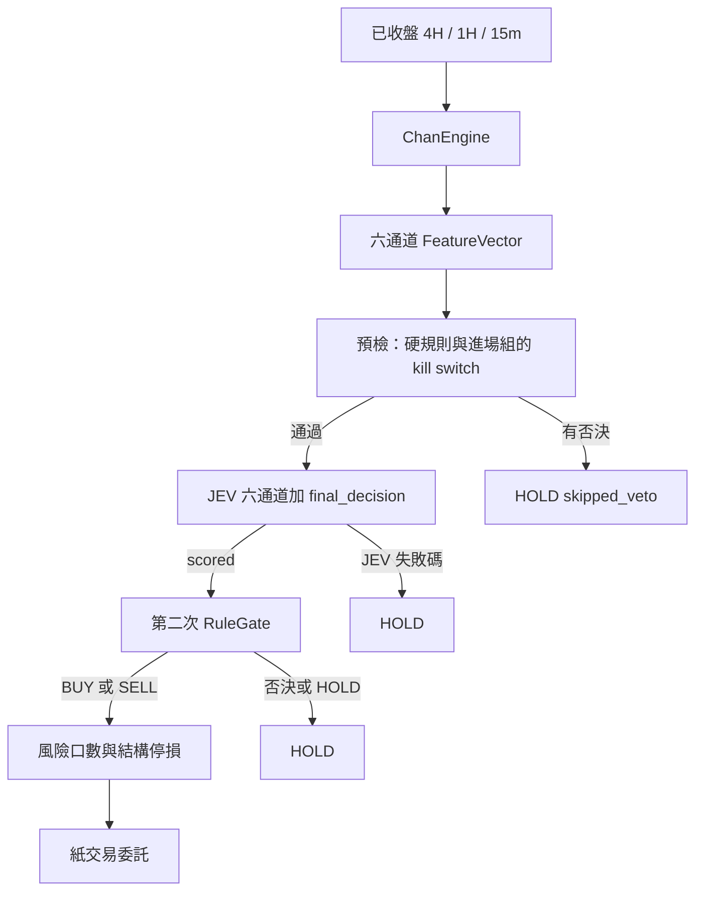

# ChanEdge 架構邏輯

日期 2026-10-29。狀態 Draft。

這份寫定案後的系統邏輯。纏論謂詞、夾具、前 20 名算法、口數與出場價位仍以 `docs/ARCHITECTURE.md` 的「架構設計」正文為準，這裡不重抄那些數字。JEV 的身分、進場呼叫順序與 `0.62` 門檻以這份為準。

下面幾段對過現有程式，用來把接縫寫死。`systemone.enabled` 預設是 false，所以沒有 overlay 時跑起來的仍是本地加權，不是 System One：

- `rules/gate.py` 的 `evaluate` 不會因為 `proposed_action` 是 `HOLD` 就放行。唯一讀提議動作的是否決是 `KILL_SWITCH`：多單要提議是 `BUY`、空單要提議是 `SELL` 才觸發。
- `NO_CANDIDATE` 與 `AMBIGUOUS_SIGNAL` 已經是 `VetoCode`。前者看 `candidate_side is NONE`，後者看這根 15m 是否同時有已確認的買賣。兩者都不看提議動作。
- `DecisionRecord` 已有 `jev_json`、`feature_json`、`hard_rule_json`、`reason_chain_json`。`journal/schema.py` 的 `SCHEMA_VERSION` 是 1。
- `decision_id` 是七個欄位的規範化 JSON，沒有分數，也沒有否決。
- `app` 把 `run_pipeline` 注入回測。`backtest` 不 import `app`。
- 撮合之後，`paper_loop._jobs` 只把仍在榜上、而且已經沒有倉的名字放進進場組。這根被打平、同時又掉出前 20 名的名字，不在出場組，也不在進場組。

`src/chanedge/jev/model.py` 仍是本地加權 `JevModel.assess`。`config/default.yaml` 的 `systemone.enabled` 是 false，`jev.version` 是 `weighted-v1`。這條預設不打 HTTP，也不讀快取，進場仍是先評分、再跑硬閘門。旗標為 true 時，進場才改走預檢、一次 System One、以及只有 `scored` 才有的第二次閘門。出場日誌在兩種路徑都是本地 `weighted-v1`。`config/paper.yaml` 沒有把旗標打開。

## 系統做什麼

ChanEdge 做 Binance USDⓈ-M 的 USDT 本位永續。交易池是每天凍結一次的成交額前 20 名。每個幣種獨立決策，共用一個帳戶。Phase 1 只做紙交易與事件回測，不送實盤單。

四件事分開：

| 角色 | 負責 | 不負責 |
| --- | --- | --- |
| 纏論引擎 | 4H 方向與中樞、1H 結構完整性、15m 二買／三買與對稱賣點 | 評分、否決、口數、下單 |
| 硬規則 `RuleGate` | 否決不可交易的狀態 | 改分數、決定口數 |
| JEV | 通過硬規則之後的品質分數與進場門檻 | 產生結構、推翻否決、決定出場、決定口數、送單 |
| 風險 | 口數、結構停損、分批、移動停損、帳戶上限 | 改 JEV 權重、改硬規則 |

JEV 是 TypeSafe System One。請求的模型釘在版本 id `jev-1.14.0`。別名 `jev-latest` 只出現在說明裡，不送出。回應的 `model` 若不是這個版本 id，狀態是 `JEV_MODEL_MISMATCH`，不寫快取，不進場。金鑰是環境變數 `TYPESAFE_API_KEY`。

`jev-1.14.0` 下架或要換版時，新的版本 id 就是新的快取命名空間。舊檔的列不會被新 pin 讀到。必須重新暖機，用下面的開啟條件再看一次兩側筆數，然後才把 overlay 的 pin 換過去。不默默跟著別名。

一買、一賣只留列舉，不是 Phase 1 的進場信號。

## 三個週期

- 4H 定方向與中樞。
- 1H 看結構是否仍完整。
- 15m 產生二買、三買、二賣、三賣。

信號在確認那根 K 線收盤時成立。成交不用同一根的高低點。持倉多久由結構是否仍有效決定，沒有固定時間停損。

## 一根 15m 的順序

先撮合，再決策。紙交易與回測用同一份 `match_bar`、同一份 `run_pipeline`。`run_pipeline` 與 System One 埠都由 `app` 注入。`backtest` 不 import `app`，也不 import `typesafe_sdk`。

1. 上一根留下的 `next_open` 在這根開盤成交。
2. 撮合器做盤中停損與 TP1。同一部位這根只有一筆出場。停損優先於 TP1。
3. 出場組，再進場組。每個幣至多一次 `run_pipeline`。出場組先是掉榜但仍有倉的名字（字母序），再來榜內持倉（名次）。進場組是沒有倉、在前 20 名裡、而且這根有 K 線的名字（名次）。
4. 這根被打平、而且仍在前 20 名裡的名字，留在進場組。動作是 `HOLD`，原因 `FLATTENED_THIS_BAR`，不呼叫 `plan_entry`，也不打 System One。
5. 這根被打平、但已經不在前 20 名裡的名字，不是出場組，也不是進場組。沒有決策工作。

這是刻意的反手間隔。反向信號或任何把倉打平的成交，都要再等：打平發生在某一根的開盤或盤中；那一根收盤的進場組只記 `FLATTENED_THIS_BAR`；下一根才可以做新的進場決策；那筆進場若成立，成交在再下一根的開盤。從打平那根算起，最早的反手成交是兩根之後的開盤。

紙交易在抓 K 線之前先等 `close_wait_seconds`（預設 3 秒）。回測不等。紙交易的 60 秒牆鐘從該根的幣種迴圈開始，出場組先跑。超過 60 秒的幣不進 `run_pipeline`，寫一筆只有 `PIPELINE_TIMEOUT` 的 `HOLD`。因此逾時先落在進場組裡名次低的幣。回測沒有這道牆鐘。這是紙交易和回測的已知分歧，不是策略分叉：對帳把 `PIPELINE_TIMEOUT` 另列。

另一個已知分歧：紙交易裡高名次幣的 HTTP 失敗會讓它 `HOLD`，帳戶額度空出來，低名次幣可能進場。回測裡同一個高名次幣命中快取就會佔用額度。這種差集記成系統呼叫差異，不算策略分歧。

## 進場預檢

預檢的載體可以是 `proposed_action = HOLD`，但閘門不會因此放行。現有 `RuleGate` 在單一候選上仍檢查過期、缺口、時段、4H／1H 方向、波動帶、榜內、視窗與已有持倉。無候選與歧義各自成否決。

進場組在打 System One 之前要成立的否決，分兩類。

和提議動作無關，預檢直接採用 `RuleGate` 的結果：

- `NO_CANDIDATE`
- `AMBIGUOUS_SIGNAL`
- `STALE_DATA`
- `GAP_DATA`
- `SESSION_SKIP`
- `HTF_DIRECTION`
- `MTF_1H_CONFLICT`
- `VOL_BAND`
- `OUTSIDE_UNIVERSE`
- `INSUFFICIENT_HISTORY`
- `POSITION_OPEN`

依賴提議動作，所以 `HOLD` 載體不會觸發，進場預檢要另判：

- `KILL_SWITCH`。進場組的成員都沒有倉，開著開關就不可能有進場通過。預檢看到 `safety.kill_switch` 為真就否決，不再等提議變成 `BUY` 或 `SELL`。緊急打開開關時，進場組不再打 System One。出場組的 `reduce_only` 不受這條影響。

有任一否決：不打 HTTP，不讀快取。狀態是 `skipped_veto`。`HardRuleResult` 就是這次預檢。直接 `HOLD`，不呼叫 `plan_entry`。

帳戶上限（持倉筆數、同方向筆數、合計名義）在風險模組，不在 `RuleGate`。它們依賴這根較高名次的進場結果，不能提前當成和路徑無關的否決。預檢通過後仍可能評分，然後在 `plan_entry` 被拒絕。暖機會事先把這種鍵打好，見下節。

預檢通過才評分。七題是六個通道再加 `final_decision`，放在同一個 `system_one` 請求。評分成功才跑第二次 `RuleGate`，用真實的 `BUY`／`SELL`／`HOLD` 提議。第二次閘門失敗，或提議是 `HOLD`，都不呼叫 `plan_entry`。分數、`GO`、`NO_GO` 不能把已失敗的預檢改成進場。

`config/default.yaml` 的 `kill_switch` 預設是 true。`config/paper.yaml` 才把它蓋成 false。沒有 overlay 的命令走本地評分器，不呼叫 System One。

## 暖機打哪些狀態

回測會碰到哪些進場，取決於先前哪些分數過了門檻、帳戶還剩多少額度。暖機事先不知道這條路徑，所以故意多打。

`chanedge jev-warm` 對每根 K 線、每個幣，只套用和路徑無關的預檢：`NO_CANDIDATE`、`AMBIGUOUS_SIGNAL`、過期、缺口、時段、方向、波動帶、榜內、視窗。它忽略持倉、`KILL_SWITCH`、以及風險模組的帳戶上限。通過的候選都評分並寫入快取。不送單，不寫 `decisions`。

因此第一次回測需要的進場鍵，暖機都已經打過。沒跑暖機就回測，第一次缺鍵就中止，不會用一份走樣的帳戶路徑把區間跑完。

紙交易的預檢比暖機嚴：含持倉與 kill switch。紙交易不為了填滿暖機那種超集而在開關打開時繼續打模型。

## 六個通道

題目說明維持英文。`question_set` 是 `entry-v1`。送給模型的 `state` 只來自 `FeatureVector` 的原始欄位，加上符號與 `15m`。序列化用 `domain/canon.py` 的 `canonical_json`：鍵排序、數字八位小數、負零收成 `0.00000000`。紙交易與回測用同一支函式。不用 `repr`，也不用預設的 `json.dumps`。

硬規則已經擋下的判斷，不再拿同樣的是非題問一次。三題改成「已經允許進模型的狀態有多乾淨」：

| 通道 | 問的是什麼 | 題型 |
| --- | --- | --- |
| 結構品質 | 筆與線段重疊、中樞是否清晰、突破是否乾淨 | `Score`，五級 |
| 位置 | 在中樞邊緣、前高前低與大週期結構裡的位置品質 | `Score`，四級 |
| 多週期共振 | 方向否決已經通過之後，大週期配合有多乾淨。不問「方向是否一致」 | `Score`，四級 |
| 波動與成交量 | 波動帶之內，ATR 與相對成交量有多適合。不問「是否在帶外」 | `Score`，四級，低到高單調 |
| 信號 K 線 | 收盤位置、實體占比、影線 | `Score`，三級 |
| 時段與市場狀態 | 這個時段的交易品質。不問「要不要跳過」。跳過仍是 `SESSION_SKIP` | `Score`，四級 |

第七題是 `final_decision`：`Choice`，選項 `GO`／`NO_GO`。它不進複合分。

`Score` 的級數從 0 開始，等於 `criteria` 的索引。`score` 是各級編號乘上機率的期望值，可以落在兩級之間，不是 argmax。文件定義是 `Σ level_number × probability`。通道子分是 `score / (級數 - 1)`，也就是除以最高級編號。六個通道同一條公式。不把波動通道做成兩端為 0 的折線。

複合分是六個固定權重乘上通道子分。權重在 `config/default.yaml` 的 `jev.weights`，總和必須是 1。計算用 `Decimal`。比較前先走 `format_fixed8`，得到八位小數，再與 `0.62000000` 做 `>=`。不用二進位浮點直接比，避免 `0.6199999` 掉到門檻下面。剛好等於量化後的 `0.62000000` 是 `BUY` 或 `SELL`。

- 候選是多，而且量化後的複合分 `>= 0.62000000` → `BUY`
- 候選是空，而且同樣 `>=` → `SELL`
- 其餘，包含沒有候選 → `HOLD`

`0.62` 與六個頂層權重不在同一段資料上重搜。這個門檻原是本地加權的尺度。TypeSafe 的複合分分布不同，所以它不是換評分器之後仍然有效的市場結論。開啟 overlay 之前用筆數把明顯退化擋下來，並不把它搜成另一個數。

`GO`／`NO_GO` 只寫進 `jev_json`。和門檻不一致時，門檻贏。`NO_GO` 配 `HOLD` 是一致。缺選項或選項不是這兩個，整筆是 `JEV_MALFORMED`。

`typesafe-v1` 的列不寫 `p_buy`、`p_sell`、`p_hold`。這三個值若仍用本地線性公式，會和這次複合分矛盾。本地 `weighted-v1` 的列仍寫它們，而且仍不得用於口數。

## 出場

出場不看 JEV 分數，也不看 `GO`／`NO_GO`。低分不能把該出的倉留下，高分也不能逼出仍有效的結構。

出場組的順序是：建特徵、用本地加權寫一筆日誌、`review_open`。有出場就送 `reduce_only`。有移停損就改停損。否則 `HOLD`。這條不打 HTTP，也不讀 System One 快取。

接入之後，進場列的 `jev_version` 是 `typesafe-v1`，出場列仍是 `weighted-v1`。停損、TP1、棘輪、反向信號、1H 方向與中樞失效的價位在架構稿「結構何時失效」與部位狀態那兩節。

## 失敗碼

這些碼寫在 `reason_chain`，階段是 `jev`。它們不是 `VetoCode`，不放進 `HardRuleResult`。

| 碼 | 何時 |
| --- | --- |
| `JEV_TIMEOUT` | 紙交易這一次呼叫超過 1.5 秒，或連線失敗。不重試 |
| `JEV_HTTP_ERROR` | HTTP 錯誤。日誌只記例外類名 |
| `JEV_MALFORMED` | 缺題、`score` 超出 `0` 到最高級、機率鍵不齊、`choice` 不是 `GO`／`NO_GO` |
| `JEV_MODEL_MISMATCH` | 回應的 `model` 不是 `jev-1.14.0`，含別名 `jev-latest` |
| `JEV_CACHE_MISS` | 回測的只讀埠沒有這個鍵 |
| `JEV_NO_KEY` | 需要打網路時金鑰是空的。正常啟動不該走到這裡 |

失敗不開新倉，也不把持倉打平。

`enabled` 為真、而且這個命令會打網路時，啟動就檢查 `TYPESAFE_API_KEY`。紙交易與 `jev-warm` 沒有金鑰則拒絕啟動，不進入迴圈。回測不讀金鑰，缺金鑰不是它的失敗。

紙交易逾時維持 1.5 秒、不重試。這個數字不進 `config_hash`。Phase 1 沒有 Telegram。每次回測與每次紙交易時段的報告都要計數：`skipped_veto`、`scored`，以及上表六個碼各有幾筆。1.5 秒若靠近服務的中位延遲，這些計數會先顯出來，而不是整天安靜地 `HOLD`。

`jev-warm` 對同一鍵最多試 3 次，間隔 1 秒、2 秒。三次仍失敗就列入缺鍵清單，最後以非 0 結束，並印出仍缺的鍵。不把失敗列寫進快取。

## 快取與重播

回測只拿得到只讀埠 `SystemOneReader`，上面只有 `lookup`。沒有送 HTTP 的方法，也不靠 `allow_network` 旗標。紙交易與暖機用另一個型別 `SystemOneClient`。`app` 決定注入哪一個。回測行程裡不建構客戶端。

快取檔是 `data/jev/systemone.jsonl`。不進 SQLite。

寫入規則：

- 同一個檔同時只允許一個寫入者。紙交易與 `jev-warm` 不得一起跑。寫入者拿排他鎖，寫完一整行再 `flush`。回測拿共享鎖來讀。沒有換行結尾的半行忽略。
- 同一個鍵的第一筆完整列生效。後面的列即使答案不同也忽略。不採最後一列。模型兩次回答不一樣時，重播仍讀到先寫入的那筆。
- 鍵是 `sha256(canonical_json([model_pin, question_set, questions, state]))`。浮點都走八位小數。紙交易的即時 K 線與回測的 Parquet 只要進了同一支 `canonical_json`，最後一位不會分成兩把鍵。
- 只有回應 `model` 等於 pin 的成功列才追加。

`decision_id` 序列相同，不能證明快取內容相同。分數不在 `decision_id` 裡，快取也不在 `config_hash` 裡。報告另外寫 `cache_digest`：這次實際 `lookup` 到的 `(key, answer_hash)`，按鍵排序後再做 `canonical_json` 的 sha256。兩次回測要同時有相同的 `decision_id` 序列和相同的 `cache_digest`，才算重播。只對上 `decision_id` 不夠。

回測第一次 `lookup` 未命中：立刻中止。不再處理後面的幣，也不再跑後面的 K 線。不把已經偏掉的帳戶路徑跑完。若報告目錄已經建立，寫上 `incomplete: true` 與 `JEV_CACHE_MISS` 計數，這份目錄不是 Phase 1 結果。行程退出碼是 `3`。未知指令仍是 `2`。成功是 `0`，而且 `incomplete` 不是 true。

`config/default.yaml` 保持 `systemone.enabled: false` 與本地 `weighted-v1`。沒有 overlay 的回測不讀這份快取，也不會因缺鍵退出。

開啟 `config/paper.yaml` 的 `systemone.enabled` 之前，暖機必須印出量化後複合分 `>= 0.62000000` 與 `<` 的筆數。兩側都至少 30 筆，而且每一側至少佔已評分候選的 10%。少於這個數就不改 overlay，也不改 `0.62`、權重或題組。這是開啟條件，不是把門檻搜到別的數。

紙交易缺鍵才打一次 HTTP。命中則不打。

## 決策列放哪裡

`GO`／`NO_GO`、`systemone_status`、`jev_version`、通道分數與失敗碼都放進已經存在的 `jev_json` 與 `reason_chain_json`。不加欄，不升 schema，沒有 migration 002。`typesafe-v1` 列的三個機率鍵省略。本地列仍是現在的 `JevAssessment`。

`decision_id` 的七個欄位維持不變。

## 誰擁有什麼

| 套件 | 擁有 |
| --- | --- |
| `domain` | 型別、id、`SystemOneReader` 與失敗狀態。不做 I/O |
| `marketdata` | K 線、Parquet、缺口、榜單、小數推估 |
| `chanlun` | `ChanEngine.compute` |
| `features` | 六通道純函數與候選 |
| `rules` | 硬否決 |
| `risk` | 口數、結構停損、分批、移動停損、帳戶上限 |
| `jev` | 把答案映射成複合分，並做量化後的 `0.62` 比較。不開 HTTP |
| `typesafe` | `SystemOneClient`、檔案鎖、JSONL。全倉庫只有這裡 import `typesafe_sdk` |
| `execution` | `Broker` 與 `PaperBroker`。不撮合 |
| `backtest` | 撮合、回測迴圈、報告。只接收注入的 `run_pipeline` 與 `SystemOneReader` |
| `journal` | 決策、訂單、成交、持倉、現金、`ChartFrame` |
| `app` | 組合、CLI、紙交易迴圈、預檢順序、`jev-warm`、把埠注入回測 |
| `monitor` | Phase 2 唯讀網頁（PR-13 已完成）。只讀幀畫圖，不呼叫 `ChanEngine`，沒有下單路由 |

`app` 組裝物件。業務公式不寫在 `app`。`execution` 不 import `journal`。`backtest` 不 import `marketdata`、`journal`、`app` 或 `typesafe`。

## 階段

Phase 1 是紙交易、事件回測、稽核日誌，以及把 `ChartFrame` 寫進 SQLite。不開繪圖埠，不接 Telegram，沒有 `execution/live.py`。`mode=live` 在讀取交易金鑰之前失敗。

Phase 2 是唯讀圖形監控。畫面不呼叫 `ChanEngine`，沒有下單路由。這一步已完成（PR-13）。

Phase 3 才是 Telegram 與實盤。告警只有連續資料過期與 kill switch 狀態變化。JEV 的逾時不進這組告警。它的可見性是報告裡的失敗計數。

## 每次決策留下什麼

非精簡列寫下六通道原始欄位、六個通道子分、量化後的複合分、`GO`／`NO_GO`，以及最終動作。回測在進場組、沒有候選、也沒有歧義時仍寫精簡列，不為精簡列打模型。紙交易的無候選列會建特徵，然後在預檢被 `NO_CANDIDATE` 擋下，不打 HTTP。

紙交易 SQLite 是 WAL。報告庫才設 `synchronous=OFF`。圖幀在帳簿提交之後寫。寫圖失敗不回滾委託。回測不寫圖幀。

## 現在樹上已經有的

PR-1 到 PR-12 已完成：設定與 `config_hash`、領域型別、行情與榜單、日誌、纏論引擎與四種信號、六通道、本地 JEV 加權、硬閘門、風險、撮合與回測、CLI、紙交易與重啟。

PR-13 已完成：唯讀圖形監控。`chanedge monitor` 另開行程，只綁 `127.0.0.1`，只讀 `chart_frames`，沒有寫入路由。

System One 路徑已在樹上：領域埠與失敗狀態、`jev/compose.py` 的映射、`typesafe` 的 JSONL 鎖與客戶端、進場預檢、`jev-warm`、回測快取未命中中止、報告計數。預設檔仍是 `systemone.enabled: false`。沒有 overlay 時，跑起來的進場分數仍是 `src/chanedge/jev/model.py` 的本地加權。

還沒有做的是營運步驟。`jev-warm` 印出兩側都達標之後，才打開 `paper.yaml` 的 `systemone.enabled`。這次沒有改那份 overlay，也沒有改 `0.62`。
